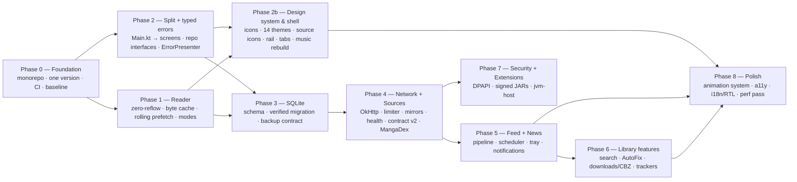

# ZERAVRIX — PC Native Blueprint v5 (build-ready: 1000+ sources, CBZ downloads, reader settings, speed, Antigravity plan)
## One document: ZERAVRIX 1.5.0 + Mihon + Kotatsu (+ its parsers library) + manga-api, all read directly

> [!IMPORTANT]
> **What this is.** The single plan to build from. v1 was an idea list, v2 was grounded in your 1.5.0 source, v3 added Mihon. **v4 adds Kotatsu, the Kotatsu parsers library and manga-api, and re-organises everything by *feature* (sources, network, feed/news, reader, library, UI) instead of by reference repo.** Every section ends in tickets (§14) you can start on.
>
> **How claims are tagged**
> - **[VERIFIED]** — I read the code (path/line given). Paths: ZERAVRIX = relative to the zip root (`store-edition-1.5.0/…` unless stated); Mihon = relative to `mihon-main`; Kotatsu = relative to `app/src/main/kotlin/org/koitharu/kotatsu/`; parsers = Kotatsu's pinned library commit `4d1e521aef` (`libs.versions.toml`), relative to `src/main/kotlin/org/koitharu/kotatsu/parsers/`.
> - **[CHECK]** — plausible, needs a 10-minute experiment before you build on it.
> - **[TARGET]** — a goal or a design of mine, not a measurement and not copied from anything.
> - **[DOCS]** — from the official MangaDex API docs fetched on 2026-10-30.
>
> **Limits, stated up front.** Static review only: nothing was compiled or run (no Windows/JDK toolchain here), so all performance numbers are targets until Phase 0 measures a baseline. I read the *structure* of Kotatsu's 1,261 parser files and the full source of the contracts/base classes, not every site parser. Part of Mihon's WebGPU shader pipeline and the tracker OAuth flows were not read (App. C). "Perfect" is not something static reading can prove — this is the most complete *buildable* plan the sources support, with tests (§13) that will tell you when it is wrong.

> [!NOTE]
> **v5 — PC native only.** The Android project is out of scope. This is the single document to hand to your coding agent (Antigravity): it contains every earlier section (nothing removed) plus five new parts and corrected decisions.
> - **§18 The 1000+ sources plan** — real numbers from the Kotatsu parsers snapshot (1,256 listed; ≈ 30 % flagged broken; ≈ 880 working incl. adult, ≈ 650 non-adult), three engines behind one contract, the **GPL-3.0 consequence** and how to keep the Store edition clean.
> - **§19 Downloads v2** — what Kotatsu, Mihon and your downloader really do (your files are **not** converted to WebP; the slowness is sequential pages, thousands of small files, whole-image string decoding, folder rescans, no queue), and the target: **per-chapter CBZ, stored (no compression), parallel pages, resumable, self-draining queue**.
> - **§20 Reading settings catalogue** — ~100 settings drawn from Kotatsu's 27 and Mihon's ~45 reader prefs plus PC-only controls, with defaults, scopes and per-title overrides.
> - **§21 Speed contract** — why Kotatsu/Mihon feel fast and twelve rules + budgets to match them.
> - **§22 Antigravity plan** — how to run the work, prompts, definition of done; the starter kit (rules, skills, task cards) is delivered with this file.
> - Decisions **D7/D8 rewritten, D15–D20 added**, release train, tests, budgets and tickets **Z-200…Z-252** updated.
>
> **Honest limits of v5.** Nothing was compiled or run. Source counts come from a script over annotations (±3 %). The kotatsu-parsers adapter, the JS runtime choice, the pack-vs-stream benchmark and every Windows behaviour are **[CHECK]** spikes. Antigravity file conventions come from secondary sources. Licence statements are my reading, not legal advice.
>
> **What changed in v4.2 (second review pass).** You asked me to re-read the blueprint and make sure sources, the extension system, overall performance, settings, buttons and choices are professional like Kotatsu and Mihon. Added: **§7D** settings redesign (two-pane, searchable, one registry, control vocabulary, button rules; 11 findings in today's Settings screen incl. a real colour bug) · **§10.9** Sources screen, per-source settings, "Test source", global search · **§10.10** Extensions screen and store dialogs · **§10.11** extension runtime hardening (host-brokered I/O, watchdog, rollback, conformance kit) · **§9.1** performance engineering (no JVM options set today, recomposition, thumbnail decoding, JVM flag experiments) · **§17** review table · tickets **Z-160…Z-185**, decisions D13-D14, updated release train. Nothing was removed.
>
> **What changed in v4.1 (design pass).** You asked for source icons, a modern Kotatsu-grade UI, a better music player, a more professional tab bar, more themes, and a review of anything else that could be better. Added:
> - **§7.9** what the visible shell does today (text-glyph icons, 2 themes, fixed rail, custom title bar, basic music) — read from your code.
> - **§7A** design system: vector icons, **source icons (favicons)**, a **theme engine with 14 original themes** (+ system accent, from-cover, custom editor, AMOLED, contrast levels), design tokens, cards/lists.
> - **§7B** window chrome, a real **tab strip**, a rebuilt **navigation rail**, search/command palette, onboarding, app lock, incognito.
> - **§7C** **music player rebuild** (engine state machine, PCM pipeline, more formats, tags/cover art, mini-player, Now Playing + queue, media keys) and **§7C.6 Spotify** (connect your account, play your playlists online, offline via matched local files — Spotify's own offline downloads are not usable by other apps).
> - **§16** review: 18 gaps found in v4 (startup, DPI/renderer fallback, crash log, licences, Windows integration, offline, hardware matrix…) and **§14.1** a release train so something ships every cycle.
> - Tickets **Z-100…Z-146** (new **Phase 2b**), decisions **D9–D12**, new budgets/tests, and updated appendices. Nothing from v4 was removed.
>
> **Honest limits of this pass.** The UI was read, not run; theme seed colours are untuned suggestions; library choices (colour generator, tag reader, decoders/miniaudio), Snap Layouts, Skiko ICO/SVG decoding and Windows accent/SMTC/MSIX details are **[CHECK]** spikes (Appendix C).

---

## 0. Start here

### 0.1 Where to find what you asked for

| You asked for | Section |
|---|---|
| **Feed** (new chapters, update log, scheduling) | **§11.1–11.4, 11.7** |
| **News** | **§11.5** (neither Mihon nor Kotatsu has one — designed from scratch) |
| **Sources** (contract, catalogue, health, mirrors) | **§10.1–10.4, 10.8, §6.2** |
| **Source extensions** (trust, install, isolation) | **§10.5** (+ §5 security) |
| **APIs** (Komga/Kavita/MangaDex/trackers, manga-api verdict) | **§10.6–10.7**, §12.4 |
| **Performance** | §2 reader, §3 DB, §6 network, §9 budgets |
| **UI & animation** | **§7**, plus the design pass **§7A–7C** |
| **Source icons** | **§7A.3** |
| **Modern UI / themes (more, like Kotatsu)** | **§7A.4–7A.6** |
| **Tab bar / navigation** | **§7B** |
| **Music player** | **§7C** |
| **"Anything that can be better?"** review | **§16**, **§17**, release plan **§14.1** |
| **Settings, buttons, choices (Kotatsu/Mihon-grade)** | **§7D** |
| **1000+ sources** | **§18** |
| **Downloads as CBZ, fast, endless queue** | **§19** |
| **Reading settings (many, like Kotatsu)** | **§20** |
| **"Fast like Kotatsu"** | **§21, §9.1** |
| **How to build it with Antigravity** | **§22** + the starter kit |
| **Sources screen / per-source settings / search UI** | **§10.9** |
| **Extension system: UI + security hardening** | **§10.5, §10.10, §10.11** |
| **Overall performance (how, not just targets)** | **§9, §9.1** |
| Reader behaviour & controls | §2, §7.5 |
| What to build first | **§0.5, §14** |

### 0.2 What each reference is worth to you

| Reference | What it is | Licence **[VERIFIED: `LICENSE` file]** | Use it for | Do **not** |
|---|---|---|---|---|
| **Mihon** (`mihon-main`) | Android reader + extension ecosystem | **Apache-2.0** | Contracts, algorithms, constants — adaptable with a `NOTICE` entry if you port code | Port Android/WorkManager/WebView code; copy the hidden-WebView Cloudflare solver |
| **Kotatsu** (`Kotatsu-devel`) | Android reader, built-in parsers, feed, suggestions, sync | **GPL-3.0** | **Ideas and observed behaviour only** (clean-room) | Copy any code. GPL-3.0 in a Store-distributed closed app is a licensing problem — I'm not a lawyer; get one if in doubt |
| **Kotatsu parsers** (library, pinned commit) | 1,261 site-parser files | **GPL-3.0** | The *template-family* idea (§10.4), contract design | Use it **as a library only in the GPL Website/GitHub build** (§18); never in the Store build. ≈ 292 classes are adult, 374 marked `@Broken` |
| **manga-api** (`manga-api-master`) | 786-line Express scraper for one Indonesian site | **MIT** (`LICENSE`; `package.json` says ISC — inconsistent) | Nothing structural — see the verdict in §10.7 | Depend on it, host it, or call its public instance |

**Clean-room rule for GPL material:** read Kotatsu to learn *what* to build; then build from your own reading of the target site's HTML / API docs, with your own code and your own tests. Don't paste, translate line-by-line, or ask anyone to "port" a Kotatsu file. If you ever plan to release ZERAVRIX itself under GPL-3.0 this rule relaxes — tell me and I'll re-plan. **v5 update:** the Website/GitHub build now links the parsers *library* under GPL-3.0 (§18.3); this clean-room rule still governs the core app and the Store edition.

### 0.3 Principles (every ticket must respect these)
1. **The reader never waits for anything else** (network, DB, feed). Frame budget is sacred.
2. **Layout never moves.** Unknown/evicted pages keep their size (zero-reflow).
3. **Memory is bounded in bytes, not items.**
4. **Polite by construction:** per-source sequential, rate-limited, back-off honours `Retry-After`.
5. **Every failure is typed and has exactly one user action** (§6.5).
6. **Source and mirror health is visible, never silent.**
7. **Store paths, not URLs** (domain-less data) so mirrors/domain moves don't break libraries.
8. **User data is sacred:** atomic writes, verified migration, staged restore, tombstones for sync.
9. **No CAPTCHA automation, no dynamic code in the Store build, no adult sources in the Store build, no TLS-verification bypass anywhere.**
10. **Remote updates are data, never code** (mirror lists, news, source messages): schema-validated, size-capped, HTTPS.
11. **Every promise has a test** (fixtures for sources, golden files for migration, benchmarks for speed).
12. **Clean-room for GPL.**

### 0.4 Decisions I've made so you can start (veto any — they're listed again in §15)
| # | Decision | Why |
|---|---|---|
| D1 | New monorepo seeded from the **Website tree** (127 files, buildable), with the Store tree's newer reader files overlaid | The Store tree can't build alone (§1) |
| D2 | C++/WinUI shell → `experimental/`, out of CI | Project's own audit rejects it |
| D3 | Keep user data under `%USERPROFILE%\.zeravrix` for now; add "Open data folder" + privacy-policy line | Moving data is irreversible; decide *before* Phase 3 [CHECK MSIX redirection] |
| D4 | Cloudflare: Store = manual (open browser, paste cookie — already built); Website = **user-initiated** "Verify source" via a small WebView2 helper process; **no silent solving anywhere** | Matches your own stated policy |
| D5 | **CBZ/ZIP: local import + optional export, on** (update `ARCHITECTURE.md`) | Needed for a local library and offline sharing; Kotatsu and Mihon both do it |
| D6 | **News = bundled announcements + optional remote JSON**, no third-party news scraping | §11.5 |
| D7 | **Superseded by D15.** (Was: Kotatsu = clean-room.) Mihon (Apache-2.0) adaptable with notices; Kotatsu *app* code still not copied into the core | §0.2, §18.3 |
| D8 | **Tiered catalogue:** Store edition = few vetted sources (your 9 + MangaDex + template-family growth); **Website/GitHub = 1000+ listed via `engine-kotatsu`**, with live "N working today" and health gating | ~30 % of listed sources are broken at any moment (§18.1) — so show it honestly |
| D9 | **One theme engine** (`ThemeSpec`: seed + mode + AMOLED + contrast) with 14 **original-named** themes; no Kotatsu names/palettes copied | §7A.4 — palettes are generated, so adding a theme is one line |
| D10 | **Tab strip is built behind a setting**; its default is decided after the Z-118 memory tests | Tabs hold readers — memory rules first (§7B.2) |
| D11 | **Rebuild the music engine** (state machine + PCM pipeline), **link files instead of copying**, formats chosen by spikes Z-132a/Z-133a | §7C — also fixes a probable Stop/Next race (U8) |
| D12 | **Native title bar first (option A)**; custom caption (B) only after Snap Layouts is verified | §7B.1 — avoids breaking Windows 11 window behaviour |
| D13 | **One typed setting registry** drives UI, search, reset, backup and tests; settings apply instantly, with a restart banner only when truly needed | §7D.4 |
| D14 | **Extensions are confined by process + brokered I/O + watchdog, not by an in-JVM sandbox**; unsigned code only in Developer mode | §10.11 |
| D15 | **Licence architecture:** `:engine-kotatsu` (GPL-3.0) is a separate module used **only** by the Website/GitHub app; the Store app has **no GPL module** (CI task `verifyNoGplInStore`). Core licence is your choice (open item 21) | §18.3 |
| D16 | **Three engines, one `ZSource` contract:** E1 kotatsu-parsers adapter → E2 native templates + APIs → E3 Mihon bridge only if needed | §18.2 |
| D17 | **Downloads: per-chapter CBZ, stored (no compression), original bytes never re-encoded by default**, parallel pages streamed to disk, persisted self-draining queue, in-memory index | §19 |
| D18 | **One HTTP stack = OkHttp** (already D-chosen in §6.1); the kotatsu adapter reuses it through `MangaLoaderContext` | §6.1, §18.4 |
| D19 | **Reader settings are registry rows** with app → source → title overrides and saveable reading profiles; ship the core 25 in 1.6, the rest in 1.9 | §20 |
| D20 | **Agent kit:** `AGENTS.md` under 12,000 characters + short rule files + skills; the blueprint lives in `docs/`; one ticket per agent task | §22 |

### 0.5 First 10 working days
| Day | Do | Ticket |
|---|---|---|
| 1 | Create monorepo; import Website tree; overlay Store reader; make `./gradlew build` pass | Z-001 |
| 2 | `version.properties`; fix `ZERAVIX`→`zeravrix` dir; CI on `windows-latest` | Z-002..004 |
| 3 | Benchmark harness + record baseline on a written-down reference PC | Z-005 |
| 4–5 | Reader: `PageDimensions` + zero-reflow, then `ByteBoundedLru` | Z-010, Z-011 |
| 6 | Reader: single rolling prefetch with cancellation | Z-012 |
| 7 | **Feed stop-gap:** make "refresh" actually do something (§1 row F1) — parallel-by-source, rate-limited, cached | Z-050a |
| 8–9 | Split `Main.kt` mechanically (no behaviour change) | Z-020 |
| 10 | Typed exceptions + `ErrorPresenter` skeleton; UncaughtExceptionHandler | Z-041, Z-023 |

---
## 1. Ground truth: what is actually in the zip

```text
zeravrix-1.5.0-source-code/
├── store-edition-1.5.0/              31 files — "current 1.5.0 Store tree"
├── website-edition-source-recovered/ 127 files — older snapshot, explicitly NOT an exact 1.5.0 checkout
└── release-docs/                     manifests, MSIX scripts
```

| Fact | Evidence |
|---|---|
| Stack is **Kotlin 2.1.21 / Compose Desktop 1.8.2 / JVM 21**, Gradle 9 | `website…/build.gradle.kts`, `desktop-app/build.gradle.kts` |
| `Main.kt` is **2,219 lines (Store) / 2,587 lines (Website)** | `wc -l` |
| 4 production modules: `core`, `source-api`, `reader`, `desktop-app` (+ `jvm-host` in Website) | `website…/settings.gradle.kts` |
| **The Store tree is not self-contained.** `Main.kt` uses `LibraryStore`, `DesktopDownloader`, `BackupManager`, `KomgaSource`, `KavitaSource` — none are defined anywhere in `store-edition-1.5.0/`. It also has no `settings.gradle.kts`, and `reader/` and `source-api/` have no `build.gradle.kts`. | grep of class definitions; `ls` |
| **Version drift:** Store `packageVersion=1.5.0`, Website `desktop-app` = `1.4.0`, installers = `0.9.0`, `1.4.0`, `1.4.0-dev`, `1.5.0` | `grep packageVersion/MyAppVersion` |
| Directory typo `…/ZERAVIX/reader/ReaderPageLoader.kt` (missing R) and package `com.zeravrix.zeravrix` vs directory `ZERAVRIX` | file listing |
| Dead dynamic-loader in the Store tree: `ExtensionLoader.kt` is still present although the Store notes say it was removed (Main.kt doesn't reference it) | `source-api/…/ExtensionLoader.kt` |
| Tests: **3 files** (`DesktopDownloaderTest`, `ServerSourceTest`, jvm-host tests) — none for reader, library store, backup | file listing |
| A **C++ / WinUI native shell** (`native/`, `ipc/`) exists but the project's own audit says the native owner-drawn UI "should not remain the production UI"; it was never built into a real EXE | `KOTLIN-UI-SOURCE-AUDIT.md`, `MIGRATION-STATUS.md` |
| Already good (v1 didn't credit it): `ReaderPageLoader` (3-permit semaphore + in-flight de-dupe), atomic `.part` → rename page writes with 3 retries, HTML/"verification page" rejection, SHA-256-hashed filenames (no path traversal), path-checked backup restore, lazy `LazyColumn` with stable keys | `ReaderPageLoader.kt`, `ReaderWindow.kt` L25-72, `BackupManager.kt` |


**New ground-truth findings from this pass (feed, sources, API surface)**

| # | Fact | Evidence |
|---|---|---|
| **F1** | **The scheduled "Refresh sources" does nothing but save a timestamp.** `refreshSources` and the interval loop only `copy(lastRefreshEpochMillis = …)` and `save()`; no source is contacted. The Settings screen then prints "Last refresh: <time>" — a refresh that didn't happen. | `Main.kt` L345-365 (loop), L393 (menu item), L492 (button), L2036 (label) — **[VERIFIED]** |
| **F2** | **"New chapters" fetches everything, one title at a time, and hides failures.** On every open/Refresh it loops the *whole library*, calling `source.details()` then `source.chapters()` per title **sequentially** (a plain `mapNotNull`), wraps both in `runCatching { … }.getOrDefault(…)` (errors vanish), and defines "new" as *"not downloaded"* — not "appeared since you last looked". It keeps only the single newest chapter per title (`listOf(newest)`), so the "N new chapter(s)" label is always 1. 200 titles ⇒ ~400 serial requests behind a spinner, no rate limit, no cache TTL. | `Main.kt` L1566-1625 — **[VERIFIED]** |
| **F3** | There is **no feed, no update log, no news, no new-chapter counter, no scheduled check, no notification** in 1.5.0. "Latest" on a source is just a catalogue listing. | grep of `feed\|news\|latest` across all `.kt` — only `Source.latest()` and the F2 screen |
| **F4** | The `Source` contract has no combined details+chapters call, no filter model beyond a query string, no update strategy, no content rating, no link resolver and no typed error contract. Source IDs are hand-typed hex constants (`0x535041524B4DL`, …). | `source-api/…/Source.kt`; `BuiltInWebSources.kt` L126-174 — **[VERIFIED]** |
| **F5** | Backup scheduling already exists (interval days → zip into `appDir/backups`) — keep it, but fix scope/atomicity (§3.4). | `Main.kt` L366-374 |

---

## 2. Reader pipeline (highest user-visible impact)

### 2.1 What the code really does today

```text
download  →  PageCache.get()  →  byte[] in heap  →  SkiaImage.makeFromEncoded(bytes).close()   (validate)   ReaderWindow.kt L50-58, L106-109
                                  Files.write(.part) → rename
display   →  Files.readAllBytes(path)  →  makeFromEncoded(...).toComposeImageBitmap()           ReaderView.kt L205
          →  ImageBitmapLru(maxEntries = 16)  →  decodedBitmaps = bitmapCache.snapshot()         ReaderView.kt L180, L208
```

**[VERIFIED] Double work, not double *pixel* decode.** Skia's `makeFromEncoded` builds a lazy, codec-backed image, so the validate call is mostly header/codec setup; the expensive pixel decode happens once in `toComposeImageBitmap()`. The real waste is: (a) the whole response held as `byte[]` (`BodyHandlers.ofByteArray()`), (b) the whole file read back into a second `byte[]`, (c) a throw-away codec created at download time. Worth fixing, but **[CHECK]** with a profiler before promising a speed-up.

**[VERIFIED] Memory is bounded by *count*, not size.** A 1200×16000 webtoon page is 1200·16000·4 B ≈ **77 MB** as a raster. `16 × 77 MB ≈ 1.2 GB` of native memory (Skia pixels are off-heap, so `-Xmx` does not protect you). A normal 800×1280 page is ≈ 4 MB, so 16 entries looks harmless in testing and blows up on exactly the content (long strips) the reader is meant for.

**[VERIFIED] Reflow bug (v1 was right about the symptom).** In vertical mode `ReaderPageImage` renders a `CircularProgressIndicator` box whenever the bitmap is absent (`ReaderView.kt` L785-799) and only switches to `aspectRatio(w/h)` once decoded (L805). Because `decodedBitmaps` is replaced by the LRU snapshot, an evicted page goes back to spinner height → everything below it moves → the scroll position jumps. Same jump happens the first time each page decodes.

**[VERIFIED] Prefetch pile-up.** `prefetchWindow()` launches a *new* `pageLoadScope.launch` on every visible-index change (L232-248, L260) and never cancels the previous one or pages that left the window. Fast scrolling queues work for pages the user has already passed.

**[CHECK] Texture limits.** v1 says oversized images "trigger catastrophic frame drops / crashes". Skia's GPU backend normally tiles oversize raster images automatically, so I'd expect *slow*, not *crash*. Slicing is still the right design (cacheable GPU textures, finer eviction) — but test a 25,000 px page first so you know which problem you're solving.

### 2.2 Target design

1. **Dimensions first, pixels later (fixes the reflow).**
   - Read width/height from the image header (Skia `Codec` on the first KB, or a sidecar written at download time). Store them in a `PageDimensions` map keyed by page index and persist in the DB (`page_dim` table, §3).
   - Unknown pages use the **median aspect ratio of the pages already known** (fallback 1 : 1.4) — never a spinner-sized box. The spinner is drawn *inside* a box that already has its final height.
2. **Byte-bounded decoded cache.** Replace `ImageBitmapLru(maxEntries)` with `ByteBoundedLru` that evicts by `width·height·4`. Default **256 MB**, configurable (Settings → "Reader memory"), clamp to a fraction of physical RAM. Evicted pages keep their dimensions, so nothing moves.
3. **Decode near display size.** `PC_PERFORMANCE.md` already says "decode images near the displayed size" but nothing implements it. For pages wider than `viewportWidth × maxZoom`, decode at reduced size (Skia scaled decode) — large saving for 2000 px-wide sources. **[CHECK]** which scaled-decode API your Skiko version exposes.
4. **Strip tiles for very tall pages (v1 §3.1, kept).** Slice pages taller than ~4000 px into strips and cache strips individually, so a 16,000 px page can be partially resident. Use `Image.makeSubset` / raster subset — **[CHECK]** the exact overload in your Skiko version; v1's snippet called `makeSubset(IRect)` without verifying it.
5. **Prefetch by bytes, not by page count.** Replace "±6 pages" with "keep ~N MB decoded ahead of the viewport in scroll direction". Page-count windows are the same bug as count-bounded LRU.
6. **One prefetch job.** Hold a single `Job`; on each new center, cancel the previous job and `ReaderPageLoader.cancel(keysOutsideWindow)`. Debounce visible-index changes (~100 ms).
7. **Single-pass I/O.**
   - Download with `BodyHandlers.ofFile(tmp)` (or `ofInputStream`) instead of `ofByteArray`; check the first 16 bytes of the file with the existing `hasImageSignature` and the first 256 bytes for HTML. **Drop `isDecodableImage`** — decode errors are already surfaced by `decodeErrors` in the reader.
   - Decode from a memory-mapped file / stream rather than `Files.readAllBytes`.
   - Extend the signature check to every format your Skiko build can decode (AVIF is now common on scan sites) — **[CHECK]**.
8. **Auto letterbox crop (v1 §3.4, kept, low priority).** Optional, per-title, computed from a downscaled copy; cache the crop rect in `page_dim`.

**Acceptance criteria:** scrolling a 40-page, 800×~6000 px chapter back and forth shows **zero scroll-offset jumps** (assert in a UI test by sampling `firstVisibleItemScrollOffset`), peak native memory stays under the configured budget, and cancelling a chapter stops all in-flight downloads within 1 s.


### 2.3 Merged additions from Mihon and Kotatsu (adopt on top of §2.2)

**Prefetch & loading**
| Rule | Source | Note |
|---|---|---|
| Rolling chunks: load first **3** then **5**; on a jump **cancel every in-flight load outside the first two chunks**; atomic "launch load once" per page; progressive stream (page shows while still arriving); page *lists* cached separately from images | Mihon `HttpPageLoader.kt` **[VERIFIED]** | Replaces the ±6 uncancelled window (`ReaderView.kt` L232-262) |
| Loader concurrency **3**; prefetch queue default **6**, newest-first, oldest dropped when over limit; **skip prefetch when free RAM ≤ 80 MB** | Kotatsu `reader/domain/PageLoader.kt` L99-107, L312, L338-339 **[VERIFIED]** | Your loader already has 3 permits + de-dupe (good). Add the RAM gate and the cancel-on-jump |
| `LIMITED_PAGES_AHEAD = 4` in data-saver/metered mode | Mihon | Settings: "Reduce data use" |
| Page image cache on disk (`.part`→rename already done) + **in-memory preview/thumbnail reuse** so the page strip shows instantly | Kotatsu `PageLoader` (Coil memory + disk snapshot) | |

**Tall-strip numbers (Mihon `WebtoonStripImageView.kt`, `PageImageProcessing.kt`) [VERIFIED]:** `STRIP_BYTES` 4 MiB (tile above this) · `MAX_PAGE_BYTES` 128 MiB hard ceiling · `MAX_STRIP_WIDTH` 4096 px (downscale wider) · `LARGE_PAGE_BYTES` 64 MiB (**release the bitmap on detach but keep its measured size**) · strip decode `Semaphore(1)`. The "keep the size" rule *is* zero-reflow — back it with `page_dim`.

**Reader mode detection (Kotatsu `DetectReaderModeUseCase.kt`) [VERIFIED]:** if the user hasn't chosen a mode for this title, sample the page at **30 %** of the chapter, read only its header size, and pick **Webtoon if `height > 1.8 × width`**; remember the choice per title. Cheap, and removes the most common "why is this unreadable" moment.

**Auto-crop of white margins (Kotatsu `EdgeDetector.kt`) [VERIFIED structure]:** decode a **downscaled RGB_565 copy**, scan the four edges **in parallel** in blocks, bail out (no crop) if any edge result is negative/inconsistent, cache the resulting rectangle per image in a small LRU. Port the *idea* (clean-room): compute on a thumbnail, store the rect in `page_dim.crop_*`, apply as a clip — never re-decode the full image for it. Optional, per-title.

**Reading modes to offer:** paged LTR, paged **RTL (reversed)**, vertical-paged, **webtoon (continuous)**, **double page** and double-RTL (Kotatsu has all six: `reader/ui/pager/{standard,reversed,vertical,webtoon,doublepage,doublereversed}`), with Mihon's spread pairing (`wide ratio 1.2`, tolerance `0.1`) so covers/spreads don't pair wrongly, and optional rotate/split of wide pages.

**Input (desktop-first):** Kotatsu's **3×3 tap grid** (9 areas × 6 actions: next/prev page, next/prev chapter, toggle UI, show menu; user-remappable) becomes a **click-zone grid + full keyboard map** (←/→, Space/Shift-Space, PgUp/PgDn, Home/End, `[`/`]` chapters, F fullscreen, M menu, Ctrl+wheel zoom, middle-drag pan, touchpad/touch gestures). **Auto-scroll timer** (Kotatsu `ScrollTimer`) with speed control — popular with webtoon readers.

**Display options:** colour filter (brightness/contrast/invert + a warm "night" filter), per-title overrides, Mihon's `TransitionAnimation` set (none/basic/flip/stack) for paged modes, background colour (black/white/grey/auto), page-number & clock info bar.

**Reading stats (Kotatsu `stats/*`) [VERIFIED]:** table `stats(manga_id, started_at, duration, pages)` written by a collector that, per reading session, adds `+1 page` on each page/chapter change and updates the duration; opt-in. Gives "time read", "pages read", per-title charts and feeds Mihon's `history.read_duration`.

**Image-pipeline hook sources need (Kotatsu `MangaLoaderContext.redrawImageResponse`):** some sites serve **scrambled tiles**; give `Source` an optional `ImageInterceptor` that can descramble a bitmap *before* it is cached (so the cache holds the final image). Store builds: built-in sources only.

**Formats:** keep the signature check broad (JPEG/PNG/WebP/GIF/AVIF/JXL/HEIF/BMP); **[CHECK]** which your pinned Skiko decodes before claiming AVIF/JXL.

**Acceptance (extends §2.2):** a 200-page jump cancels all out-of-window loads within one frame; one strip decode at a time; 0 layout shifts after first measure; auto-detect picks webtoon for an 800×6000 sample and paged for 800×1200; memory ≤ budget at all times; downloaded chapters read with the network disabled.

---

## 3. Storage: from 1 file per record to SQLite

### 3.1 Why (all **[VERIFIED]** in `core/…/LibraryStore.kt`, Website tree)

| Hot path | Current behaviour |
|---|---|
| `list()` | opens and parses **every** `library/*.properties` file on each call |
| `latestProgress(id)` / `latestProgressSnapshot()` | lists and parses **every** file in `progress/` (one file per *manga × chapter*), then filters in memory |
| `hasUnreadChapter()` in `Main.kt` L207 | calls `cachedChapters()` — parses `chapter.N.*` keys for the whole chapter list — per library card |
| Writes | `Files.newOutputStream(file)` truncates then writes: a crash/power loss mid-write leaves a **corrupt record** (the page cache, by contrast, correctly uses `.part` + atomic move) |
| Backup | `BackupManager` copies loose files; restore overwrites live files one by one (non-atomic) |

### 3.2 Corrections to v1's schema

v1's `reading_progress` was one row per manga. **1.x stores progress per (manga, chapter)**, so a migration with v1's schema would silently drop per-chapter resume points. v1 also stored absolute `cover_url`, which breaks mirror switching (§6.2), and had no schema version, no WAL, and no indexes.

```sql
PRAGMA journal_mode = WAL;
PRAGMA foreign_keys = ON;
-- schema version tracked with PRAGMA user_version (or SQLDelight .sqm migrations)

CREATE TABLE manga (
  id            INTEGER PRIMARY KEY,
  source_id     INTEGER NOT NULL,
  legacy_id     TEXT    NOT NULL,          -- Manga.id as used by 1.x; needed for migration & backup import
  path          TEXT    NOT NULL,          -- SOURCE-RELATIVE url, never absolute
  title         TEXT    NOT NULL,
  cover_path    TEXT,
  author TEXT, artist TEXT, description TEXT NOT NULL DEFAULT '',
  genres        TEXT    NOT NULL DEFAULT '',
  status        INTEGER NOT NULL DEFAULT 0, -- enum: UNKNOWN/ONGOING/COMPLETED/…  (drives update strategy)
  in_library    INTEGER NOT NULL DEFAULT 0,
  added_at      INTEGER,
  UNIQUE (source_id, path)
);

CREATE TABLE chapter (
  id          INTEGER PRIMARY KEY,
  manga_id    INTEGER NOT NULL REFERENCES manga(id) ON DELETE CASCADE,
  legacy_id   TEXT    NOT NULL,
  path        TEXT    NOT NULL,
  title       TEXT    NOT NULL,
  number      REAL, volume INTEGER, scanlator TEXT, uploaded_at INTEGER,
  is_read     INTEGER NOT NULL DEFAULT 0,
  last_page   INTEGER NOT NULL DEFAULT 0,   -- per-chapter resume point (what 1.x already stores)
  progress_at INTEGER,
  UNIQUE (manga_id, path)
);
CREATE INDEX chapter_by_manga ON chapter (manga_id, is_read);

CREATE TABLE history  (chapter_id INTEGER PRIMARY KEY REFERENCES chapter(id) ON DELETE CASCADE, read_at INTEGER NOT NULL);
CREATE INDEX history_by_time ON history (read_at DESC);

CREATE TABLE download (chapter_id INTEGER PRIMARY KEY REFERENCES chapter(id) ON DELETE CASCADE,
                       state INTEGER NOT NULL, page_count INTEGER, bytes INTEGER, completed_at INTEGER);

CREATE TABLE page_dim (chapter_id INTEGER NOT NULL REFERENCES chapter(id) ON DELETE CASCADE,
                       page_index INTEGER NOT NULL, width INTEGER NOT NULL, height INTEGER NOT NULL,
                       PRIMARY KEY (chapter_id, page_index));         -- zero-reflow (§2.2)

CREATE TABLE category (id INTEGER PRIMARY KEY, name TEXT NOT NULL UNIQUE, sort INTEGER NOT NULL DEFAULT 0);
CREATE TABLE manga_category (manga_id INTEGER REFERENCES manga(id) ON DELETE CASCADE,
                             category_id INTEGER REFERENCES category(id) ON DELETE CASCADE,
                             PRIMARY KEY (manga_id, category_id));

CREATE TABLE source_domain (source_id INTEGER NOT NULL, domain TEXT NOT NULL,
                            state INTEGER NOT NULL DEFAULT 0, last_ok INTEGER, last_probe INTEGER,
                            PRIMARY KEY (source_id, domain));            -- mirror switcher (§6.2)

CREATE TABLE tracker_link (manga_id INTEGER REFERENCES manga(id) ON DELETE CASCADE,
                           tracker INTEGER NOT NULL, remote_id TEXT NOT NULL, last_synced_chapter REAL,
                           PRIMARY KEY (manga_id, tracker));

CREATE VIEW library_view AS
SELECT m.id, m.source_id, m.title, m.cover_path, m.status,
       COUNT(c.id)                                   AS total_chapters,
       COALESCE(SUM(c.is_read), 0)                   AS read_chapters,
       COUNT(c.id) - COALESCE(SUM(c.is_read), 0)     AS unread_chapters,
       MAX(c.uploaded_at)                            AS latest_upload,
       MAX(h.read_at)                                AS last_read_at
FROM manga m
LEFT JOIN chapter c ON c.manga_id = m.id
LEFT JOIN history h ON h.chapter_id = c.id
WHERE m.in_library = 1
GROUP BY m.id;
```

**Library choice:** SQLDelight (typed queries + `.sqm` migrations; it is what Mihon uses) on `sqlite-jdbc`. Run every DB call on a single-writer dispatcher; never on the UI thread.

### 3.3 Migration (the risky part — treat it as a feature)

1. On first launch of the new version, **don't touch** `library/`, `progress/`, `chapter-cache/`.
2. Import into a *temporary* DB file (`library.db.tmp`): library → `manga`, chapter caches → `chapter`, per-chapter progress files → `chapter.last_page/is_read/history`.
3. Verify: row counts equal file counts; every progress file maps to a chapter (orphans logged, not dropped).
4. Atomic rename `library.db.tmp → library.db`; write a `migrated-from-properties` marker.
5. Keep the old folders for **two releases** as `*.legacy/`; offer "Delete old data" in Settings.
6. Idempotent and resumable: if the app dies at step 2, next start repeats from scratch.

### 3.4 Backup — make it a real contract
Current backup omits downloads, page cache, source preferences, installed extensions, music data (`BackupManager.kt` L12) — and restore is non-atomic. New contract: `VACUUM INTO 'backup.db'` for the DB (consistent snapshot), plus settings and (optionally) downloads manifest, written to `.tmp` then renamed; restore into a staging dir, verify `PRAGMA integrity_check`, then swap. Label the export honestly in the UI ("Library & progress" vs "Everything").

### 3.5 Other v1 storage ideas
- **In-memory download index** (v1 §4.2): keep, but back it with the `download` table + a `ConcurrentHashMap` warmed at startup.
- **`ComicInfo.xml`** (v1 §4.3): fine as a **sidecar file in the chapter folder**. Note `ARCHITECTURE.md` currently states the app accepts no CBZ/archive formats — CBZ *export* is therefore a product decision, not a given.
- **Update strategy** (v1 §2.5 "−80 %"): sound idea — skip `COMPLETED` titles after one full fetch (the model already has `Manga.status` and settings already have `refreshIntervalHours`). Drop the 80 % figure until measured.


### 3.6 Merged schema additions (apply to §3.2; sources: Mihon and Kotatsu Room v27)

**From Mihon [VERIFIED `data/{manga,chapter,history}.sq`, `view/*.sq`]**
- **Ownership-prefixed columns:** `remote_*` (source-provided; safe to overwrite on refresh) · `user_*` (user edits — custom title/cover/notes; **never** overwritten) · `state_*` (app bookkeeping). Prevents "refresh wiped my custom title/cover".
- `user_favorite_at` timestamp (not a boolean) — also drives the feed rule "fetched after you followed" (§11.2).
- **Partial indexes**, e.g. `CREATE INDEX manga_followed ON manga(id) WHERE follow_at IS NOT NULL`.
- **`history.manga_id` denormalised + `read_duration`**; the v2 `library_view` joined history *per chapter* — replaced below by per-manga aggregates.
- `excluded_scanlator(manga_id, scanlator)` table.

```sql
ALTER TABLE history ADD COLUMN manga_id INTEGER;               -- backfill in migration, then NOT NULL
ALTER TABLE history ADD COLUMN read_duration INTEGER NOT NULL DEFAULT 0;
CREATE INDEX history_by_manga ON history (manga_id, read_at DESC);

CREATE VIEW library_view AS   -- replaces the view in §3.2
SELECT m.id, m.source_id, m.title, m.cover_path, m.status, m.added_at,
       COALESCE(a.total,0) AS total_chapters, COALESCE(a.read,0) AS read_chapters,
       COALESCE(a.total,0) - COALESCE(a.read,0) AS unread_chapters, a.latest_upload, h.last_read_at
FROM manga m
LEFT JOIN (SELECT manga_id, COUNT(*) total, SUM(is_read) read, MAX(uploaded_at) latest_upload
           FROM chapter GROUP BY manga_id) a ON a.manga_id = m.id
LEFT JOIN (SELECT manga_id, MAX(read_at) last_read_at FROM history GROUP BY manga_id) h ON h.manga_id = m.id
WHERE m.in_library = 1;
```
**[CHECK]** with `EXPLAIN QUERY PLAN` on a generated 50k-chapter DB before relying on it (§13).

**From Kotatsu [VERIFIED `core/db/MangaDatabase.kt`: Room, `DATABASE_VERSION = 27`, 16 entities]** — tables to mirror in design (not copy): manga, tags + manga_tags, history, chapters, favourite_categories + favourites, manga_prefs, tracks + track_logs, suggestions, bookmarks, scrobblings, sources, stats, local_index.
- **History = resume point:** `(manga_id PK, created_at, updated_at, chapter_id, page, scroll, percent, deleted_at, chapters)` — page **and scroll offset and percent** (a webtoon resumes mid-strip) plus a **`deleted_at` tombstone**. Add `scroll REAL` and `percent REAL` to per-chapter progress (1.x's `last_page` alone can't resume a webtoon).
- **Tombstones (`deleted_at`)** on history, favourites and categories — needed for correct sync and for "Undo" after delete.
- **`manga_prefs`** per-title overrides: reader mode, colour filter, sort/branch, notify flag.
- **Bookmarks** table (manga_id, chapter_id, page, scroll, image path, created_at) with thumbnails — distinct from history.
- **Categories:** `(name, sort, order, notify flag, show-in-library flag, deleted_at)`; titles may be in several; "notify" is **per category** (§11.3).
- **Migrations:** Room kept 27 versions of explicit migrations — in SQLDelight use `.sqm` files and a **migration test per version** (§13).
- **GC:** Kotatsu's `tracks.gc()` removes tracking rows for titles no longer in history or a notifying category — run similar housekeeping weekly; cap logs (`feed_item` ≤ 120 unread-or-recent, diagnostics log ≤ 120).
- Kotatsu re-stores manga on every list result (`MangaDataRepository.storeManga`). ZERAVRIX: upsert **only on user actions** (follow/read/download); storing every browsed title bloats the DB.

---

## 4. Release hygiene & repo structure (new — do this first)

Problems: two diverged trees, a Store tree that can't build alone, five version strings, a hard-coded `Z:\home\ubuntu\…` installer path (`ZERAVRIX-ReaderFix.iss`), a typo'd source directory, mixed-case package/dir names (this already caused a real bug: the ServiceLoader descriptor under `META-INF/services` used the wrong-cased package, so extensions silently failed to load — `MIGRATION-STATUS.md`).

Target layout (**one repo, one Gradle build, two editions**):

```text
zeravrix/
├── settings.gradle.kts            # includes all modules below
├── gradle/libs.versions.toml      # single version catalog
├── version.properties             # THE version; Gradle + Inno + MSIX manifest all read it
├── core/                          # models, repository interfaces, pure Kotlin (no UI, no JDBC)
├── data/                          # SQLDelight DB, migrations, backup, settings, credential vault
├── network/                       # HTTP client, DoH, cookie jar, mirror policy, rate limiting
├── source-api/                    # Source contract (kept) + HtmlMangaSource/HttpSource
├── sources-builtin/               # MangaSpark, Mangalek, Olympus, MangaSwat, Hijala, Dilar, Azora, Komga, Kavita
├── reader/                        # pipeline (loader, caches, decoder) + Compose reader UI
├── desktop-app/                   # shell, navigation, screens (split from Main.kt — §7)
├── edition-store/                 # Store wiring: NO extension loader, NO adult source, NO artwork themes
├── edition-website/               # Website wiring: extension host, NSFW option, themes, verification browser
├── jvm-host/                      # out-of-process extension host (kept from Website tree)
├── packaging/{msix,inno}/         # scripts reading version.properties; no absolute paths
└── experimental/native-winui/     # the C++ shell, OUT of the default build (see below)
```

Rules:
- **Edition differences live in `edition-*` modules, not in `if (isStore)` flags.** Microsoft Store policy 10.2.2 (no dynamic code) is easiest to prove when the extension-loader classes are *physically absent* from the Store artifact. Add a CI check that scans the Store payload for `ExtensionLoader`, JavaFX, and the three artwork files.
- Rename `ZERAVIX/` → `zeravrix/`, make directory names equal package names (lowercase), and add a CI check for it.
- **Decide the native C++ branch:** its own audit rejects it as the production UI. Move `native/` and `ipc/cpp/` to `experimental/`, exclude them from CI, keep `jvm-host`. Revisit only if a measured need appears.
- CI on `windows-latest`: `./gradlew build` → both editions → size/payload checks → MSIX staging. Add release checks: no `build/`, `.kotlin/errors`, installers or jars in source archives.

**Exit criteria:** a clean checkout builds both editions with one command and every artifact's version equals `version.properties`.

---

## 5. Security & trust (new)

| # | Finding | Evidence | Fix |
|---|---|---|---|
| S1 | Komga/Kavita username, password, API key and Cloudflare-Access headers are saved as plain `.properties` | `AppSettingsStore.kt` `SourcePreferencesStore` (Store L89), `KomgaSource.kt` L25-26 | Encrypt with **Windows DPAPI** via JNA `Crypt32Util.cryptProtectData`, store the blob; redact from logs and exclude from backups unless the user opts in |
| S2 | Extension store parses `signingKeyFingerprint` but **never verifies** it; JAR download only checks HTTPS/size/HTML | `ExtensionStoreClient.kt` L77, L104 (grep: no hash/signature check) | **Superseded by M2:** sign the JAR; trust = user-added store + signer-cert SHA-256 equals the store's `signingKey`; updates must keep the same key, no downgrades; typed load-failure reasons. Website edition only |
| S3 | Extensions run in-process with full user privileges (`ExtensionLoader.kt` comment says so) | `ExtensionLoader.kt` L8 | Run them in the existing **`jvm-host`** process (NDJSON protocol + tests already exist). Not a true sandbox, but a crash/hang no longer takes down the UI and the process boundary is where Job-Object/low-integrity restrictions can be added later |
| S4 | Backup restore overwrites live files non-atomically; archive is incomplete | §3.4 | New backup contract |
| S5 | Static UA `ZERAVRIX/1.0.1` hard-coded in `HttpSource.USER_AGENT` and `PageCache` while the app is 1.5.0 | `HttpSource.kt` L43, `ReaderWindow.kt` L41 | One `UserAgentProvider` fed by `version.properties` |
| S6 | Store policy 10.4.2 (prompt start, graceful exit, exception handling) | `microsoft-store-requirements.md` | Global `UncaughtExceptionHandler` → local log + friendly dialog; startup budget in §9 |


**Additional security items from this pass**

| # | Finding | Evidence | Fix |
|---|---|---|---|
| S7 | Source/remote data must never be able to make the app fetch arbitrary hosts or write arbitrary paths. manga-api shows the failure mode (client-supplied slug → server-side fetch). In ZERAVRIX the equivalent is a source returning an absolute `url` on another host, or a chapter path containing `..`. | manga-api `routers/chapter.ts` L18-20; ZERAVRIX uses SHA-256 file names (good, §1) | Resolve every source URL against the source's allowed host set (domain presets + declared image/CDN hosts); reject `file:`/`data:`/private-IP targets (SSRF guard, incl. after redirects); keep hashed on-disk names |
| S8 | Remote *data* (mirror lists, news, extension index) is an injection surface | §10.5, §11.5 | HTTPS only, size caps, strict schema validation, ignore unknown fields, sanitise markdown (no HTML/links except `https`), never `eval`; failure ⇒ fall back to bundled copy |
| S9 | TLS verification must stay on | Kotatsu offers `disableCertificateVerification()` | Don't implement; explain causes instead (§6.7) |
| S10 | Logs and diagnostics can leak credentials/cookies/URLs with tokens | manga-api returns raw axios errors to clients (A4) | Redact `Cookie`, `Authorization`, query tokens in every log/exception message and in the "copy diagnostics" output |
| S11 | Supply chain: Gradle and npm deps drift | manga-api uses `axios 0.21`, `helmet 3` | Version catalog + `dependencyUpdates`/OSV scan in CI; pin; SBOM in releases |

---

## 6. Network & resilience (merged: Mihon + Kotatsu + corrections)

### 6.1 One shared HTTP stack **[VERIFIED problem, TARGET design]**
Today every `HttpSource` builds its **own** lazy `java.net.http.HttpClient` (`HttpSource.kt` L17): no cookie jar, no shared pool, no DNS control, so DoH and anti-bot cookie handling can't be done cleanly. Replace with **one OkHttp client** in `network/`; each request carries a **`SourceTag`** (Kotatsu tags every request with its source: `core/network/CommonHeadersInterceptor.kt`) so interceptors can apply per-source headers, limits and health.

**Interceptor chain (outermost first):**

| # | Interceptor | Behaviour | Comes from |
|---|---|---|---|
| 1 | `UncaughtToIoException` | Any non-`IOException` thrown by a later interceptor becomes an `IOException("Error in interceptor: …")`, rethrow `CancellationException`/`Error` untouched | Mihon `UncaughtExceptionInterceptor` is first in chain; Kotatsu `interceptSafe` does the same — both **[VERIFIED]** |
| 2 | `SourceHeaders` | Per-source headers; default `Referer = https://{IDN.toASCII(domain)}/` if absent; User-Agent from one `UserAgentProvider` (S5) | Kotatsu `CommonHeadersInterceptor` |
| 3 | `RateLimiter` | Proactive **sliding window per source** (N req / period); **cache hits don't consume permits** (apply it as a *network* interceptor or check `response.cacheResponse`) | Mihon `RateLimitInterceptor` |
| 4 | `RetryAfter429` | `429` → `TooManyRequests(url, retryAt)`; parse `Retry-After` as seconds **or HTTP-date** (see bug below) | Kotatsu `RateLimitInterceptor` |
| 5 | `CloudflareDetector` | §6.4 | Mihon + Kotatsu |
| 6 | `Gzip` | Transparent | Kotatsu |
| 7 | `CacheCap` (network) | Cap the effective `max-age` of cacheable catalogue responses at **1 h** so listings can't go stale for days | Kotatsu `CacheLimitInterceptor` **[VERIFIED]** |

**Defaults [TARGET, start from Mihon's]:** connect 20 s · read 30 s (page images 60 s) · call 120 s · 5 MiB HTTP cache for *catalogue pages only* (images use the reader's own cache) · HTTP/2 · persistent cookie jar **encrypted with DPAPI (§5 S1)** shared with the verification browser flow.

> [!WARNING]
> **Bug to avoid copying (Kotatsu `core/network/RateLimitInterceptor.kt`, [VERIFIED by reading, not run]):** for an HTTP-date `Retry-After` it returns `ZonedDateTime.parse(...).toInstant().toEpochMilli()` — an *absolute* epoch value — which the exception then adds to "now" as if it were a delay (`retryAt = now + retryAfter`). The result is a retry time decades away, so the download worker (which gives up when the delay exceeds 2 h) abandons the file instead of waiting. Correct rule: `delay = max(0, date − now)`, then clamp (e.g. ≤ 2 h).

### 6.2 Mirror switcher — final design
**What Kotatsu actually does [VERIFIED]** (`core/parser/MirrorSwitcher.kt`, `ParserMangaRepository.kt`): wraps most repository calls in `withMirrors{}`. If the call throws (except Cloudflare/auth/interactive/proxy errors) **or returns an empty collection**, it (a) sends a `HEAD` to the current host and, if it redirects to a new host, tries that first; (b) otherwise tries every preset domain **in sequence** with the same call; (c) on total failure rolls back the domain and **blacklists the source for the rest of the process**. Presets come from the parser's `ConfigKey.Domain(vararg presetValues)`; the user can also pick the domain by hand.

**Flaws to design out:**
1. *Empty = failure.* A legitimate empty search result triggers a full domain sweep and can blacklist a healthy source. → Only treat empty as failure for **non-search, non-filtered** list calls, and confirm with the probe below.
2. The blacklist **never expires** (process lifetime). → Time-decayed: 15 min, doubling to 6 h; persisted in `source_domain.state/last_probe`.
3. Presets tried **sequentially** (N × timeout). → Probe candidates in parallel (cap 3), first valid wins.
4. Validation is "non-empty", so a parked domain that returns *some* list-shaped HTML passes. → **Probe = fetch the source's catalogue page and require the source's own card selector / API field to match** (`HtmlMangaSource.mangaFromCard` already exists).
5. One `Mutex` per switcher instance serialises sweeps **[CHECK scope]**. → Per-source lock.

**Rules (from v3, kept):** persist **source-relative paths** (`manga.path`, `chapter.path`, `cover_path`); fail over **only** on DNS failure, connect/TLS error, timeout or 502/503/504 — **never** on 404/410; always rethrow `CancellationException`; promote a domain only after the probe; record in `source_domain`; show "Using mirror X (auto)" with a manual override and the preset list; after a switch, tell the user "this mirror needs verification" instead of failing silently (cookies are per-domain). Bundled mirror lists are **data inside the app** (Store); the Website edition may fetch a schema-validated, size-capped list over HTTPS (no code, policy 10.2.2 untouched).

### 6.3 DNS-over-HTTPS
Opt-in, **off by default**. Provider table with **bootstrap IPs** so DoH doesn't need DNS to start (Mihon ships 12 providers in `core/common/…/network/DohProviders.kt`; Kotatsu 4 — Google, Cloudflare, AdGuard, 0ms — in `core/network/DoHManager.kt`). **On `UnknownHostException` fall back to the system resolver** (Kotatsu does; a DoH outage must not take reading offline). Disclose in the privacy policy.

### 6.4 Cloudflare / verification
- **Detection (use both, in this order):**
  1. Mihon's exact rule — challenge **iff** response header `cf-mitigated: challenge` **and** `Server` ∈ {`cloudflare`, `cloudflare-nginx`}; clearance cookie `cf_clearance` (`core/common/…/interceptor/CloudflareInterceptor.kt`) **[VERIFIED]**.
  2. Kotatsu's body markers as a fallback, **only on 403/503**: element `h2[data-translate="blocked_why_headline"]` ⇒ **BLOCKED** (your IP/region is denied — verification won't help), `#challenge-error-title`/`#challenge-error-text` ⇒ **CAPTCHA** (`parsers/network/CloudFlareHelper.kt`) **[VERIFIED]**. Keeping BLOCKED and CAPTCHA distinct lets the UI say the right thing.
- **State is persisted per source** (`sources.cf_state`, as Kotatsu's `MangaSourceEntity.cfState`), so the Sources screen shows "needs verification" and the Feed can skip it instead of failing 50 times.
- **One verification at a time per host** (Mihon's per-host read/write lock) so ten parallel requests don't open ten windows.
- **Cookie scope:** `cf_clearance` is bound to **domain + User-Agent**; store both. Cloudflare-related cookie names to treat as a set: prefixes `cf_`, `_cf`, `__cf` and `csrftoken` (Kotatsu `isCloudFlareCookie`).
- **Interactive challenges are never solved by the app** (Mihon aborts them; Kotatsu opens a user-facing WebView). ZERAVRIX: Store = open the user's browser and paste the cookie header (existing flow, `Main.kt` ~L1857); Website = user-initiated "Verify this source" in a visible WebView2 helper window (D4). Hidden/silent solving is **out** in both editions.

### 6.5 Typed errors → one user action each (the "ExceptionResolver" pattern)
Kotatsu centralises this in `core/exceptions/resolve/ExceptionResolver.kt` **[VERIFIED]**: every exception type maps to exactly one resolution. Adopt the idea as `ErrorPresenter` (Compose) with this table:

| Exception (ZERAVRIX name) | User sees | One action |
|---|---|---|
| `CloudflareChallenge(source)` | "X needs verification" | Verify source (D4) |
| `CloudflareBlocked(source)` | "X blocks your network/region" | Open in browser · try proxy/DoH |
| `AuthRequired(source)` | "Sign in to X" | Source login dialog (credentials → DPAPI vault) |
| `TooManyRequests(retryAt)` | "X asked us to slow down" | Auto-retry at `retryAt` (bounded); show countdown |
| `NotFound(url)` | "Page no longer exists" | Open in browser |
| `EmptyManga(NO_CHAPTERS)` / `UnsupportedSource` | "Nothing to read from this source" | **Open Alternatives (AutoFix, §12.2)** |
| `ContentUnavailable(msg)` | source's message | Open in browser |
| `ParseError(shortMessage,url)` | "X changed its layout" | Report/copy diagnostics; mark source *degraded* (§10.8) |
| `SslError` | "Secure connection failed" | Explain (clock, antivirus HTTPS scanning, corporate proxy); **never offer to disable verification** |
| `ProxyConfig` | "Proxy settings invalid" | Open proxy settings |
| `NoNetwork` | offline banner | Retry; keep reading cached/downloaded |

Also add the Store-policy-10.4.2 global `UncaughtExceptionHandler` (S6).

### 6.6 Politeness (the "fast but not banned" contract)
- **Updates:** ≤ **5 sources in parallel**, **1 request at a time within a source**, biggest source group first (Mihon `LibraryUpdateWorker`).
- **Page downloads:** ≤ **4 pages in parallel per source** (Kotatsu `MAX_PAGES_PARALLELISM = 4`; Mihon uses 5), ≤ 5 sources.
- **Discovery/global search:** ≤ 3–4 sources in parallel (Kotatsu: suggestions 3, global search/alternatives 4).
- **Proactive limiter** per source (§6.1 #3) + **reactive 429** (§6.1 #4) + **circuit breaker** (e.g. 5 consecutive failures ⇒ pause the source 10 min, doubling).
- A per-source **"be gentle" toggle** (Kotatsu has `isSlowdownEnabled` in its source settings) that halves concurrency and doubles delays.
- Official APIs have their own published limits — obey them exactly (§10.6).

### 6.7 TLS, proxy
- **Never ship "ignore SSL errors".** Kotatsu has an opt-in `disableCertificateVerification()` (`NetworkModule.kt`); don't copy it.
- Windows reality: the JDK uses its own CA store, so corporate TLS inspection or antivirus HTTPS scanning causes `SSLHandshakeException`. Use the Windows certificate store (`KeyStore.getInstance("Windows-ROOT")`) **[CHECK on your JDK build]**.
- HTTP/SOCKS **proxy** with authentication (Kotatsu `ProxyProvider`) — credentials go in the DPAPI vault.

**Tickets:** Z-040…Z-047 (§14).

---

## 7. UI, navigation & animation

### 7.1 Splitting `Main.kt` (do first, mechanically)
Real seams (Store tree line numbers, [VERIFIED]):

| Lines | Contents | Becomes |
|---|---|---|
| 1-238 | imports, NSFW helpers, **cover cache with blocking `Files.*` I/O (L128-170)**, search ranking, chapter display helpers | `core/text`, `data/CoverCache.kt` |
| 239-573 | `main()` composition root (~335 lines: stores, sources, refresh loop, backup scheduler, tray, window) | `App.kt` + `AppController` (owns services, scheduler, coroutines) |
| 574-754 | splash, chrome, navigation rail, command bar | `ui/chrome/` |
| 755-983 | Library screen, cards, `CoverImage` | `ui/library/` |
| 984-1258 | Search screen | `ui/explore/` |
| 1259-1474 | Library manga dialog | `ui/library/MangaDialog.kt` |
| 1475-1565 | Music | `ui/music/` |
| 1566-1769 | New chapters, Downloads | `ui/feed/` (rebuilt, §11), `ui/downloads/` |
| 1770-1935 | Sources, verification dialog | `ui/sources/` |
| 1936-2219 | Settings, shared widgets, i18n helpers | `ui/settings/`, `ui/components/` |

Order: **(1)** pure move, tests green → **(2)** repository interfaces in `core` (`LibraryRepository`, `FeedRepository`, `SourceRegistry`) → **(3)** swap to SQLite behind them. A plain `StateFlow` holder per screen is enough (full MVI optional).

### 7.2 Information architecture (new top-level layout)
> The visual/behavioural design of this navigation (collapsible, configurable rail, tabs, counters) is in **§7B.3**; this table stays the source for *which destinations exist*.

Navigation rail (Mihon/Kotatsu both converge on this set; Kotatsu's main areas are *history, favourites, explore, feed, local, suggestions, downloads, stats, settings* — `main/`, `explore/`, `tracker/ui/feed/`):

| Destination | What it is | Notes |
|---|---|---|
| **Library** | Followed titles by category; grid/list, unread badges, sort/filter, **search language** (§12.1) | Per-category notify flag; category tabs |
| **Feed** | **Updates** (chapters since followed) + **Log** toggle + failure banner | §11 — replaces "New chapters" |
| **Discover** | Sources list + per-source browse (popular/latest/filters), **Suggestions**, global search | Source cards show health badge (§10.8) |
| **History** | Resume list with progress ring, remove/undo | Tombstones |
| **Downloads** | Queue + library of offline chapters, storage usage | §12.3 |
| **Music** | Existing | unchanged |
| **Settings** | Reader, Library & updates, Network, Storage & backup, Appearance, About/Diagnostics | |
| Top bar | Global search · **News bell** · "Update library" with live progress | News §11.5 |

### 7.3 Screen standards (every list screen)
Loading **skeletons** (not spinners) with the final layout; **empty states** with one primary action; **error states** from §6.5 with exactly one button; **pull/Ctrl-R refresh**; stable item keys; paging for lists > 200 rows (`LazyVerticalGrid` + `items(key=)`); selection mode (Shift/Ctrl-click, Ctrl-A) with a contextual bar (mark read, download, category, remove); **Undo snackbar** for destructive actions (tombstones make it cheap).

### 7.4 Animation spec [TARGET — a motion system, not decoration]
Respect the existing `AnimationLevel` / reduced-motion setting as **authoritative**; level *Off* removes all non-essential motion.

| Token | Duration · easing | Used for |
|---|---|---|
| `motion.instant` | 90 ms · linear | press feedback, checkbox |
| `motion.fast` | 150 ms · standard-decelerate | hover elevation, chip select, tooltip |
| `motion.base` | 220 ms · standard | list-item enter/exit, dialog fade+scale 0.96→1 |
| `motion.slow` | 320 ms · emphasised | screen/shared-element transitions, bottom sheets |
| spring (zoom/pan, drag) | damping 0.8, stiffness medium | reader zoom, swipe |

Rules: animate **only** `graphicsLayer` properties (alpha, scale, translation) — they don't relayout (already how the reader zoom works, `ReaderView.kt` L807); never animate size/position of list items that feed layout (it reintroduces reflow); **cover → title page shared-element** transition; skeleton shimmer ≤ 1.2 s loop and paused off-screen; page-turn animations in paged mode = Mihon's set (none/basic/flip/stack); chapter-boundary toast slides, never covers the page; **no animation in the reader's hot path while a decode is in flight** (drop to instant). Budget: animation work ≤ 2 ms/frame; measured in §9.

### 7.5 Reader chrome
Auto-hiding overlay (tap-zone *toggle UI*), top: title · chapter picker · mode · bookmark; bottom: page scrubber with **chapter ticks and thumbnails**, prev/next chapter, settings sheet (mode, fit, background, colour filter, tap/keyboard map, auto-scroll, crop, data-saver). Info bar: page x/y · chapter · clock · battery. **End-of-chapter card**: next chapter (auto-preloaded), mark read, rate/track, "download next 5". Progress is saved on every page change with 500 ms debounce **and on close/crash recovery**.

### 7.6 Internationalisation
UI strings are inline triplets (`uiText(lang, en, ar, fr)`, `Main.kt` L2209) across ~2,200 lines. Move to resource bundles, add a lint for missing keys, and test **RTL layout, Arabic digits and text shaping** — the bundled sources are Arabic-first, so Arabic is a primary language. Add a **pseudo-locale** build to catch hard-coded strings and truncation.

### 7.7 Accessibility & input
Full keyboard navigation + visible focus ring, screen-reader names (`semantics`), contrast ≥ 4.5:1, text scaling to 200 %, high-contrast theme, no information by colour alone (Kotatsu colours tap-zones — add icons/labels too), reduced-motion honoured, touch targets ≥ 40 dp.

### 7.8 Other UI items kept from v3
Blocking I/O in UI code at `Main.kt` L137-164, L1972, L2124-2140 — verify each runs on `Dispatchers.IO` (only 7 `Dispatchers.*` references exist in 2,219 lines). Update the privacy policy/Store disclosure before shipping trackers.

**Tickets:** Z-020…Z-029, Z-060…Z-069. *Z-065 (high-contrast theme) is subsumed by the contrast levels of the theme engine, Z-102/Z-103.*

### 7.9 What the code does today in the visible shell **[VERIFIED, `Main.kt` unless stated]**

| # | Finding | Evidence |
|---|---|---|
| U1 | **Every icon is a text glyph**: nav rail `◷ ✦ ♡ ◈ ⇩ ♫ ⌁ ⚙`; window buttons `— □ ×` and a text button `"TAB"` (L624); search `⌕`; overflow `⋮`; and **every source in the Sources screen shows the same `◈`**. Glyphs depend on the installed font, differ in weight/baseline between machines, can't be tinted per state or animated, and look dated. | L610-660 (chrome + caption buttons), L664-704 (rail), L1795 (source row) |
| U2 | **"History" and "Favorites" both go to `Screen.LIBRARY`**, and Favorites is hard-coded `selected = false` — it can never highlight; "History" highlights for the whole Library. There is no separate History screen. | L675-677 |
| U3 | **Only two themes** (`AppTheme { DARK, LIGHT }`) and a single hard-coded blue accent (`PcBlue = 0xFF8DBAFF`). Store's `ArtworkTheme` has one value, `NONE`. The scheme sets only 9 of Material 3's ~30 colour roles, so tonal surfaces, containers and outlines fall back to library defaults. | `AppSettingsStore.kt` L8, L12; `Main.kt` L109-110, L213-235 |
| U4 | **Custom window chrome** (`WindowDraggableArea`, 52 dp tall, 14 dp shadow, gradient, accent border) with text buttons. Custom-drawn caption buttons usually lose **Windows 11 Snap Layouts** (hover on maximise), the system menu and native double-click/drag-to-edge behaviour — **[CHECK on a real Windows 11 box]**. | L610-641 |
| U5 | **Fixed 232 dp rail** that can't collapse; a decorative "Native Windows reader" info card takes space; no badges, no tooltips, no keyboard focus ring (`indication = null`). | L664-704 |
| U6 | **Music screen:** one non-lazy `Column(verticalScroll)` with a `forEach` over **every track** (laggy at a few thousand tracks); play/remove are text buttons; no seek bar, volume, pause, queue, cover art, duration or artist/album; playlists are made by ticking checkboxes and typing a name. | L1475-1565 (track loop L1546) |
| U7 | **Music engine:** MP3 via JLayer `Player` (no seek/pause/volume API), WAV/AIFF/AU via `javax.sound.sampled.Clip` (loads the whole file into RAM, no streaming); **only 5 formats** (`mp3 wav aif aiff au`) — no FLAC/OGG/AAC/M4A/OPUS; imports **copy** every file into `%USERPROFILE%\.zeravrix\music` (duplicates disk space); titles come from file names only (no tags); playlists in a `.properties` file. | `MusicStore.kt` L1-155 |
| U8 | **Probable race in Stop/Next (MP3 path only):** `stop()` closes the JLayer player, which makes `play()` return, and the worker thread then **always calls `onFinished()`** (`MusicStore.kt` L127) — the same callback that auto-advances to the next track (`Main.kt` L278-287). So pressing **Stop** or **Next** while an MP3 plays can trigger an extra advance (music restarts after Stop, or skips a track). The WAV/AIFF path guards this (it only calls `onFinished()` when the position is within 50 ms of the end, L137), which is why it can look fine in a quick test with WAVs. **[VERIFIED by reading; not run — write the test in §13 first]** | `MusicStore.kt` L114-143, L145-155; `Main.kt` L276-288 |
| U9 | **No source branding anywhere** (library cards, feed, history, search groups): users can't tell which site a title came from. | grep: no favicon/icon code |

---

## 7A. Visual design system (modern, Kotatsu-grade, desktop-first)

### 7A.1 Design principles
1. **Content first:** covers carry the colour; chrome is quiet (tonal surfaces, thin outlines, little shadow).
2. **One icon family, one type scale, one spacing grid (4 dp), three shapes** — enforced by tokens, not by memory.
3. **Everything responds:** hover, press, focus, selected, disabled, loading, error — all designed, all keyboard-reachable.
4. **Motion explains** (where did it come from / go), never decorates; always honours reduced-motion (§7.4).
5. **Works at 1280×720 → 4K, 100 %–200 % scaling, LTR and RTL.**

### 7A.2 Iconography (replaces every glyph — fixes U1)
- Use **Material Symbols (Rounded, 24 dp grid, Apache-2.0)** — one family, filled/outlined pair for *selected/unselected* (Kotatsu does the same with `*_selector` drawables: `ic_history_selector`, `ic_feed_selector`, …).
- Ship only the **~70 icons you use**, converted once to Compose `ImageVector` source (SVG→ImageVector, committed in `ui/icons/`), not a whole icon library — keeps the installer small and startup fast. **[CHECK]** whether your pinned Compose Multiplatform still ships `material-icons-extended` and what it costs in MB before choosing; the generated-vectors route is safe either way.
- Icon API: `Icon(Icons.Feed, selected = true, tint = …)`; sizes 16/20/24/32 dp; stroke weight fixed; mirrored automatically in RTL where directional (back/forward, chevrons) — **not** for clocks, play, logos.
- Window caption buttons become vector icons (minimise/maximise/restore/close), 46×32 dp hit targets like Windows, close turns red on hover (`#C42B1C`), tooltips on all icon-only buttons.
- App logo: provide light/dark/monochrome variants (tray, taskbar, splash, notification) and the MSIX asset sizes (44/50/150/310 …) generated from one SVG in CI.

### 7A.3 Source icons (favicons) — what you asked for

**What Kotatsu does [VERIFIED]** (`core/parser/favicon/FaviconFetcher.kt`; parsers `util/FaviconParser.kt`, `model/Favicons.kt`):
1. Fetch the source's home page (`https://{domain}`) and collect icon candidates from **(a)** the web-app **manifest** `icons[]`, **(b)** every `<link rel*="icon">`, **(c)** `rel="apple-touch-icon"`; if none, fall back to `/favicon.ico`. Sizes parsed from `sizes="192x192"`; `any`/missing ⇒ 0.
2. Sort candidates largest-first; **`find(requestedPx)` = the smallest icon ≥ the requested size, else the largest**; optional file-type filter.
3. Try the candidate; on I/O failure **remove it and try the next**; Cloudflare errors propagate (so the UI can ask for verification).
4. **Disk-cache** the bytes under key `"${source}_${sizePx}"`, read the cache first; never writes a cache entry for a non-network result.
5. Fallbacks: local storage ⇒ a storage icon; unknown source ⇒ plain white; external plugin ⇒ the plugin app's icon.
6. Icons appear throughout the app because it is a normal image *scheme* (`favicon://{source}`) that any list item can load.

**ZERAVRIX design [TARGET]** (clean-room; same idea, own code):

| Aspect | Decision |
|---|---|
| **Scheme** | `SourceIcon(sourceId, size)` composable backed by an `IconRepository`; also usable as a Coil-style loader key `source-icon:{id}:{px}` |
| **Resolution order** | 1) **user override** (picked file, `%…\icons\custom\`), 2) **extension/API-declared** `iconUrl` (extension index, MangaDex, Komga/Kavita logos bundled as vectors), 3) **cached favicon**, 4) **fetch** (below), 5) **generated monogram** |
| **Monogram (instant, offline, always shown first)** | Rounded square (`shape.icon` = 25 % radius), background = deterministic hue from `sourceId` run through the *current theme's* tonal palette (so it matches every theme and passes contrast), 1–2 initial letters in the source's script (Arabic initial supported). Cross-fades to the real icon in 150 ms when it arrives. No layout shift ever. |
| **Fetch** | Through the shared network stack (§6.1: DoH, cookies, UA, SSRF guard S7); `GET https://{domain}/`; parse `<head>` only (stop after `</head>` or 128 KB); candidates as in Kotatsu; request **at most once per source per 7 days** (positive TTL), **24 h negative TTL** after total failure; domain change (mirror switch) invalidates; counts against the source's rate limiter; **runs at low priority and never blocks list rendering** |
| **Decode** | Skia decodes PNG/ICO/WebP/JPEG; **SVG via Skiko's SVG DOM**; **[CHECK]** ICO and SVG support in your pinned Skiko before relying on them. Normalise to **48×48 and 96×96 PNG** (for 1×/2× DPI), keep alpha, trim transparent padding, discard icons < 16 px or with extreme aspect ratio, **flatten onto a theme surface colour** if the icon is mostly transparent-white (invisible on light) |
| **Cache** | `%LOCALAPPDATA%\Zeravrix\icons\{sourceId}_{48 or 96}.png` + tiny index (url, fetchedAt, etag, domain); memory LRU of decoded `ImageBitmap`s (≤ 200 entries ≈ 3 MB); covered by the cache-size UI and excluded from backups |
| **Safety** | Only `https`; max 1 MB response; max 2 redirects, same registrable domain; content-type sniffing by magic bytes (not extension); never execute/parse scripts; SVG rendered through Skia only (no external references) |
| **Store edition** | Icons are **fetched at runtime and cached** like a browser would — you don't *ship* third-party logos in the package (avoids bundling someone else's trademark). Built-in non-site sources (Komga/Kavita/Local/MangaDex) use **your own vector glyphs**. **[CHECK]** with Store review notes if you'd rather bundle |
| **Privacy** | Fetching an icon contacts the site (it would on first browse anyway). Fetch **only for enabled sources**, **never** in the background for disabled ones; mention it in the privacy policy |
| **Health overlay** | 8 dp status dot at the icon's bottom-right: green OK · amber degraded/mirror · red broken/needs verification · grey disabled (§10.8) — colour **plus** a shape/tooltip for accessibility |

**Where icons appear (all at the sizes shown):**
| Place | Size | Behaviour |
|---|---|---|
| Sources list rows & source picker | 40 dp | name + language chip + domain + health dot; **drag to reorder, pin** (Kotatsu `sort_key`/`pinned`), enable/disable switch |
| Browse/Discover header & tab title | 24 dp | click ⇒ source menu (mirror, filters, verify) |
| **Library cards & list rows** | 18 dp badge, top-right corner, optional (Settings ▸ Appearance ▸ "Show source icon") | tooltip = source name |
| Feed items, History, Downloads, Bookmarks | 20 dp | grouped by source in Feed's failure report |
| Global-search result groups | 24 dp header | with result count + per-source spinner/error |
| Tab strip (§7B.2) | 16 dp | before the title |
| Title page | 28 dp | next to "Read on {source}"; click ⇒ open alternatives (§12.2) |
| Notifications & tray toast | 32 dp | as large image |
| Sources screen "New" ribbon | – | uses `added_in` (§10.8) |

### 7A.4 Theme engine and theme catalogue (what you asked for: "more themes like Kotatsu")

**What Kotatsu has [VERIFIED `core/prefs/ColorScheme.kt`, `res/values/themes*.xml`, `AppSettings.kt`]:** 11 colour schemes — **Default, Dynamic (Monet, from the wallpaper, Android 12+), Expressive**, plus **8 character-named palettes**; a **separate light/dark/system mode**; a separate **AMOLED (pure-black) toggle**; each palette defines the *whole* Material 3 role set (primary/secondary/tertiary + containers + inverse + the "fixed" roles + surface/outline roles — roughly 40 roles, ~420 colour entries in `colors_themed.xml`); dynamic ones are hidden where unsupported. Its palettes are named after anime characters — **don't copy those names or branding**; use your own.

**ZERAVRIX engine [TARGET]:**
```kotlin
data class ThemeSpec(
    val id: String, val name: LocalizedText,
    val seed: Color,                    // generates the full tonal palette
    val secondary: Color? = null, val tertiary: Color? = null,   // optional overrides
    val overrides: SchemeOverrides = none,                       // hand-tuned roles where generation isn't enough
    val kind: Kind = Kind.PALETTE,      // PALETTE | SYSTEM_ACCENT | FROM_COVER | CUSTOM
    val surfaceStyle: SurfaceStyle = TONAL, // TONAL | FLAT | GLASS(optional, Website only)
)
enum class Mode { SYSTEM, LIGHT, DARK }          // + amoled: Boolean, contrast: STANDARD|MEDIUM|HIGH
```
- Generate light **and** dark schemes from the seed with a Material-3 tonal-palette generator (HCT). Use an existing Apache-2.0 library — e.g. **MaterialKolor** or Google's `material-color-utilities` — **[CHECK]** compatibility with your Compose Multiplatform 1.8 / Kotlin 2.1 before adopting; otherwise port the tonal-palette maths yourself (it is documented).
- Fill **all** `ColorScheme` roles (fixes U3) and add ZERAVRIX extras via `CompositionLocal`: `success`, `warning`, `info`, `cardOverlay`, `unreadBadge`, `healthOk/Warn/Bad`, `readerBackground`.
- **AMOLED:** pure `#000000` background/surface, surfaces one tonal step above for separation; OLED-safe outlines.
- **Contrast levels:** standard / medium / high (M3 supports these) + a **high-contrast** theme honouring Windows contrast mode **[CHECK detection]**.
- **System accent theme:** read the Windows accent colour (`HKCU\Software\Microsoft\Windows\DWM\ColorizationColor` / `AccentColor`) and use it as the seed; re-read on `WM_SETTINGCHANGE` **[CHECK]**. Equivalent of Kotatsu's "Dynamic".
- **From-cover theme (signature touch):** on the title page and the reader chrome, derive a *local* palette from the cover's dominant colour (quantise on a 64 px copy) and apply it to buttons/badges/progress via `MaterialTheme(colorScheme = coverScheme)` on that subtree only; animate colour changes over 320 ms. Disable when it fails contrast (§test below).
- **Custom theme editor:** pick a seed (colour picker + hex), choose tertiary, preview live on a mini library screen; save/export/import `.zeravrix-theme` JSON (≤ 4 KB, validated — S8). 
- **Per-reader background** is independent (black / dark grey / white / sepia / auto) — Kotatsu has `DEFAULT, LIGHT, DARK, WHITE, BLACK`.
- **Persistence:** `theme.id`, `mode`, `amoled`, `contrast`, `customThemes[]`. **Switch without restart**, cross-fade the root surface 220 ms.
- **Automated guardrail:** a test that renders every theme × {light, dark, amoled} × {standard, high} and asserts **WCAG contrast ≥ 4.5:1 for body text, ≥ 3:1 for large text/icons** on the key role pairs (onSurface/surface, onPrimary/primary, onSecondaryContainer/secondaryContainer, error/…). Fails CI when a seed produces an unreadable pairing.

**Starting catalogue (14, original names; seeds are *suggestions to be tuned on screen*, not measured):**

| # | Theme | Seed | Mood / use |
|---|---|---|---|
| 1 | **Indigo Night** (default; evolves today's blue) | `#6C8CFF` | calm blue, current identity |
| 2 | **System accent** | Windows accent | follows the OS |
| 3 | **From cover** | dominant cover colour | dynamic per title |
| 4 | **Sakura** | `#E5739B` | soft pink, light-first |
| 5 | **Matcha** | `#6FA66A` | green, easy on eyes |
| 6 | **Ember** | `#E8743B` | warm orange |
| 7 | **Ocean** | `#2E9CCA` | cyan-blue |
| 8 | **Lavender** | `#9B87F5` | violet |
| 9 | **Crimson** | `#D64550` | bold red, high energy |
| 10 | **Aurora** | `#2FBF9B` (teal) + `#8B6CFF` tertiary | teal→violet accent pair |
| 11 | **Sunset** | `#F2A33A` + `#E5567A` tertiary | amber/rose |
| 12 | **Graphite** | `#8A93A6` | near-neutral, minimal chroma |
| 13 | **Paper** | `#8B6F47` (light) | warm sepia for long reading sessions |
| 14 | **Mono / High contrast** | black-white | accessibility |
Each in light, dark and AMOLED (14 × 3 ≈ 42 looks) from one seed each. **Store edition:** all included (they're colours, not artwork). The old `ArtworkTheme` backdrops stay Website-only.

### 7A.5 Tokens (so the whole app changes in one place)
| Token group | Values |
|---|---|
| Spacing (4 dp grid) | 4 · 8 · 12 · 16 · 24 · 32 · 48 |
| Shapes | `small` 8 dp (chips, badges) · `medium` 12 dp (cards, inputs) · `large` 20 dp (dialogs, sheets) · `icon` 25 % radius (source icons) · `full` (pills) |
| Elevation | tonal surfaces first (M3); shadows only for menus/dialogs/the mini-player (≤ 8 dp); **remove the 14 dp chrome shadow** (U4) |
| Typography | `Segoe UI Variable` (Win 11) → `Segoe UI`; Arabic → `Segoe UI` / `Noto Naskh Arabic` fallback; scale: display 32/40 · headline 24/32 · title 18/24 · body 14/20 · label 12/16 · caption 11/14; tabular numerals for counters/time. **[CHECK]** whether bundling *Inter* + *Noto Sans Arabic* (OFL) is worth ~1–2 MB for identical rendering across machines |
| Layout | Content max-width 1600 dp; library grid min-cell 150 dp (size slider 100–220 %, as Kotatsu's `gridSize`); gutters 16/24 dp; rail 72/232 dp |
| States | hover +8 % state layer, pressed +12 %, focus 2 dp ring (`primary`), disabled 38 % — via one `Modifier.interactive()` |

### 7A.6 Library, cards and lists (the "Kotatsu-like" polish)
- **Three list modes** (Kotatsu `ListMode`): **Grid**, **List**, **Detailed list** (cover + title + source icon + last chapter + progress + tags), per-screen memory (Library, History, Feed can differ — Kotatsu stores a separate history mode), plus the **grid-size slider**.
- **Cover card:** 2:3, 12 dp corners, subtle 1 dp outline, bottom gradient scrim for the title, **top-left unread/new badge (pill with count)**, **top-right source icon**, **bottom progress bar**; hover: lift 2 dp + 1.03 scale (`graphicsLayer`), quick-actions row (Read/Continue · Download · ⋮) fading in 150 ms.
- **Progress indicator modes** (Kotatsu `ProgressIndicatorMode`): none · % read · % left · chapters read · chapters left.
- **Selection mode**, **category tabs** with counts, sort/filter chips, quick filters on Feed (Kotatsu `UpdatesListQuickFilter`).
- **Details page:** big blurred-cover header (cheap: scaled 32 px copy + blur once, cached), title/authors/status chip/rating, **Continue** primary button, chapter list with read/downloaded/bookmarked states, branch (translation) switcher, description collapse, tags as chips, related titles row (§11.6), source icon + "Read on".
- **Skeletons** everywhere (§7.3); **empty states** with an illustration + one action; **error states** from §6.5.

---

## 7B. Navigation & window shell (the "tab bar")

### 7B.1 Window chrome — pick the safe path first
Today: custom 52 dp chrome with text buttons (U4). Options:
| Option | Pros | Cons / risk |
|---|---|---|
| **A. Native title bar** (`undecorated = false`) + put tabs/search *inside* the content area | Snap Layouts, system menu, accessibility, DPI, drag-to-edge all correct, **zero risk for Store review** | Less "branded" look |
| **B. Custom caption area with the Windows 11 caption-button hit-testing** | Modern, Edge/Terminal-like single-row tabs + search in the title bar | Needs native `WM_NCHITTEST` handling (JNA) to keep Snap Layouts; **[CHECK]** with the JetBrains decorated-window component / JBR; more code and more QA |
Recommendation: **ship A now**, build B behind a flag only after you verify Snap Layouts on real Windows 11 (checklist in §13). Either way caption buttons use the vector icons from §7A.2 and `Mica`-style flat background (no shadow, no gradient).

### 7B.2 Tab strip (browser/IDE-style multitasking) — new
Why: readers jump between *library → title → reader → another title → feed*; a back-stack hides that. A tab strip makes it explicit and is the "professional" desktop pattern.
- **Pinned tabs (icon only, not closable):** Library · Feed · Discover. **Dynamic tabs:** each opened **title page** and **reader** (`[source icon] Title · Ch. 87`), plus Downloads/Settings when opened.
- **Behaviour:** `Ctrl+T` new (opens Discover), `Ctrl+W` close, `Ctrl+Shift+T` **reopen closed**, `Ctrl+Tab`/`Ctrl+Shift+Tab` cycle, `Ctrl+1…9` jump, middle-click close, drag to reorder, overflow chevron + tab list menu, double-click empty strip = new tab, right-click menu (Close others / to the right / Duplicate / Pin). **Session restore** on launch (titles, scroll, reader page), opt-out.
- **Visuals:** 32 dp tall, 12 dp top corners, selected tab = surface colour merging into content (no divider), **16 dp source icon + 1-line title + × on hover**, unread dot, a thin **progress ring/underline** on reader tabs, 150 ms width/appear animations (`motion.fast`), reduced-motion = instant.
- **Resource rule (important for performance):** only the **active** reader tab keeps decoded bitmaps; background reader tabs **release bitmaps but keep `PageDimensions` and position** (zero-reflow rule, §2.2), and pause prefetch. Cap at ~12 dynamic tabs (warn), each tab's state ≤ a few KB.
- The old `"TAB"` button (L624) becomes a normal reader tab.
- **Optional:** "single-window mode" toggle for users who dislike tabs (Library/Feed/Discover as plain sections; back-stack navigation).

### 7B.3 Navigation rail (replaces `PcNavigationRail`, fixes U2/U5)
- **Collapsible:** 232 dp expanded ↔ **72 dp icon rail**; auto-collapse below ~1100 dp width; remember state; `Ctrl+B` toggle (VS Code-style); animated width 220 ms.
- **User-configurable items (Kotatsu `NavItem` + `nav_main`/`nav_labels`/`nav_pinned` prefs [VERIFIED]):** choose which destinations show, their **order**, and whether **labels** show. Kotatsu's set: History, Favourites, On device (local), Explore, Suggestions, Feed, Updated, Bookmarks. ZERAVRIX set: **Library, History, Feed, Discover (sources + suggestions), Bookmarks, Downloads, Music, Sources, Settings** — each a real, separately highlighted destination.
- **Selected state:** an animated **pill indicator** sliding between items + filled icon variant; hover state layer; focus ring.
- **Badges:** Feed unread count, Downloads active count, Sources "needs attention" dot (Kotatsu `setCounter`); counters animate (scale-pop 150 ms).
- **Tooltips** (name + shortcut) when collapsed; section headers ("Browse", "Manage") hide when collapsed.
- **Bottom block:** compact **mini-player** (when music is playing, §7C), **update-library progress** (circular, tap ⇒ details), user/profile/lock toggle; **remove** the decorative "Native Windows reader" card (U5).
- **Top bar (per screen, not global):** large search field (`Ctrl+K` / `/` focus; searches library + sources + history as one palette with sections, Kotatsu-style suggestions: recent queries, history/favourite hits, source hits, tag hits), source/filter chips, view-mode switch, sort menu, News bell (§11.5), overflow menu. Replaces `TopCommandBar` (always-visible giant search + Refresh).
- **Command palette** (`Ctrl+Shift+P`): "Go to…", "Switch theme…", "Update library", "Open data folder", every settings toggle — cheap with a central action registry and great for power users.

### 7B.4 Status & feedback surfaces
Bottom-aligned **snackbar host** with Undo (one place for all destructive actions, Kotatsu `ReversibleAction`); **non-blocking progress** for updates/downloads in the status area (not modal); **toasts** for feed results; **one banner slot** for critical states (e.g., offline, source needs verification).

### 7B.5 Onboarding & privacy (from Kotatsu `main/ui/welcome`, `protect/` [VERIFIED])
- **First-run sheet:** language, theme (live preview), **source languages & content types** (Kotatsu's Welcome screen groups sources by locale/type and lets you pick), enable starter sources, optional import of an old backup. 5 steps max, skippable.
- **App lock:** optional PIN/password (Kotatsu `AppProtectHelper`) → Windows Hello where available **[CHECK]**; lock on minimise/idle option; hide window contents in Alt-Tab/screenshots toggle (Kotatsu `ScreenshotsPolicy`) **[CHECK Windows API: `SetWindowDisplayAffinity`]**.
- **Incognito mode** (Kotatsu `isIncognitoModeEnabled`, with a NSFW-only variant): don't write history/progress/stats/suggestions while on; visible indicator in the shell. (Store build: no adult sources, so only the general switch.)

---

## 7C. Music player — rebuild

### 7C.1 Goal
A **proper local music player for reading sessions**: always-available mini-player, queue, seek/volume/pause, tags and cover art, many formats, rock-solid Stop/Next behaviour, and light enough not to disturb the reader.

### 7C.2 Engine (fixes U7/U8)
**Architecture:** `PlayerEngine` (one dedicated audio thread/coroutine) ⇒ `Decoder` ⇒ PCM ⇒ `SourceDataLine` (Java Sound), with an explicit **state machine** `Idle → Loading → Playing ⇄ Paused → Ended | Error` and a **monotonic `playbackId`**: every callback (`onEnded`, `onError`, `onPosition`) carries the id and is **ignored if stale**. That alone removes the Stop/Next race (U8): *a stopped track can never advance the queue.*
| Capability | How |
|---|---|
| Pause/resume, seek, position, duration | Own the PCM loop; decode into a ring buffer (~1 s), `SourceDataLine.write`; seek = reposition the decoder (MP3: via frame index/Xing TOC; PCM/FLAC: sample offset) |
| Volume / mute | Software gain on PCM (ramped over ~20 ms to avoid clicks) + persisted per-app volume |
| Gapless & crossfade (optional) | Pre-open next decoder at ~5 s before end; optional 0–8 s crossfade |
| Formats | **MP3** (JLayer, already a dependency), **WAV/AIFF/AU** (Java Sound), **FLAC** (e.g. `jflac`), **OGG Vorbis/Opus**, **AAC/M4A** — each needs a decoder library or native helper. **[CHECK] licences** (several Java decoders are LGPL — fine as separate JARs under LGPL's relinking rule, but confirm for MSIX/Store before shipping) |
| Broad-codec alternative | Bundle **miniaudio** (public-domain/MIT-0, MP3/FLAC/WAV/Vorbis built in) as a small native DLL called through JNA/FFM: one engine for decode + device output + seek + volume. Costs a native binary and a thin JNA layer; **[CHECK]** Store policy comfort with bundled native DLLs (data-decoding code is not "dynamic code loading", but confirm) |
| Don't | Spawn a process per track; use `Clip` for anything but tiny sound effects (loads the whole file) |
| Device handling | Re-open on default-device change; handle device unplug (pause + notice); exclusive-mode not needed |
| Media keys & Windows overlay | Play/Pause/Next/Prev keys and the Windows volume/media flyout use **System Media Transport Controls**; JVM has no direct API — **[CHECK]** via a tiny native helper/JNA; at minimum register in-app shortcuts (`Space`, `Ctrl+←/→`) |
| Robustness | Corrupt/unsupported file ⇒ `Error(trackId)` event ⇒ skip to next with a quiet notice; never crash the UI thread; all engine calls off the UI thread; `close()` is idempotent |

### 7C.3 Library & data
- **Link, don't copy** (default): store the file *path*, size, mtime and a content hash; "Copy into app folder" stays as an option for portability (U7). **Watch folders** (Win32 `WatchService`) to auto-add/remove; drag-and-drop files/folders onto the window to import; relink missing files.
- **Tags & art:** read ID3/Vorbis/MP4 tags (title, artist, album, track no., year, duration) and **embedded cover art**; fall back to folder `cover.jpg`/`folder.jpg`; fall back to a generated gradient tile (theme-aware, like the source-icon monogram). Use a maintained tag library (e.g. `mp3agic` MIT / `jaudiotagger` LGPL) **[CHECK]** licence.
- **SQLite** tables (same DB engine as §3): `music_track(id, path, size, mtime, hash, title, artist, album, album_artist, track_no, disc_no, year, duration_ms, art_path, added_at, play_count, last_played_at)`, `music_playlist(id, name, sort, created_at)`, `music_playlist_item(playlist_id, position, track_id)`, `music_state(key,value)` for last queue/position/volume/shuffle/repeat. Replaces `music.properties`.
- **Scale:** virtualised lists (`LazyColumn`/`LazyVerticalGrid` with stable keys — fixes the U6 `forEach`); scan/tag-read on `Dispatchers.IO` with progress; 10 000 tracks must open in < 300 ms (§9).

### 7C.4 UI
- **Persistent mini-player** (bottom of the window, 64 dp; docked in the rail when collapsed): art 48 dp · title/artist (marquee on overflow) · ⏮ ⏯ ⏭ · **seek bar** (click/drag, hover time tooltip) · time · volume popover · queue button · expand. Visible on **every screen including the reader** (as a slim auto-hiding strip inside reader chrome, §7.5) so reading music never needs a screen switch. Slide-up 220 ms; hidden when nothing is loaded.
- **Now Playing (full view):** large art with a colour extracted from it driving the screen's accent (same engine as *From cover* theme), title/artist/album, seek bar, transport, shuffle (off/on) and repeat (off/all/one), volume, speed (0.75–1.5× optional), sleep timer (15/30/60 min/end of track), queue panel with **drag-to-reorder, remove, play next, add to queue, clear**.
- **Library view:** tabs **Tracks · Albums · Artists · Playlists · Folders**; search; sort; grid/list; multi-select with context menu (Play, Play next, Add to queue, Add to playlist, Remove, Show in Explorer); **inline playlist create/rename/delete** and **drag tracks into playlists** (replaces checkbox + "Save playlist" form, U6).
- **Reading-aware extras [TARGET, optional]:** **per-title playlist** ("play *Study mix* whenever I read this title"); **fade out on reader close**; **auto-pause when the reader loses focus** (option); **duck volume for notifications** (option).
- **Keyboard:** `Space` play/pause, `Ctrl+←/→` prev/next, `Ctrl+↑/↓` volume, `M` mute, `Ctrl+Shift+Q` queue.
- **Spotify provider:** `SpotifyMusicProvider` exists in `core` (loopback OAuth, `127.0.0.1:8765/callback`, L50-63) — expose it through the **same** `MusicSource` interface (`LocalFiles`, `Spotify`) and the same mini-player, rather than a second UI. Streaming through a third-party SDK has its own Store/terms implications — **[CHECK]** before enabling by default.
- **Edition note:** background audio while minimised to tray is fine for both editions; no audio ever autoplays at launch (restore *paused*).

### 7C.5 Acceptance tests (add to §13)
Stop never advances; Next advances exactly one; rapid Next×10 yields exactly the 10th track and one live audio line; seek to 50 % lands ±100 ms; pause holds position; 10 000-track library scroll ≥ 60 fps; opening with missing files shows "relink" not an exception; FLAC/OGG/M4A fixtures decode; mini-player present in reader and doesn't drop reader frames below budget; resume after restart is paused at saved position.

### 7C.6 Spotify account: connect, play your playlists online, listen offline (added on request)

**What you asked for:** connect your Spotify account, play your playlists from inside ZERAVRIX when online, and still listen offline to music you have downloaded.

**What Spotify allows (checked 2026-10-30 from secondary sources — re-read Spotify's current developer terms before building; [CHECK]):**
- The Web API gives **metadata and playback control, not audio files**. You cannot download, store or re-serve Spotify audio, and a third-party app cannot read the offline downloads inside the Spotify app (they are encrypted by Spotify's own client). So **"offline Spotify inside ZERAVRIX" is not something a compliant app can build.** Do not rip, decrypt/re-implementing Spotify's streaming protocol — it breaks their terms and puts your Store listing at risk.
- Playback through the API needs the listener to have **Premium**. Playing audio *inside your own app* goes through Spotify's Web Playback SDK, which runs in a browser engine with DRM (EME/Widevine), not in a Skia/JVM canvas.
- **Developer-mode limits:** new apps are in Development Mode — about **5 allow-listed users**, a Premium developer account, one Client ID per developer, fewer endpoints (stricter rules apply to new Client IDs from 2026-02-11 and existing ones from 2026-03-09). Serving the public needs Spotify's **Extended Quota** review. Several older endpoints (recommendations, audio features, preview URLs) are closed to new apps, and search returns at most 10 results per request.

**Design that gives you everything legal, in three layers:**

| Layer | What the user sees | How | Needs |
|---|---|---|---|
| **1. Connect account** | "Connect Spotify" → browser consent → your playlists, Liked Songs, albums appear next to local music | OAuth **Authorization Code + PKCE** with the loopback redirect already in `SpotifyMusicProvider` (L47-63); tokens in the DPAPI vault (§5); refresh handled silently; scopes requested only for what is used (`playlist-read-private`, `user-library-read`, `user-read-playback-state`, `user-modify-playback-state`) | Spotify account |
| **2. Play online** | Press play on a Spotify playlist; the **same mini-player / Now Playing / queue** shows cover, title, progress, volume | **Route A (ship first): Spotify Connect remote** — ZERAVRIX controls the Spotify desktop app (or any Connect device) through the Web API: list devices, transfer, play/pause/seek/volume, queue. Audio comes from Spotify's app. **Route B (later, Website edition first): Web Playback SDK** hosted in a small WebView2 helper so "ZERAVRIX" appears as its own Connect device and plays audio itself | Premium; Route A needs the Spotify app installed; Route B needs WebView2 + DRM support [CHECK on your target PCs and Store policy] |
| **3. Offline** | Your downloaded/local music plays with no internet; Spotify playlists that you have matched show a small **"offline copy"** badge per track | **Local library (§7C.3) is the offline engine.** Feature **"Offline copy of a Spotify playlist":** match each Spotify track to a local file by tags (artist, title, album, duration ±2 s), show the matches for confirmation, store the mapping. Online → plays from Spotify; offline (or on request) → the matched local file; unmatched tracks are greyed with "not available offline" | Files you own (bought, ripped from your CDs, Bandcamp, etc.) |

Everything shares one `MusicSource` interface (`LocalFiles`, `SpotifyConnect`, `SpotifyWebPlayback`) and one `PlayerEngine` state machine (§7C.2), so queue, mini-player, media keys and the reader integration behave the same for both.

**Rules**
1. **Offline detection** (connectivity detector, [CHECK] on Windows) switches the music UI to *offline mode*: Spotify rows disabled with a reason, local and matched tracks stay playable. Never show a spinner that never ends — a typed error with one action (§6.5): *Reconnect* / *Open Spotify* / *Use offline copy*.
2. **Token safety:** tokens only in the vault; never logged (S10 redaction); "Disconnect" deletes them and the cached Spotify metadata.
3. **Rate limits:** one shared Spotify client with a limiter and `Retry-After` handling (seconds form, §6.1); poll playback state at most every 1–2 s only while the Now Playing view or mini-player is visible, otherwise pause polling.
4. **Metadata cache:** keep playlist names/covers only briefly and only as Spotify's terms allow [CHECK]; never cache audio or preview clips.
5. **Free accounts:** show clearly "Playback needs Premium" and still let the user browse playlists and match them to local files.
6. **Who can connect:** because of Development Mode limits, choose one — (a) apply for **Extended Quota** so any user can connect (needs a published, policy-compliant app), or (b) **"bring your own Client ID"**: the settings page walks the user through creating a free Spotify developer app and pasting its Client ID (works for personal use, up to the dev-mode limits). Decision in §15.
7. **Edition:** Route A in both editions. Route B and any embedded DRM engine: Website edition first; Store only after a Store-policy check [CHECK].

**Acceptance tests:** PKCE round-trip against a fake auth server (state/verifier mismatch refused); expired token refreshed once under concurrent calls; 429 with seconds and with HTTP-date `Retry-After`; Connect commands against a fake Web API (device list, transfer, seek); offline switch within 2 s of losing the network; matched playlist plays local file when offline and Spotify when online with no double audio; Disconnect leaves no tokens on disk; free-account path shows the Premium message, not an exception.

**Tickets:** Z-100…Z-139 and Z-147…Z-152 (§14).

## 7D. Settings, buttons & choices (professional-app standard)

You asked for settings, buttons and choices that feel like Mihon and Kotatsu. This section is the design; the ideas come from reading both apps' settings structure (Mihon: `presentation/more/settings/screen/*`; Kotatsu: `res/xml/pref_*.xml`) — **ideas only, clean-room** (Kotatsu is GPL-3.0, §0.2).

### 7D.1 What your Settings screen does today **[VERIFIED, `Main.kt`]**
| # | Finding | Evidence |
|---|---|---|
| SET1 | **One long scrolling page**, 8 cards, about 15 controls. No categories, no search, no back-stack of sub-pages | `SettingsScreen` L1936-2083 |
| SET2 | **Bug: success shown in the error colour.** The status line is red if the text starts with `"Backup"`, and both `"Backup exported successfully."` and `"Backup export failed…"` start with it. Fragile string-matching instead of a typed result | L2078 |
| SET3 | **Mixed languages:** section titles go through `uiText(en/ar/fr)` but row titles/descriptions ("Theme", "Language", "Refresh interval", …) are English literals, so Arabic/French users see a half-translated page | L1944-2019 vs L2209 |
| SET4 | "Last refresh" prints a raw ISO UTC timestamp (`Instant.toString()`) instead of a localised relative time | L2036 |
| SET5 | **Backup cadence is shown as text but cannot be changed** (the setting exists and drives the scheduler) | L366-370, L2079 |
| SET6 | Refresh interval offers 6/12/24 h only, though the store accepts 1-168 h | L2019-2021 vs the `coerceIn(1, 168)` clamp in `AppSettingsStore.kt` |
| SET7 | **Non-settings dressed as settings** ("ZERAVRIX Store Edition", "Content safety" rows hold only text) — noise, and users try to click them | L1957, L2010 |
| SET8 | **Swing `JFileChooser`** for every file/folder dialog — looks like a 2005 Java app, not Windows | L1501, L1964, L2058, L2068 |
| SET9 | Hard-coded brand colour on the Discord button (`0xFF5865F2`) bypasses the theme | L2046 |
| SET10 | **No settings exist at all for:** network/proxy/DoH, cache & storage usage, downloads, notifications, sources, extensions, privacy/lock, accounts, diagnostics. Today these are either hard-coded or missing | whole screen |
| SET11 | One `AppSettings` data class held in one `mutableStateOf` at the root (`var settings … = mutableStateOf(settingsStore.load())`) and passed whole — any single change recomposes everything that reads it | L300, L553 |

### 7D.2 Information architecture: two-pane settings with search
- **Wide window:** left list of categories (icon + title + one-line summary of current state), right pane shows the selected category. **Narrow window (< ~900 px):** list first, tap to drill in with a back arrow. (Mihon does the same two-pane/one-pane split — `SettingsMainScreen`, `twoPane` flag **[VERIFIED]**.)
- **Search box at the top (also `Ctrl+,` opens settings, `Ctrl+F` focuses search):** searches title, summary and keywords of *every* setting across all categories, shows a breadcrumb ("Reader › Webtoon › Side padding"), and on click opens the page, scrolls to the row and **flashes it**. Mihon builds the index from the same preference objects and highlights via a global `highlightKey` hack (`SearchableSettings.kt`, `SettingsSearchScreen.kt` **[VERIFIED]**); do it properly — a `settingId` passed to the destination.
- **Categories** (union of Mihon's 9-10 and Kotatsu's 9; names are mine):

| Category | What lives there | Mihon / Kotatsu evidence |
|---|---|---|
| **Appearance** | Theme (14 + System accent + From cover + Custom), Light/Dark/System, AMOLED, contrast level, language, list mode + grid size, progress indicator, badges, date/time format, relative dates, nav items/labels/pinned, tab strip on/off, animation level, window chrome | Mihon `SettingsAppearanceScreen`; Kotatsu `pref_appearance.xml` (`color_theme`, `amoled_theme`, `grid_size`, `nav_main`…) |
| **Library & updates** | Auto-update interval, restrictions (Wi-Fi / charging→"on AC power" / not metered), categories to include/exclude, smart update, refresh metadata, unread badge, chapter swipe actions, duplicate handling, hide missing-chapter indicators | Mihon `SettingsLibraryScreen`; Kotatsu `pref_tracker.xml` |
| **Reader** | Default mode + auto-detect, zoom mode, page transitions, background colour, fullscreen, keep screen on, page numbers, preload amount, "reduce data use", crop borders, colour filter, tap/click zones + remap, keyboard map, webtoon gap/side padding/double-tap zoom, double-page split/invert, skip read/duplicate chapters, flash | Mihon `SettingsReaderScreen`; Kotatsu `pref_reader.xml` |
| **Sources & extensions** | Source sort/grid, language filter, hide-in-library, NSFW rules (Website only), mirror switching, link handling, **Extension stores**, **allowed content warnings**, trust & revoke, dev mode | Mihon `SettingsBrowseScreen`, `ExtensionStores*`; Kotatsu `pref_sources.xml`, `pref_source.xml` |
| **Downloads & storage** | Download folder, format (folders / CBZ), concurrent sources/pages, delete-after-read rules, auto-download new / ahead-while-reading, storage usage, clear cache, auto-clear cache | Mihon `SettingsDownloadScreen`, `SettingsDataScreen`; Kotatsu `pref_downloads.xml` |
| **Network & privacy** | Proxy, DNS-over-HTTPS, user-agent, clear cookies, rate-limit "politeness" level, offline mode, app lock, hide in screenshots/Alt-Tab previews, incognito, redact logs | Mihon `SettingsAdvancedScreen` (DoH, UA, clear cookies), `SettingsSecurityScreen`; Kotatsu `pref_network_storage.xml`, `pref_proxy.xml` |
| **Accounts & trackers** | AniList, MAL, **Spotify** (connect/disconnect, access mode, §7C.6), sync (later) | Mihon `SettingsTrackingScreen`; Kotatsu `pref_services.xml` |
| **Music** | Library folders (watch), formats, crossfade/gapless, normalise volume, output device, reader integration, media keys | §7C |
| **Notifications & tray** | Notify on new chapters, per-category notify, quiet hours, keep running in tray, start with Windows, taskbar progress | Kotatsu `pref_notifications.xml` |
| **Backup & data** | Create/restore (with pre-restore report), automatic cadence + keep-N, location, import/export library list, open data folder | Mihon `CreateBackupScreen`/`RestoreBackupScreen`; Kotatsu `pref_backups.xml` |
| **Advanced** | Diagnostics (copy redacted bundle, open logs), verbose logging, reset onboarding, rebuild caches, clear database (typed confirmation), **renderer** (Auto / GPU / Software), reset all settings | Mihon `SettingsAdvancedScreen`, `debug/*` |
| **About** | Version, licences, changelog, check for updates (Website), links | Mihon `AboutScreen`, `OpenSourceLicensesScreen` |

### 7D.3 Control vocabulary (when to use which — keeps every page consistent)
| Control | Use when | Rules |
|---|---|---|
| **Switch** | A yes/no that takes effect immediately | Row shows title + a one-line summary of *what happens* in the current state; whole row clickable |
| **Segmented buttons** | 2-4 short, mutually exclusive options (Light/Dark/System; Smooth/Reduced/Off) | Selected has a filled check; arrow keys move; never use for 5+ options (today's `ChoiceButton` rows overflow on narrow windows) |
| **Dropdown** | 5-12 options, one line each | Shows the current value in the row's trailing text |
| **Radio dialog** | Options need a one-line explanation each (Reader mode, Download format) | Dialog lists title + description, applies on click |
| **Slider** | A number with a natural range (grid size, preload pages, cache MB) | Shows the value + unit live, has min/max labels, a **Reset** affordance, and keyboard step; slider changes preview instantly where visible (grid size) |
| **Stepper / number field** | Exact numbers (concurrent downloads) | Validates and clamps; shows the allowed range |
| **Chips (multi-select)** | Languages, categories, content warnings | "Select all / none"; empty state explained |
| **Folder/file picker** | Download folder, backup file | **Native Windows dialog** (SET8); shows the chosen path + "Open" + "Change"; validates writability |
| **Action button** | Clear cache, export backup, test source | See button rules below |
| **Info row** | Explanation only | Visually distinct (no chevron/hover), never looks clickable (fixes SET7) |

**Rules for every setting**
1. **Apply instantly, no "Save" button.** Show a subtle "Saved" only for slow actions. Settings that truly need a restart (renderer, language in some views, custom title bar) are marked **"Restart to apply"** and gathered into one banner with a **Restart now** button.
2. **Every setting has a default and can be reset**: per row (context menu / reset icon when it differs from default) and per category ("Reset this page"). A small dot marks changed settings.
3. **Dependent settings** are indented under their parent and **disabled with a reason** ("Needs automatic updates on"), never hidden silently.
4. **Summaries show the current value** ("Every 12 hours · Wi-Fi only") so most pages never need opening.
5. **Localised everything**: all strings from one bundle with a lint that fails on literals (fixes SET3, §7.6).
6. **Dangerous actions** (clear database, reset all, restore backup) use the error colour, a dialog that states exactly what will be lost, and — for the worst — a typed confirmation; where possible, **Undo** instead (§7.3).

**Button hierarchy (app-wide):** one *filled primary* per view (the main action) · *tonal* for secondary · *outlined* for neutral · *text* for low-emphasis · *error-tonal* for destructive. Buttons have a **loading state** (spinner + label "Exporting…") and a **Cancel** if the work is long; they are disabled with a tooltip stating why when unavailable; icon-only buttons have tooltips with their keyboard shortcut. Minimum hit target ≈ 32 px mouse / 44 px when touch/pen is detected **[TARGET]**; visible keyboard focus ring on every control; consistent 8-px spacing scale (§7A.5).

### 7D.4 One registry drives everything
Define each setting once:
`Setting<T>(id, category, title, summary, default, validator/range, scope = APP | TITLE | SOURCE, restartRequired, visibleIf, enabledIf(reason), editions = {STORE, WEBSITE}, keywords)`.
From that one declaration generate: the UI row, the search index and breadcrumb, reset-to-default, the **backup/restore section**, the schema version + migration, docs and a unit test ("every setting has a default, a title in every locale and a valid range").
- **State:** one `StateFlow<T>` per setting (or a keyed store) so changing *grid size* recomposes only what reads grid size — not the whole app (SET11).
- **Persistence:** atomic write; unknown keys preserved across versions; values validated/clamped on load (the current store already clamps — keep that); per-title and per-source overrides live in their own tables (§3.2 / §10.9).
- **Per-title settings** (reader mode, crop, direction, colour filter) and **per-source settings** (§10.9) use the same widgets from a bottom sheet / side panel.
- Edition gating comes from the registry (`editions`), so the Store build cannot even *contain* the adult-source or extension rows.

### 7D.5 Acceptance
Every setting findable by search in all 3 languages; reset works for each; changing any setting never drops a reader frame; keyboard-only user can reach and change every control; Arabic (RTL) page mirrors correctly; Store build contains no Website-only rows; the SET2 bug has a regression test (typed `Result`, not string prefix).

**Tickets:** Z-160…Z-169 (§14).

---

## 8. Edition feature matrix (final)

| Feature | Store | Website | Note |
|---|---|---|---|
| Reader (zero-reflow, byte cache, prefetch, modes, crop, stats) | ✅ | ✅ | |
| SQLite + migration + backup/restore | ✅ | ✅ | |
| Feed, scheduler, tray, notifications | ✅ | ✅ | Autostart: Store via MSIX StartupTask [CHECK] |
| News: bundled announcements + source status | ✅ | ✅ | Remote `news.json`: Website only |
| DPAPI vault | ✅ | ✅ | |
| Built-in sources (template families) | ✅ vetted, **no ADULT** | ✅ + NSFW opt-in | Registry enforces `contentRating` |
| MangaDex + Komga + Kavita | ✅ | ✅ | |
| Mirror switcher | ✅ bundled lists | ✅ + validated remote list | |
| DoH | ✅ opt-in | ✅ opt-in | Privacy policy |
| Cloudflare | manual cookie paste | user-initiated "Verify source" (WebView2 helper) | **No silent solving anywhere** |
| Extensions (signed JAR, `jvm-host`) | ❌ absent from payload | ✅ | Policy 10.2.2 |
| AutoFix / migrate | ✅ user-confirmed | ✅ | |
| Trackers (AniList, MAL) | ✅ | ✅ | Disclosure update |
| CBZ import/export, ComicInfo | ✅ | ✅ | D5 |
| Self-update | ❌ (Store updates) | ✅ (signed installer check) | |
| Sync server | ❌ | ❌ (later) | §12.6 |
| 14 themes + custom editor, AMOLED, contrast levels | ✅ | ✅ | §7A.4 |
| Source icons (cached favicons) | ✅ vetted-source hosts only | ✅ | §7A.3; SSRF-guarded |
| Tab strip | ✅ | ✅ | Behind a setting (D10) |
| Music: MP3/WAV (+ FLAC/OGG/M4A) | ✅ | ✅ | Extra codecs depend on spikes Z-132a [CHECK Store comfort / licences] |
| Spotify: connect account, browse playlists, control playback (Connect) | ✅ | ✅ | §7C.6; Premium needed for playback |
| Spotify: in-app playback (Web Playback SDK) | ❌ until Store check [CHECK] | ✅ (later) | Z-150 |
| Offline copy of Spotify playlists (matched to your own local files) | ✅ | ✅ | Spotify's own downloads cannot be used by other apps |
| Windows integration (taskbar progress, Jump List, file association) | ✅ [CHECK manifest] | ✅ | Z-143 |
| Two-pane searchable settings, per-title / per-source settings | ✅ | ✅ | §7D |
| Extensions screen, stores, consent, Developer mode | ❌ absent | ✅ | §10.10 |
| Extension host confinement (job object, brokered I/O, watchdog) | ❌ n/a | ✅ | §10.11 |
| Test source / global search with per-source status | ✅ | ✅ | §10.9 |
| 1000+ sources (`engine-kotatsu`, GPL-3.0) | ❌ **never** | ✅ | §18; CI enforces no GPL in Store |
| Native template sources + MangaDex | ✅ | ✅ | §10.4, §10.6 |
| Adult (18+) sources | ❌ | ✅ opt-in + age confirmation | §18.6 |
| Per-chapter CBZ downloads, persisted queue | ✅ | ✅ | §19 |
| Signed `sources-status.json` | ❌ | ✅ | §18.5 |
| Reading profiles, per-title overrides | ✅ | ✅ | §20 |

---

## 9. Performance budgets & test gates

Phase 0 records a **baseline** for every row on a written-down reference machine; then these become CI gates. All **[TARGET]**.

| Metric | Measure | Target |
|---|---|---|
| Cold start → first frame | process start → first composition | ≤ 2.0 s |
| Library open, 1,000 titles / 50,000 chapters | `library_view` query + first paint | ≤ 50 ms query; ≤ 300 ms paint |
| Reader peak native memory (long-strip chapter) | working set during scripted scroll | ≤ budget (default 256 MB) + overhead |
| Scroll smoothness, 40 × 800×6000 | Compose frame timing p95 | ≤ 16.7 ms; stretch 8.3 ms |
| Scroll-offset jumps across eviction | UI test | 0 |
| Time to first page cached / uncached | timer | ≤ 150 ms / ≤ 1.5 s |
| Cancel on chapter close | in-flight downloads stop | ≤ 1 s |
| Feed refresh, 200 titles across 20 sources (fake servers, 150 ms latency) | wall clock | ≈ 10 titles/source × 150 ms ≈ 1.5 s plus overhead (sources run concurrently, ≤ 5 at a time ⇒ ~4 waves ≈ 6 s) — vs. ~400 serial requests today (F2) |
| Feed screen first paint (10k titles, 120 log rows) | timer | ≤ 300 ms |
| Update pass with nothing new | DB writes | 0 |
| Migration of 1,000-title library | timer + integrity | ≤ 10 s, 0 lost records |
| Animation cost | frame profiler | ≤ 2 ms/frame |
| Theme switch (light/dark/any theme) | click → fully repainted, no restart | ≤ ~100 ms |
| Tab switch (warm tab) | click → content visible | ≤ 100 ms; cold tab ≤ first-page budget |
| Source-icon fetch | UI-thread blocking | **0 ms**; placeholder (monogram) shown instantly, icon fades in |
| Music library open, 10 000 tracks | query + first paint | ≤ 300 ms |
| Mini-player while reading | extra CPU / reader frame time | no reader frame above budget; idle UI work ≈ 0 |
| Startup work added by design pass (icons, theme, music tags) | cold-start delta | ≤ 100 ms (all else lazy/off-thread) |
| Settings: open page / type in search | click→painted / key→results | ≤ 100 ms / ≤ 50 ms |
| Settings change (e.g. grid size) | recomposition scope | only readers of that setting; no dropped frame |
| Global search, 20 sources | first group visible / all settled | ≤ 1.5 s / bounded by slowest source's timeout; cancel ≤ 300 ms |
| Extension call timeout | runaway extension | killed ≤ timeout; reader frames unaffected |
| Idle RSS in tray vs. window open | working set | tray ≤ 50 % of open (after cache trim) **[TARGET]** |
| Chapter pack + verify (100 × 500 KB, stored CBZ) | after last page | ≤ 300 ms; heap delta ≤ 50 MB (§19.3) |
| Cold start → library interactive / open title / open chapter | see §21.3 | ≤ 1.5 s / ≤ 150 ms / ≤ 400 ms cached |
| Startup parser classes loaded | count | **0** (§18.6) |
| Downloads / Library screen with 20,000 downloaded chapters | open | ≤ 300 ms (index, no scan) |

### 9.1 Engineering for "perfect performance" (what the budgets need underneath)
The budgets above say *how fast*; this says *what has to change to get there*. Findings first **[VERIFIED]**:
| # | Finding | Evidence |
|---|---|---|
| PF1 | **No JVM options are configured at all** — the `compose.desktop` block has `nativeDistributions` but no `jvmArgs`, so the app runs with the JVM defaults (heap sized from machine RAM, default GC, no CDS/AppCDS archive of your own). `packageVersion` is also a literal `"1.5.0"` | `desktop-app/build.gradle.kts` L17-L31 |
| PF2 | Root `AppSettings` in a single `mutableStateOf`, passed whole → any setting change can recompose a lot | `Main.kt` L300, L553 (SET11) |
| PF3 | Cover/page images are decoded with `Image.makeFromEncoded(bytes).toComposeImageBitmap()` at full resolution; I did **not** find a downsample-to-display-size step on those paths **[CHECK]** | `Main.kt` L945, L2130, L2142; `ReaderView.kt` L205 |
| PF4 | Skia bitmaps live in **native memory outside the JVM heap**, so a heap cap alone does not bound the app (this is why §2's cache is byte-bounded) | design |

**Plan (everything is an experiment decided by the Z-005 benchmark harness, not a guess):**
1. **JVM flag matrix (Z-180):** compare on the reference PC — default G1; a smaller fixed `-Xms`/`-Xmx` cap; Serial GC (tiny heaps, low overhead); generational ZGC (JDK 21) for latency; `-XX:G1PeriodicGCInterval` so an idle/tray app **gives memory back** (JDK 12+) **[CHECK]**; AppCDS archive (Z-140). Choose by cold-start, p95 frame time, idle RSS and peak RSS — and record the result in the repo. Don't copy a flag list from the internet.
2. **Bound native memory:** `ByteBoundedLru` for decoded pages (§2.2), a separate bound for cover thumbnails, and a "Reduce memory use" setting for low-RAM PCs.
3. **Decode at the size you draw (Z-182):** thumbnails decoded to ≤ 2× the displayed pixel size (sampled decode or re-encode once into a **disk thumbnail cache**, key = URL hash + size); full-resolution decode only in the reader. Biggest single win for a 1,000-title library grid.
4. **Recomposition hygiene (Z-181):** per-setting state (§7D.4); `@Immutable`/`@Stable` UI models; lazy-list `key` + `contentType`; `derivedStateOf` for computed flags; no allocation of lambdas/brushes per frame; **Compose compiler metrics in CI** that fail on newly unstable parameters in hot composables **[CHECK** your compiler version's skipping defaults**]**.
5. **Network efficiency (Z-182):** HTTP/2 connection reuse, gzip, conditional requests (`ETag`/`If-Modified-Since`), **single-flight** (two callers asking for the same URL share one request), **priority** (visible page > prefetch > feed), cancel when the item scrolls away or the chapter closes.
6. **Tray/idle trim (Z-183):** when the window is hidden to the tray, drop image caches and let the heap shrink; no timers except the scheduler's next-due alarm (§11).
7. **Startup (Z-140):** window and skeleton first; everything else lazy and off the UI thread; measure with the harness, not by feel.
8. **Perf dashboard (Z-184):** CI stores every §9 metric per commit and charts it; a >5 % regression fails the build.
| Idle CPU in tray | 5-min sample | ≈ 0 % outside check windows |
| Installer / payload size | CI | tracked, no regression > 5 % |

---
## 10. Sources, extensions & APIs

### 10.1 Today **[VERIFIED]** (`source-api/…/Source.kt`, `BuiltInWebSources.kt`)
`Source { id, name, language, baseUrl, capabilities, popular(page), latest(page), search(page, query), details(manga), chapters(manga), pages(chapter) }`. Built-ins: SparkManga, Mangalik, Olympus Staff, MeshManga (plus Komga/Kavita adapters in the Website tree). IDs are hand-typed hex. Gaps are listed in F4 (§1).

### 10.2 Contract v2 — what to add (merged from Mihon `source-api` and Kotatsu `MangaParser`)

```kotlin
interface Source {
    val id: SourceId                      // stable hash, §10.3
    val name: String; val language: String
    val contentRating: ContentRating      // SAFE / SUGGESTIVE / ADULT  — Store build refuses ADULT at registry level
    val isUnmetered: Boolean get() = false // local/LAN (Komga, Kavita, folders): skip data-saver & rate limits (Mihon UnmeteredSource)
    val updateStrategy: UpdateStrategy get() = ALWAYS_UPDATE   // or ONLY_FETCH_ONCE for finished/one-shot titles (Mihon)

    val sortOrders: Set<SortOrder>                 // UPDATED, POPULARITY, RATING, NEWEST, ALPHABETICAL, ADDED, RELEVANCE, …
    val filterCapabilities: FilterCapabilities     // multipleTags, tagsExclusion, search, searchWithFilters, year, yearRange, originalLocale, author
    suspend fun filterOptions(): FilterOptions     // tags, states, locales, ratings, demographics -> builds the filter UI dynamically
    suspend fun list(offset: Int, order: SortOrder, filter: MangaFilter): List<Manga>

    /** One call that can return details + chapters; default implementation calls details()+chapters(). (Mihon getMangaUpdate) */
    suspend fun update(manga: Manga, knownChapters: List<Chapter>, fetchDetails: Boolean, fetchChapters: Boolean): MangaUpdate
    suspend fun pages(chapter: Chapter): List<PageRef>
    suspend fun pageUrl(page: PageRef): String     // late resolution of the image URL (Kotatsu getPageUrl) — many sites need a 2nd request
    suspend fun related(seed: Manga): List<Manga> = emptyList()
    fun resolveLink(url: HttpUrl): ResolvedLink?   // paste-a-URL / deep link (Mihon ResolvableSource, Kotatsu resolveLink)
    fun configKeys(): List<ConfigKey<*>>           // Domain(presets…), UserAgent, ShowSuspicious, SplitByTranslations, PreferredImageServer
}
```
Model fields worth adding (Kotatsu `parsers/model/Manga.kt`, `MangaState.kt`, `ContentRating.kt` **[VERIFIED]**): `altTitles`, `rating` normalised 0..1 (or unknown), `contentRating`, `state` ∈ {ONGOING, FINISHED, ABANDONED, PAUSED, UPCOMING, RESTRICTED}, `authors`, `tags`, relative `path` + `publicUrl`; chapter `branch` (a translation/scanlation variant of the same chapter list), `volume`, `number`, `uploadDate`; Mihon's opaque **`memo`** string so a source can stash private state without schema changes. **Back-compat:** give `update()`, `filterOptions()`, `related()`, `resolveLink()` default bodies so the 9 existing sources compile unchanged; migrate them one by one.

### 10.3 Identity & domain-less data
- **ID recipe (Mihon, [VERIFIED] `source-api` / `SourceManager`):** first 8 bytes of `MD5("${name.lowercase()}/$lang/$versionId")` read as a big-endian long, `and Long.MAX_VALUE`. Stable across domain moves; `versionId` bumps only on a deliberate identity break.
- Keep your 1.x hex IDs as `legacy_source_id` and migrate through a lookup table (§3.3) — don't recompute silently or libraries/backups orphan.
- **Chapter identity:** by **path/URL** within a source (Mihon diff, §11.3). Don't rely on a hash of the full URL (Kotatsu chapter IDs are hashes; when a site rewrites URLs every ID changes and its `isValid` guard silently suppresses the notification — §11.3).

### 10.4 Catalogue strategy: template families, not hundreds of bespoke parsers
> **v5:** this is now **engine E2** (own templates, both editions). The route to 1000+ listed sources is **E1** (§18). Keep both.

**What Kotatsu's library shows [VERIFIED counts]:** 1,261 parser files; many are **small subclasses of a shared template** (I confirmed the template folders and base classes, not every file's size) — `madara/MadaraParser.kt` is 857 lines and has ~18 language folders of subclasses; `mangareader/`, `zeistmanga/`, `heancms/`, `keyoapp/`, `fuzzydoodle/`, `wpcomics/`… are the same idea. For Arabic alone: Madara 29 sites, MangaReader 18, Zeist 10, Keyoapp 1, plus 4 hand-written (`site/ar`, `site/madara/ar`, `site/mangareader/ar`, `site/zeistmanga/ar`). **374 of 1,261 files (≈ 30 %) carry `@Broken`**, and **296 are adult-content parsers** — a ready-made catalogue is neither stable nor Store-compatible.

**ZERAVRIX plan [TARGET]:**
1. Write **your own** three template engines — *WordPress/Madara*, *MangaReader (MangaStream theme)*, *Zeist/Blogger* — the first already exists in embryo as `WordPressMangaSource`/`HtmlMangaSource`. **Clean-room (§0.2):** derive selectors from the live sites' HTML, not from Kotatsu's code.
2. A site = **a data record** (id, name, lang, domain presets, selector overrides, content rating, quirks) interpreted by a template. Adding/fixing a site is then a *data* change — allowed to ship as a Store update or (Website) as a validated remote list, and testable with saved HTML fixtures.
3. **Gate every built-in source** with fixtures (list/search/details/pages) + the weekly canary (§10.8). A source that fails its gate ships as **disabled with a message**, never silently broken.
4. Launch with the 9 you have + MangaDex (§10.6); expand by *evidence of demand*, not by volume.

### 10.5 Source extensions (Website edition only) — trust & isolation
Store edition: **no loader at all** (policy 10.2.2; also physically absent from the payload, §4). Website edition adopts **Mihon's proven trust model** instead of v2's "signed index":

1. **Trust anchor = a store the user added**, which declares a `signingKey` (certificate SHA-256). An extension from that store is trusted **only if its own signer certificate equals the store key** (Mihon `TrustExtension`, `ExtensionLoader`, `ExtensionStore.signingKey` **[VERIFIED]**).
2. **Updates must keep the same signer; downgrades are refused.**
3. **Verify every JAR entry** (JDK `JarFile` + read each entry fully; an unread entry is not verified) and compare the signer chain.
4. **Typed load failures** (`NotLoaded.Reason`): BadSignature, Untrusted, IncompatibleApi(min,max), MissingMetadata, LoadError — shown to the user, not "failed to load".
5. **Per-extension isolation:** one failure never blocks the others. Declare `SUPPORTED_API_RANGE`; outside it → "incompatible", not loaded (Mihon `SUPPORTED_LIB_VERSIONS`).
6. **Atomic install:** download → `.part` → verify → rename.
7. **Index is data:** JSON, gzip-sniffed, fields `mirrorUrls`, per-source `message` ("needs login", "site moved"), `contentWarning` enum (Mihon `ExtensionStore`/`ContentWarning`). The `message` field lets you tell users a source is down **without shipping an update**.
8. **Process isolation:** run them in the existing **`jvm-host`** NDJSON process. Kotatsu reaches the same conclusion on Android — external plugin sources are separate apps behind a ContentProvider with an explicit version check (`core/parser/external/*`, `IncompatiblePluginException`) **[VERIFIED]**. Add a `protocolVersion` handshake to the NDJSON protocol.
9. **Residual risk, stated plainly:** Mihon has no signature over the *index*; a hijacked store host could swap index **and** key. Mitigate with HTTPS, `mirrorUrls`, and a **"this store changed its key"** warning that forces remove-and-re-add.

### 10.6 API sources (official / self-hosted APIs) and the API kit
- **Komga, Kavita (exist):** mark `isUnmetered`; credentials → DPAPI (S1). Both double as **"enhanced trackers"** (Mihon: the library server *is* the tracker, so progress syncs without a separate login).
- **MangaDex (add as the reference-quality source) [DOCS]** — a documented API means no scraping rot:
  - `User-Agent` **required and must not be spoofed**; `Via` header **forbidden**; HTTPS (TLS 1.2+, SNI).
  - **~5 requests/second per IP** global; excess → `429`; ignoring it → temporary **IP ban (`403`)** of undocumented length. `GET /at-home/server/{id}`: **40/min**. `offset + size ≤ 10,000`.
  - Chapter images: `GET /at-home/server/{chapterId}` → `baseUrl`, `chapter.hash`, `chapter.data` / `dataSaver`; page URL = `{baseUrl}/{data|data-saver}/{hash}/{filename}`. The `baseUrl` is guaranteed **15 minutes**; expired ⇒ `403` ⇒ call at-home again. **Do not send auth headers to image nodes.**
  - **Reporting is required** for any image loaded from a `baseUrl` not containing `mangadex.org`: `POST https://api.mangadex.network/report` JSON `{url, success, cached (X-Cache starts with HIT), bytes, duration(ms, total)}`.
  - Batching rule: using many requests where one would do is treated as abuse — use the combined `update()` call (§10.2).
- **API kit (all API sources):** `kotlinx.serialization` DTOs with `ignoreUnknownKeys = true` and `coerceInputValues = true` (Kotatsu's backup JSON config uses the same tolerance); per-API `RateLimit(config)`; `ETag`/`If-None-Match` caching; pagination guard; error map → §6.5; tokens in the vault; **recorded-fixture contract tests** (sanitised real responses) so an API change fails CI, not users.
- **Trackers** (AniList, MAL; Kitsu/Shikimori/MangaUpdates later) → §12.4.

### 10.7 manga-api — verdict: do not use, do not host, do not call
**What it is [VERIFIED, all 786 lines read]:** an Express + Cheerio server that scrapes **one** Indonesian site (`API_KOMIKU_URL` env + a hard-coded `mangaku.guru` base) and re-publishes it as JSON (`/api/manga/page/:n`, `/manga/detail/:slug`, `/search/?q=`, `/genres`, `/chapter/:slug`, …). Public instance referenced in the README: `mangamint.kaedenoki.net`.

**Why it's not a foundation:**
| # | Finding | Evidence |
|---|---|---|
| A1 | **Single site, hard-coded CSS selectors** (`.bge`, `.kan > a h3`, `#Daftar_Chapter`, `div.kan > div:nth-child(5) …`); one theme change breaks every endpoint. No fixtures, no tests. | `routers/manga.ts`, `routers/chapter.ts` |
| A2 | **Reads as an SSRF**: `GET /api/chapter/:slug` calls `AxiosService(`${slug}/`)`; Express decodes `%2F` in params, and axios ignores `baseURL` for absolute URLs, so a slug like `https:%2F%2Fhost%2Fpath` makes the *server* fetch an arbitrary URL. (Output is cheerio-filtered, so mostly blind, but still a pivot.) **[VERIFIED by reading; I did not run it]** | `routers/chapter.ts` L18-20; `helpers/axiosService.ts` |
| A3 | **Query-parameter injection upstream:** `?post_type=manga&s=${query}` is built by string concatenation and passed through `encodeURI`, which leaves `& = #` intact. | `routers/manga.ts` search route |
| A4 | **Errors returned as HTTP 200 with the raw error object** (`message: error`) — leaks axios internals (request config/URL/headers) and breaks every client's error handling. | every `catch` block |
| A5 | **No timeouts, no retries, no cache, no rate limiting** (axios default timeout is none); open `cors()`; `helmet` 3.x and `axios` 0.21 are very old — run `npm audit`. | `index.ts`, `package.json` |
| A6 | **Docs ≠ code:** README `/search/[query]` vs code `/search/?q=`; README `/recommended` vs code `/recommended/:pagenumber`; README `/manhua/[n]` vs code `/manhua/page/:n`. An unset `API_KOMIKU_URL` silently produces URLs starting `undefined/manga/` (no `.env.example`). | README vs routers |
| A7 | **Licence inconsistency** (MIT file, ISC in `package.json`) and **third-party dependency risk** (a hobby host you don't control; a scraper of a site you don't own). | `LICENSE`, `package.json` |

**What to take:** only the *shape* of normalised list/detail/chapter DTOs (they're sensible) — ZERAVRIX already has its own `Manga/Chapter/MangaPage`. **If you ever host a proxy/API of your own**, the A2–A5 list is your security checklist: allow-list upstream hosts, never fetch a client-supplied URL, validate/encode every parameter, return real HTTP status codes with a typed error body, set timeouts, cache, rate-limit, pin dependencies and run `npm audit` in CI.

### 10.8 Source health system (new, ties §6 to §11)
`source_health(source_id, state, last_ok, last_probe, last_error_kind, consecutive_failures, message)` with states **OK · DEGRADED (parse errors/empty) · NEEDS_VERIFICATION (Cloudflare) · MIRROR_SWITCHED · RATE_LIMITED(until) · BROKEN(message) · DISABLED(user)**.
- Fed by real traffic (every typed error from §6.5) **and** a **weekly canary** in CI that runs each built-in source's fixtures against the *live* site (list → details → pages → first image) and opens an issue on failure.
- Surfaces: badges on the Sources screen and on library cards of affected titles, the Feed's failure report (§11.3), the News "source status" channel (§11.5).
- Sources table (from Kotatsu `core/db/entity/MangaSourceEntity.kt` **[VERIFIED]**): `enabled`, `sort_key`, `added_in` (app version that introduced it — lets you highlight new sources), `used_at`, `pinned`, `cf_state`.

**Tickets:** Z-043, Z-044, Z-047, Z-048, Z-049, Z-070, Z-071.

### 10.9 Sources screen, per-source settings and global search (UI spec)
Today's Sources screen is a list with a `◈` glyph as the icon (`Main.kt` L1795). Target, from what Mihon (`SettingsBrowseScreen`, browse tabs) and Kotatsu (`pref_sources.xml`, `pref_source.xml`) expose, **clean-room**:

| Element | Spec |
|---|---|
| Layout | Segmented tabs **Enabled · All · (Extensions, Website only)**; list or grid (Kotatsu has `sources_grid`); sticky search |
| Row | **Source icon (§7A.3)** · name · language chip · **health dot (§10.8)** · "NEW" chip from `added_in` · pin star · last-used time · the one primary action (Browse) |
| Filters | **Language chips** (multi-select, remembered, "My languages" preset), content rating (Website), "only healthy" toggle |
| Sort | Manual (drag) · A-Z · Most used · Recently used · Newest. Pinned first. Persist |
| Enable/disable | Switch on the row; bulk enable/disable by language; disabled sources vanish from search and feed but keep history |
| **Per-source sheet** (long-press / "⋯") | Enable · **Domain/mirror choice** with probe results and latency (§6.2) · **Cloudflare: Verify source** (Website) / paste cookie (Store) · **Request slow-down** (extra delay for downloads; Kotatsu `slowdown`) · **User-agent override** (advanced) · **Open in browser** · **Clear this source's cookies/cache** · **Test source** · **Copy diagnostic** |
| **Test source** | Runs the same canary as CI (list → details → chapter → first image) live and shows each step ✓/✗ with the typed error from §6.5 and the single suggested action. This is the answer to "does this source work *right now*?" without guessing |
| Browse page | Tabs Popular · Latest · (Search); filter drawer from the source's declared filters; **sticky header with the source icon**; "show in library" badge on followed titles; skeletons (§7.3) |
| **Global search** | Query once → results **grouped per source** with that source's icon, each group showing its own progress/failed/empty state; concurrency ≤ 3-5 sources at a time; **Cancel**; failures stay visible as a collapsed "N sources failed — Retry" row (never silently dropped); "pinned sources first"; results stream in; remember the last 20 queries |

### 10.10 Extensions screen and extension stores (Website edition)
Modelled on Mihon's `ExtensionStoresScreen/ViewModel/Dialogs` (Create / Delete / Confirm dialogs with `processing` and `errorMessage` state; add-by-deeplink with an "already added" check **[VERIFIED]**) and its Browse settings (allowed content warnings, "apply to installed").
- **Tabs:** *Installed · Available · Stores*. A **badge** on the nav item counts pending updates.
- **Row:** extension icon · name · version · language · number of sources · **content-warning chip** · **trust chip** (Trusted · Untrusted · Key changed · Revoked · Incompatible) · action (Install / Update / Uninstall) with progress and cancel. **Update all** with one progress bar.
- **Install consent dialog** (always, once per extension): publisher, store, **key fingerprint (short)**, hosts the extension asks to reach (§10.11), content warnings, size. Nothing installs on a keypress by accident.
- **Stores tab:** list of stores with refresh time and last status; **Add store** (URL field → fetch → show name + key fingerprint → *Confirm*), inline error text, `zeravrix://store?url=…` deeplink opens the **same confirm dialog** (never silent), **"This store's key changed"** blocking warning with *Remove store* as the safe default (§10.5 item 9), **Revoke trust** per key.
- **Settings:** allowed content warnings (multi-select, Mihon `pref_allowed_content_warnings`), "apply to already installed", "check for updates: daily / manual", "extension log".
- **Authors:** *Developer mode* (off by default) allows **Load unpacked extension** with a permanent red "unsigned extension" banner (see §10.11 item 7).

### 10.11 Extension runtime hardening (what v4 §10.5 left out)
Signing proves *who published* an extension; it does not make its code safe. A trusted-but-compromised or buggy extension is still code running on the user's PC. So:
1. **No in-JVM sandbox.** Java's `SecurityManager` is deprecated for removal and disabled by default in recent JDKs **[CHECK: JEP 411 → JEP 486 for your JDK 21 toolchain]** — don't build the model on it. **The process boundary (`jvm-host`) is the only real isolation**, plus the next points.
2. **Host-brokered I/O.** The extension API gives **no sockets and no file access**: HTTP goes through a `http.request` call to the host, which uses the shared client (§6.1), the per-source limiter, the SSRF guard (S-series), size/time caps, and a **host allow-list** declared in the extension manifest (`hosts: [...]`) and shown in the consent dialog. Requests to undeclared hosts are refused and logged. *Honest limit:* pure-JVM code in that process could still open its own socket — so this is policy + defence-in-depth, not a hard wall, unless point 3 lands.
3. **OS-level confinement spike (Z-179, [CHECK]).** Run `jvm-host` under a **Windows Job Object** (memory cap, CPU rate, kill-on-close) and evaluate a **restricted token / AppContainer without network capability**, with the host pipe as its only channel. Might not be practical for a JVM; the spike decides, and the plan does not depend on it.
4. **Watchdog.** Per-call timeouts **[TARGET]** (search/list 30 s, pages 60 s), heartbeat on the NDJSON channel, restart with exponential back-off, **auto-disable after N crashes in M minutes** with the message "disabled after repeated crashes — Re-enable / Report". One extension's crash never takes down another source or the reader.
5. **Resource caps.** `-Xmx` for the host, concurrent-call limit per extension, response-size cap, a ceiling on total extension hosts (pooled hosts with one class-loader per extension; an extension that crashed twice gets its own host). **[CHECK]** per-host JVM memory cost with your runtime before choosing pooling.
6. **Safe updates.** Download → `.part` → verify (sha-256 **in the index**, then signature) → keep the previous version as `.prev` → load; **if the new version fails to load, roll back automatically** and tell the user. Never leave the user with zero working copies of a source.
7. **Unsigned code only in Developer mode**, never by default, never silently, always bannered; never offered in the Store edition (policy 10.2.2).
8. **Ecosystem tooling (this is what makes extensions actually appear):** a **conformance kit** (a test harness extension authors run against their source: contract, rate behaviour, pagination, image fetch), a **template extension repo**, versioned API docs, and a deprecation policy for `SUPPORTED_API_RANGE`.
9. **Uninstall/revoke cleans up:** unload immediately, delete its data, offer to clear cookies for its hosts.
10. **Optional hardening of the index** (Mihon has none, §10.5 item 9): an `indexSignature` the store may add; clients that see one verify it, clients that don't fall back to HTTPS + key-change warning.

**Acceptance:** an extension that loops forever is killed within its timeout and the reader stays at budget; an extension requesting an undeclared host is refused with a log line; a corrupted update rolls back to `.prev`; key-change warning blocks install; deeplink always shows the confirm dialog; two crashes in a row disable the extension and the UI says why.

**Tickets:** Z-170…Z-179 (§14).

---

## 11. Feed, updates, news & discover

### 11.1 Starting point
There is **nothing to tune**: see F1–F3 (§1). The scheduled refresh is a timestamp write; "New chapters" is a sequential full re-fetch that hides errors and shows at most one chapter per title. This section is a from-scratch design assembled from what Mihon and Kotatsu each do best.

### 11.2 The two things a "feed" must be
| Mihon's answer [VERIFIED] | Kotatsu's answer [VERIFIED] | ZERAVRIX takes |
|---|---|---|
| A **database view** (`updatesView.sq`): chapters of **followed** titles whose `date_fetch` is **after the title was followed**, newest first. No separate fetch; "new" = *new since you followed*. | A persistent **update log** (`TrackLogEntity`, capped at **120**), each row = "title X got chapters A, B, C" with `is_unread`; plus a per-title counter (`tracks.chapters_new`). Feed screen = log grouped by date headers + a header strip (grid of up to 10 updated titles), quick filters, "clear feed". | **Both**: a *per-chapter* view for the Updates list **and** a *per-event* log for the Feed with unread state, so a notification, a badge and a list item all come from one record. |

### 11.3 Pipeline

**Data [TARGET schema, merges M7 and Kotatsu `tracks`/`track_logs`]**
```sql
-- on manga (library titles):
--   follow_at INTEGER            (Mihon user_favorite_at: when the user followed it; "new" means fetched after this)
--   notify INTEGER DEFAULT 1     (Kotatsu: per-category `track` flag; here per title with category default)
--   last_check_at, next_check_at, fetch_interval_days (negative = user-fixed, Mihon), last_result, last_error
--   new_chapters INTEGER DEFAULT 0
CREATE TABLE feed_item (id INTEGER PRIMARY KEY, manga_id INTEGER NOT NULL REFERENCES manga(id) ON DELETE CASCADE,
                        chapter_names TEXT NOT NULL, created_at INTEGER NOT NULL, is_unread INTEGER NOT NULL DEFAULT 1);
CREATE INDEX feed_by_time ON feed_item (created_at DESC);
-- chapter.date_fetch INTEGER NOT NULL  (stable ordering, below)
```

**Which titles to check, in what order**
1. Eligible = followed titles with `notify = 1`, not on a source in `NEEDS_VERIFICATION`/`BROKEN`/`RATE_LIMITED(until)` (§10.8), and passing the **user restrictions**.
2. **Restrictions (toggles)** — Mihon `LibraryUpdateWorker.kt` L184-220 **[VERIFIED]**: skip *completed* titles, skip titles that still have *unread* chapters, skip titles *not started*, skip titles *outside their predicted release window*. Device-level (Mihon L114, L446-465): *Wi-Fi only*, *unmetered*, *charging* → on desktop: **metered connection** and **on battery** [CHECK Windows APIs].
3. **Order = due first.** Sort by `next_check_at` (§11.4), ties by oldest `last_check_at`. Kotatsu's version of fairness: oldest-checked-first in **rolling batches of 46** (`TrackWorker.BATCH_SIZE`), a **full pass on manual refresh**.

**Concurrency [VERIFIED, Mihon]:**
```kotlin
val semaphore = Semaphore(5)                                   // 5 sources at once
toCheck.groupBy { it.sourceId }.values
    .sortedByDescending { it.size }                            // biggest group first -> shortest total time
    .map { group -> async { semaphore.withPermit { group.forEach { checkOne(it) } } } }  // 1 request at a time inside a source
```
(Kotatsu instead runs up to 6 *titles* in parallel regardless of source, `MAX_PARALLELISM = 6` — faster per-source hammering; prefer Mihon's grouping.) Per-title **mutex** so a manual open of a title can't race the background check (Kotatsu `MultiMutex<Long>`).

**Checking one title** = `source.update(manga, knownChapters, fetchDetails = false|true, fetchChapters = true)` (§10.2), then **diff by path/URL** (Mihon `SyncChaptersWithSource.kt` **[VERIFIED]**):
- New = not in DB → insert. Removed = in DB, absent from source → delete (cancel queued downloads for them). Changed (`ShouldUpdateDbChapter`: name/number/scanlator/date) → update. **Nothing changed ⇒ no DB transaction.**
- **`ChapterRecognition`** computes numbers over the **whole list** ("Ch. 12.5", "Vol.2 Ch.3", extras) rather than per-title regex guesses (`domain/…/chapter/service/ChapterRecognition.kt`).
- **Stable ordering:** new chapters get `date_fetch = now + (itemCount--) ms` so a batch of 20 keeps *source order* in the feed.
- **Re-uploads don't reset state:** a new chapter whose recognised number equals a just-removed one **inherits read/bookmark state and the old `date_fetch`** — so it neither loses progress nor re-appears as "new".
- **`foundRelease`** is true only if the title already had chapters and some new chapter isn't such a re-upload; a **first fetch (the back catalogue) never counts**. It feeds §11.4.

**Validity guards (Kotatsu `CheckNewChaptersUseCase.compare` [VERIFIED]) — copy the idea, since it prevents "300 new chapters!" floods:** don't announce when (a) it's the first check, (b) the *last-known* chapter has vanished (source re-indexed), (c) **every** chapter looks new. Record `last_result = INVALID` and log it. *(Improve on Kotatsu: it keys on a hash chapter id, so any URL rewrite silently suppresses notifications; ZERAVRIX keys on path + recognised number.)*

**Failures are collected, not popped up (Mihon `LibraryUpdateWorker` L256, L331 + Kotatsu's tracker-debug screen):** a `failedUpdates` list grouped by reason is written to a report; UI shows "12 titles failed — view". Include per-title `last_result`/`last_error` and the 120-entry log in a **Diagnostics → Update log** page (Kotatsu `tracker/ui/debug`).

**After the pass:** write `feed_item` rows + counters in one transaction → emit one grouped **toast** (+ per-title when ≤ N) → if enabled, **queue downloads *after* the update finishes**, not interleaved (Mihon), only for titles that already have downloads (Kotatsu `TrackerDownloadStrategy.DOWNLOADED`).

### 11.4 Release-schedule prediction (Mihon `domain/…/manga/interactor/FetchInterval.kt` + `FetchIntervalTest.kt`, [VERIFIED])
Predict each title's **next update** from its chapter upload dates: weekday patterns, day-of-month patterns, **batch** uploads, **hiatus** detection; capped at **28 days**; **±1-day grace** window; a **negative interval = user-fixed**. Then check a title only when it's *due*. Port the algorithm **and its test file as the spec** (Apache-2.0: keep the notice). Shows an honest "next update ≈ Thursday" label on the title page. Don't quote a percentage saving until §13 measures it.

### 11.5 News (neither reference has one — [TARGET] design)
Mihon's only "news-like" feature is a GitHub-releases check (`app/…/data/updater/AppUpdateChecker.kt`); Kotatsu has an in-app GitHub release lookup (`core/github`) and nothing else. For ZERAVRIX, **"news" = three optional channels, all *data, not code***:
1. **Announcements & release notes** — bundled with each build (always works offline); the Website edition may also fetch `news.json` (HTTPS, ETag, ≤ 64 KB, schema-validated, cached). The Store build never self-updates; it only *displays* notes.
2. **Source status** — messages from the extension index (`message`, §10.5), health transitions (§10.8: "MangaX moved to mirror Y", "needs verification") — generated locally.
3. **Library feed** — §11.3, the part users actually mean by "what's new".

```jsonc
// news.json  (client keeps the newest 50; dedupe by id; "read" is local-only; no analytics)
{ "version": 1, "items": [
  { "id": "2026-11-01-rel-1.6", "kind": "release|source|notice", "date": "2026-11-01",
    "title": "…", "body": "markdown-lite, ≤ 600 chars", "severity": "info|warn|critical",
    "editions": ["store","website"], "minAppVersion": "1.5.0", "maxAppVersion": null,
    "sourceId": null, "url": null } ] }
```
UI: bell with unread badge; **at most one banner** at a time, only for `warn|critical`; never blocks reading. **Out of scope until you decide otherwise:** aggregating third-party news sites/RSS (content licensing + Store-policy review).

### 11.6 Discover / suggestions (Kotatsu `suggestions/ui/SuggestionsWorker.kt`, [VERIFIED] numbers)
Local-only, no ML:
1. **Seed** = last 20 history + last 20 favourites; take the **10 most frequent tags**.
2. For each *enabled* source (≤ **3 in parallel**, shuffled): pick the first of the source's available tags that **fuzzy-matches** a seed tag (similarity threshold **0.4**) and isn't blacklisted; fetch page 0 with the source's preferred sort; shuffle; keep **20**.
3. Cap raw results **280**; **relevance** = `(Σ rank-weight of matching tags ÷ max possible)²`; keep **160**; store in `suggestions`; user **tag blacklist**; exclude adult always in Store, optionally elsewhere; optional one "suggested for you" notification with `rating ≥ 0.5` and ≥ 1 chapter.
> [!WARNING]
> **Bug to avoid copying:** the worker does `.sortedBy { it.relevance }.take(MAX_RESULTS)` — *ascending* order, so when more than 160 candidates exist it keeps the **least** relevant ones (the DAO later sorts DESC for display, which can't recover what was dropped). **[VERIFIED by reading, not run]** Use `sortedByDescending`.
Also reuse **related titles** (`source.related(seed)`) on the title page.

### 11.7 Scheduling on Windows
No WorkManager. Design **[TARGET]**: an in-process `UpdateScheduler` coroutine owned by `AppController` (replaces the no-op loop, F1) that (1) runs a **catch-up pass at launch if overdue**, (2) then wakes at the next due time, (3) keeps running from the **system tray** after the window closes (the tray already exists: `rememberTrayState`, `Main.kt` L341), (4) offers **opt-in "start with Windows, minimised to tray"** (Website: HKCU `Run` key; Store: MSIX `StartupTask` extension **[CHECK]**), (5) honours the metered/battery restrictions, (6) uses Kotatsu's **interval formula** as the default cadence: `interval_h = max(2, round(18 / runsPerFullCheck / frequencyFactor))` with `runsPerFullCheck = ceil(titles / 46)`, **linear back-off 30 min** on failure. Windows toast via the tray's notification API; every notification category is user-toggleable.

### 11.8 Acceptance tests
- Fake sources (3 sources × 50 titles): assert **≤ 5 concurrent sources, 1 concurrent request per source**; a thrown error in one title doesn't stop others; failure report lists it.
- 300 new chapters on a first fetch ⇒ **0 notifications**; re-upload of Ch. 12 ⇒ stays read, no feed item; genuine Ch. 13 ⇒ exactly one feed item.
- Diff run with no changes ⇒ **0 DB writes**.
- `FetchInterval` ported tests green; scheduler never checks a not-due title (unless manual).
- Kill the app mid-pass ⇒ next launch resumes, no duplicate feed items (unique key `(manga_id, chapter path)`).
- Feed screen with 10k titles / 120 log rows renders first paint ≤ 300 ms.

**Tickets:** Z-050…Z-057.

---

## 12. Library features: search, AutoFix, downloads, trackers, backup, sync

### 12.1 Library search language (adopt Mihon's grammar; **[VERIFIED]** `domain/…/library/model/search/LibrarySearch{Ast,Lexer,Parser}.kt`, debounce 250 ms in `LibraryViewModel`)
Tokens: `&&`, `||`, `-` (NOT), parentheses, `"quoted"` / `'quoted'`, whitespace/comma separators. Text fields: `title author artist description|desc genre|tag source|src notes|note`; field-only: `language|lang source_id|src_id`; numeric/date: `id added fetchinterval|fi nextupdate|nu unread read total` with `>= <= > < =`.
Example: `genre:action -tag:harem unread>0 && (author:oda || src:mangadex)`.
Implementation: lexer → AST → **compile to SQL `WHERE` for everything except free text**, evaluate free text in memory over the filtered set. Fuzzy global search ranking: your `normalizedSearch`/`searchRank` (`Main.kt` L171-189) moved to `core`.

### 12.2 AutoFix & migrate (merge of Kotatsu `alternatives/domain/*` and Mihon `BaseSmartSearchEngine`)
**Candidate discovery [VERIFIED Kotatsu `AlternativesUseCase`]:** search every other enabled source by the title, **4 sources in parallel**, ordered by priority = `+4` same language, `+2` user's language, `+1` same content type; fetch details for each hit. **Matching [VERIFIED Mihon]:** normalised Levenshtein similarity, **threshold 0.4**; "deep search" cleans the title (strip bracketed text `()[]<>{}`, symbols; gentler cleanup for non-Latin) and issues up to five queries in parallel — full title, two longest words, longest word, first two words, first word. Kotatsu ranks sources by the same fuzzy idea (`SearchV2Helper` uses Levenshtein on title and alt-title).
**Healthy check [VERIFIED Kotatsu `AutoFixUseCase.isHealthy`]:** a candidate counts only if it has ≥ 1 chapter and **the first chapter's first page URL actually resolves to a valid URL** (details → pages → pageUrl). Best = **most chapters**; stop after **4 candidates or 40 s**, whichever first.
**Migration [VERIFIED `MigrateUseCase`]** in **one DB transaction**: move favourites/categories, history, tracker row, and external-tracker links (unlink old, link new, re-send status/progress). Map the reading position **by chapter number** (`findByNumber(volume, number)`), falling back to the same *index*, then the *percent* position, then first/last — never by chapter id (ids differ across sources).
**ZERAVRIX rules (stricter):** never automatic — show a **diff** ("matches Ch. 1–142; 3 missing; you're on Ch. 87 → Ch. 87") and require a click; keep the old entry for 14 days (undo); run it as the single action offered by `EmptyManga/NoChapters` errors (§6.5); **don't** fire an AutoFix scan from the background without the user opening it.

### 12.3 Downloads
> **v5:** superseded by **§19** (per-chapter CBZ, queue, index). Kept below for the retry numbers and the Mihon/Kotatsu references.

- **Per-chapter temp dir → rename on success** (Mihon); page retries with **2 s / 4 s / 8 s** back-off (Mihon) — or Kotatsu's: **2 attempts**, 2 s error delay, and on `TooManyRequests` wait the server's `Retry-After` up to a **2 h cap**, else fail (`DownloadWorker.kt` L313-350, L588-592 **[VERIFIED]**). Use: 3 attempts, exponential, honour `Retry-After` (with the §6.1 fix), cap 2 h.
- Concurrency: ≤ 4–5 pages per source, ≤ 5 sources; pause/resume; queue persisted in `download` table; **in-memory index warmed at startup** + hourly re-verify (Mihon `DownloadCache`) so screens never scan folders.
- **Local library:** CBZ/ZIP read & write (Kotatsu `local/data`: `LocalMangaZipOutput`, `LocalMangaDirOutput`, `CbzFilter` = `.cbz`/`.zip`); **import** a folder/CBZ as a title; **`ComicInfo.xml`** sidecar (Mihon fields, `core-metadata/…/ComicInfo.kt`). Decision D5.
- Auto-delete after read (Kotatsu `DeleteReadChaptersUseCase`), storage-usage page, "download next N", **auto-download new chapters only for titles that already have downloads** (§11.3).

### 12.4 Trackers
- **Mihon (12, [VERIFIED `app/…/data/track/*`]):** AniList, Bangumi, Comick, Hikka, Kavita, Kitsu, Komga, MangaBaka, MangaUpdates, MyAnimeList, Shikimori, Suwayomi. **Kotatsu (4 + Discord presence):** AniList, Kitsu, MAL, Shikimori. **Start with AniList + MAL** + Komga/Kavita "enhanced" links.
- **Offline queue (Mihon `DelayedTrackingUpdateWorker`):** persist pending progress in SQLite; retry with exponential back-off starting 5 min, ≤ 3 attempts per run; drop entries whose link vanished. Update the tracker when a chapter is **marked read**, not on page turns.
- OAuth: reuse the Spotify loopback-redirect helper (`SpotifyMusicProvider.kt` L50-63, `127.0.0.1:8765/callback`) — extract it. Tokens → DPAPI vault. Update the privacy policy and Store data disclosure before shipping. **Tracker OAuth flows themselves were not read in Mihon/Kotatsu — read the providers' docs when implementing.**
- Optional "Discord rich presence" (Kotatsu has it): off by default; privacy-reviewed.

### 12.5 Backup & restore (merge)
- **Mihon** [VERIFIED]: protobuf, gzip detected by magic `0x1F8B`, entries decoded **one at a time**; **validator before restore** lists *missing sources* and *not-logged-in trackers*; options individually selectable, with a *private settings* group **off by default**.
- **Kotatsu** [VERIFIED `backups/data/BackupRepository.kt`]: a **ZIP of JSON sections** — `index, history, categories, favourites, settings, reader_grid, bookmarks, sources, scrobbling, statistics, saved_filters` — written section by section with progress, restored section by section with a **per-section result**; JSON config tolerant (`ignoreUnknownKeys`, `coerceInputValues`). Periodic backups + export to an external folder.
- **ZERAVRIX contract (merges §3.4):** ZIP with `manifest.json {schema, appVersion, createdAt, sections[]}` + `library.db` made by `VACUUM INTO` (consistent snapshot) + `settings.json` + optional `downloads-manifest.json`; written to `.tmp`, renamed; **restore → staging dir → `PRAGMA integrity_check` → pre-restore report (missing sources/trackers/version) → atomic swap**; credentials only in an opt-in encrypted section; import of your 1.x backups (golden fixtures); schema-versioned so older/newer apps give a clear message. **Path-checked ZIP extraction (no zip-slip)** — your `BackupManager` already does this; keep it.

### 12.6 Sync (optional, later — Kotatsu has a sync server, only its client structure was read)
Kotatsu syncs **history** and **favourites** through its own sync account (`sync/*`: `SyncController`, DTOs, per-entity adapters; DTOs carry `deleted_at` — hence tombstones). **Not in scope for 1.x**; if added, it needs **its own** server and privacy review, last-write-wins by `updated_at` with tombstones. Until then, cross-device = backup/restore + (optional) a user-chosen synced folder for the backup file.

### 12.7 Reader-adjacent library bits
Per-title overrides (`manga_prefs`), **chapter branches** (translations) with preferred-branch memory, bookmark list, saved filters per source (Kotatsu `saved_filters`), "mark previous as read", duplicate detection by normalised title across sources, **category-level notify flag**.

**Tickets:** Z-080…Z-089.

---

## 13. Test strategy (what makes "no mistakes" real)

| Layer | What | Notes |
|---|---|---|
| Unit | `ByteBoundedLru`, `PageDimensions`, `ChapterRecognition`, **`FetchInterval` (port Mihon's tests as spec)**, search lexer/parser, title cleaner/Levenshtein, `Retry-After` parser (**seconds + HTTP-date**), mirror policy (table: which errors fail over), migration mapping | table-driven |
| **Source fixtures** | Per source: saved HTML/JSON → parsed list/details/chapters/pages; **one fixture per template quirk** | Site change ⇒ failing test, not a user report |
| **Weekly canary** | Live run of each built-in source (list→details→pages→first image) | opens an issue; feeds §10.8 |
| Contract (APIs) | Recorded, sanitised MangaDex/Komga/Kavita/AniList responses; rate-limit headers; 429/403 handling | |
| Fake-server integration | Slow, 429 with both `Retry-After` forms, 503, redirects to new host, Cloudflare markers, HTML-instead-of-image, truncated image | One `FakeSource` harness for feed/mirror/download/reader tests |
| Feed | §11.8 list | |
| DB | Golden `.properties` fixtures → DB; migration per schema version; `EXPLAIN QUERY PLAN` guards for `library_view`/feed | |
| Backup | Round-trip; restore staging; corrupt/old/new schema; zip-slip attempt | |
| UI | Compose UI tests: zero scroll-jump, skeleton→content no layout shift, keyboard-only flows, RTL snapshot, reduced-motion | |
| Security | SSRF guard (private IP/redirect), schema-validation fuzz for remote JSON, redaction test, extension signature matrix (valid/unsigned/wrong key/downgrade/tampered entry) | |
| Perf | §9 benchmarks in CI (JMH/Compose benchmark), regression threshold | |
| Release | Store payload scan (no loader, no adult source, no artwork files), version consistency | |
| Music | Stop never advances; Next advances exactly one; Next×10 ⇒ exactly the 10th track and one live audio line; seek ±100 ms; pause holds position; missing file ⇒ relink; FLAC/OGG/M4A fixtures (§7C.5) | **Write the failing test first** (U8) |
| Themes | Contrast test over every theme × mode × contrast level (WCAG AA for text roles) as a CI gate; lint for hard-coded colours | §7A.4–7A.5 |
| Source icons | Parse head/manifest fixtures; pick-size rule; ICO/SVG/PNG decode; negative cache; SSRF (private IP, redirect to private) | §7A.3 |
| Tabs | Open/close/reorder/pin/reopen; session restore after kill; memory flat after opening 20 tabs; shortcuts | §7B.2 |
| Window shell | Snap Layouts checklist (Win 11), drag/resize/maximise, keyboard caption navigation, per-monitor DPI move | §7B.1; **[CHECK]** |
| Hardware matrix | Low-end laptop (iGPU, 8 GB, HDD) · 4K · 100/125/150/200 % scaling · touch/pen · Windows 10 vs 11 (decide your Windows 10 policy — **[CHECK]** Microsoft's current support dates) | R13 |
| Settings | Registry test (every setting: default, locale strings ×3, valid range, search keyword); search finds & highlights each; reset per row/page; RTL mirror; Store build has no Website-only rows; typed-result regression for SET2 | §7D.5 |
| Extension runtime | Infinite loop killed at timeout; undeclared host refused; oversized response refused; crash-loop auto-disable; corrupt update rolls back; deeplink always confirms; key change blocks | §10.11 |
| Sources UI | Test-source steps against `FakeSource` (each typed error → one action); global search with slow/failing/empty sources and cancel | §10.9 |
| Perf experiments | JVM flag matrix run on the harness; recomposition-metric gate; thumbnail decode size assertion | §9.1 |
| Downloads | Kill mid-chapter ⇒ resumes at last page; network cut 30 s ⇒ self-resumes; corrupt CBZ ⇒ quarantined + re-downloaded; HTML/Cloudflare body detected from first 512 bytes; path-safety (reserved names, long paths, collisions); folder→CBZ migration verified | §19.3 |
| Sources adapter | 20 sampled sources on recorded fixtures; 0 parser classes at startup; Store classpath has no GPL module; pin bump report; broken source never queried | §18.7 |
| Reader settings | Registry test (default, scope, locale ×3, range, search keyword) for every §20 row; changing fit/gap keeps position; override + reset | §20.9 |

---

## 14. Roadmap & tickets



| Phase | Size | Main risk | Exit criteria |
|---|---|---|---|
| 0 | S | Reconciling two trees | Clean checkout builds both editions; one version; baseline recorded |
| 1 | M | Skiko API differences | §2.2/2.3 acceptance pass |
| 2 | S–M | Merge conflicts | No behaviour change; tests green; no file > ~400 lines |
| 2b | L | Scope (three big areas: design system, shell, music) | Themes pass contrast CI; source icons on every source surface; tabs restore a session without memory growth; music acceptance tests (§7C.5) pass; ships as **1.6** with **no SQLite needed** |
| 3 | M–L | Data loss | Migration idempotent, verified, reversible two releases |
| 4 | L | Anti-bot unpredictability; source rot | Fake-server tests prove failover/limits; each built-in source passes fixtures |
| 5 | M | Windows background/tray behaviour | §11.8 tests pass; no work when nothing due |
| 6 | L | Scope creep | Each feature behind a setting |
| 7 | M | Extension ecosystem breakage | Unsigned/downgrade refused; credentials encrypted |
| 8 | M | Endless polish | §9 budgets met |

### Ticket list (size S ≤ 1 d · M ≤ 3 d · L ≤ 1 wk). Dependencies in brackets.
**Phase 0:** Z-001 monorepo + overlay [S–M] · Z-002 `version.properties` consumed by Gradle/Inno/MSIX [S] · Z-003 rename `ZERAVIX/`→`zeravrix/` + CI dir=package check [S] · Z-004 Windows CI [S] · Z-005 benchmark harness + baseline [M] · Z-006 move `native/` to `experimental/` [S].
**Phase 1 (reader):** Z-010 `PageDimensions` + median-aspect placeholder [M] · Z-011 `ByteBoundedLru` 256 MB [M] · Z-012 single rolling prefetch + cancel-on-jump + RAM gate [M] · Z-013 single-pass I/O (`ofFile`, drop `isDecodableImage`) [S] · Z-014 strip tiling + `Semaphore(1)` + release-keep-size [M] · Z-015 mode auto-detect + per-title mode [S] · Z-016 reader modes (RTL, double, spread pairing) [L] · Z-017 keyboard/click-zone map + auto-scroll [M] · Z-018 colour filter + auto-crop [M] · Z-019 resume with scroll/percent [S].
**Phase 2:** Z-020 mechanical split of `Main.kt` [M] · Z-021 repository interfaces [M] · Z-022 `AppController` owns services [M] · Z-023 global `UncaughtExceptionHandler` + log [S] · Z-024 i18n bundles + lint [M] · Z-025 `ErrorPresenter` table (§6.5) [M] · Z-041 typed exception hierarchy [S].
**Phase 3:** Z-030 SQLDelight schema (§3.2 + 3.6) [M] · Z-031 migration tool + golden fixtures [L] · Z-032 legacy-id / source-id map [S] · Z-033 backup contract + staging restore + pre-restore report [M] · Z-034 tombstones + undo [S] · Z-035 `EXPLAIN` guard tests [S].
**Phase 4:** Z-040 shared OkHttp client + chain (§6.1) [M] · Z-042 per-source sliding-window limiter, cache-aware [S] · Z-043 mirror switcher v2 + `source_domain` + probe [M] · Z-044 source health table + canary [M] · Z-045 Cloudflare detector + persisted `cf_state` + verify flow [M] · Z-046 DoH + system fallback [S] · Z-047 `Source` contract v2 with defaults [M] · Z-048 template engines (WordPress, MangaReader, Zeist) clean-room [L] · Z-049 fixtures for all built-ins [M] · Z-070 MangaDex source (+ report endpoint) [L] · Z-071 API kit (DTO, etag, ratelimit) [M] · Z-047b SSRF/host allow-list guard [S].
**Phase 5:** Z-050 `FeedRepository` + `feed_item` + `date_fetch` [M] · Z-050a **stop-gap**: make existing refresh real (parallel by source, limiter, TTL cache, show failures) [S] · Z-051 sync-diff + `ChapterRecognition` [M] · Z-052 update worker (semaphore model, restrictions, failure report) [M] · Z-053 `FetchInterval` port + tests [M] · Z-054 `UpdateScheduler` + tray + autostart [M] · Z-055 notifications + settings [S] · Z-056 News (bundled + source status; remote json Website) [M] · Z-057 Feed UI (updates/log/header) [M].
**Phase 6:** Z-080 search language [M] · Z-081 AutoFix/migrate with diff UI [L] · Z-082 downloads queue + index + CBZ/ComicInfo [L] *(superseded by §19: Z-210…Z-224)* · Z-083 AniList + MAL + offline queue [L] · Z-084 suggestions (fixed sort bug) [M] · Z-085 bookmarks/stats [M] · Z-086 categories with notify flag [S] · Z-087 local import [M].
**Phase 7:** Z-090 DPAPI vault [M] · Z-091 signed-JAR trust model + typed failures [L] · Z-092 `jvm-host` isolation + protocol version [M] · Z-093 extension store index + `message`/`contentWarning` [M].
**Phase 8:** Z-060 motion tokens + shared-element transitions [M] · Z-061 skeleton/empty/error components [M] · Z-062 a11y pass [M] · Z-063 RTL/Arabic QA + pseudo-locale [M] · Z-064 perf pass vs §9 [M] · Z-065 high-contrast theme [S].

### Added tickets for §7A/7B/7C and §16 (Phase 2b "Design system & shell"; depends on Phase 2 split [Z-020])
**Design system:** Z-100 icon set → ~70 `ImageVector`s from Material Symbols + `Icon` wrapper + RTL mirroring [M] · Z-101 tokens (spacing/shape/type/state layers) + lint for hard-coded values [M] · **Z-102a spike:** pick colour-generation library (MaterialKolor vs material-color-utilities vs own) [S] · Z-102 theme engine: `ThemeSpec`, all M3 roles, extras, mode/AMOLED/contrast, persistence, no-restart switch [L] · Z-103 14 themes + contrast CI test [M] · Z-104 System-accent theme (registry read + change event) + From-cover theme [M] · Z-105 custom theme editor + import/export [M] · Z-106 `SourceIcon` composable + monogram fallback [S] · Z-107 `IconRepository` (parse head/manifest, pick size, decode ICO/SVG/PNG, 48/96 cache, TTLs, SSRF guard, rate-limit) [M] · Z-108 place source icons (Sources, picker, cards, feed, history, search groups, tabs, notifications) + health dot [M] · Z-109 cover card, Grid/List/Detailed modes, grid-size slider, progress-indicator modes [L] · Z-110 details-page header (cached blurred cover), chapter list states [M].
**Shell:** Z-115 window chrome option A + vector caption buttons [S] · Z-116 Snap-Layouts verification + optional custom caption (B) behind flag [M] · Z-117 tab strip: model, pinned/dynamic tabs, shortcuts, reorder, reopen, session restore [L] · Z-118 tab resource rules (release bitmaps, keep dims, pause prefetch, tab cap) [M] · Z-119 rail rebuild (collapse, configurable items/labels, badges, pill indicator, tooltips) + real **History**, **Favorites/Bookmarks** screens (fixes U2) [L] · Z-120 top bar + global search palette (recent/history/sources/tags) [M] · Z-121 command palette + action registry [M] · Z-122 snackbar/undo host [S] · Z-123 onboarding [M] · Z-124 app lock + incognito + hide-in-screenshots [M].
**Music:** Z-130 `PlayerEngine` state machine + `playbackId` (**fix U8 first, test first**) [M] · Z-131 PCM pipeline (pause/seek/volume/ring buffer/device change) [L] · **Z-132a spike:** decoders vs miniaudio (licences, Store comfort, size) [S] · Z-132 FLAC/OGG/AAC/M4A support [L] · **Z-133a spike:** tag library + licence [S] · Z-133 tags + cover art + link-not-copy + watch folders + drag-drop import [L] · Z-134 music DB (properties→SQLite when Phase 3 lands) [M] · Z-135 mini-player [M] · Z-136 Now Playing + queue (reorder, play next) [L] · Z-137 library views (Tracks/Albums/Artists/Playlists/Folders) + playlist UX [L] · Z-138 media keys / SMTC [M] · Z-139 reader integration (strip, per-title playlist, fade, pause-on-blur) [S] · Z-147 Spotify auth (PKCE, vault, scopes, Client-ID strategy) [M] · Z-148 Spotify library browse (playlists, Liked, albums; paging; 429) [M] · Z-149 Spotify Connect remote (devices, transfer, play/pause/seek/volume/queue) in the shared player [M] · **Z-150a spike:** Web Playback SDK in a WebView2 helper (DRM, Store policy) [S] · Z-150 Web Playback route (Website first) [L] · Z-151 "Offline copy of a Spotify playlist": tag matching + confirm UI + per-track fallback [L] · Z-152 connectivity detector + music offline mode [S].
**Review items:** Z-140 jlink + AppCDS + startup work [M] · Z-141 renderer fallback + DPI matrix [M] · Z-142 licences page + NOTICE [S] · Z-143 Windows integration [M] · Z-144 window-state restore + multi-window/monitor [S] · Z-145 offline mode [S] · Z-146 local crash log + redacted diagnostics [S].

**Settings (Phase 2b):** Z-160 `Setting<T>` registry + typed prefs + persistence/versioning [L] · Z-161 two-pane settings shell + categories [M] · Z-162 setting widgets (switch, segmented, dropdown, radio dialog, slider, stepper, chips, path picker, info, action) + a11y [L] · Z-163 settings search (index, breadcrumb, highlight, `Ctrl+,`) [M] · Z-164 reset (row/page/all) + changed-dot + restart-required banner [S] · Z-165 native Windows file/folder dialogs + drag-drop (replace `JFileChooser`) [S] · **Z-166 fix SET2-SET6/SET9 now (typed backup result, localised row strings, relative time, editable backup cadence, 1-168 h interval, themed Discord button) [S] — 1.5.x hot-fix** · Z-167 category pages content per §7D.2 [L] · Z-168 per-title and per-source settings sheets [M] · Z-169 settings in backup + schema migration [M] · Z-185 keyboard-shortcut sheet (`?`) + remap [S].
**Sources UI (Phase 4):** Z-170 Sources screen v2 (tabs, language chips, sort, pin, grid/list, NEW chip, health) [L] · Z-171 per-source sheet + **Test source** + copy diagnostic [M] · Z-172 global search v2 (grouped, streaming, concurrency, cancel, failure row) [M].
**Extensions (Phase 7):** Z-173 Extensions screen (Installed/Available/Stores, trust chips, update-all, badge) [L] · Z-174 store dialogs + deeplink confirm + key-changed + revoke trust + content-warning settings [M] · Z-175 host-brokered I/O + manifest `hosts` + consent dialog [L] · Z-176 watchdog, timeouts, auto-disable, extension log [M] · Z-177 safe updates (sha-256 in index, `.prev`, auto-rollback) [M] · Z-178 conformance kit + template repo + Developer mode (load unpacked) [L] · **Z-179 spike:** Job Object / restricted token / AppContainer for `jvm-host` [S].
**Performance (cross-cutting):** Z-180 JVM flag / GC experiment matrix on the Z-005 harness + decision [S] · Z-181 per-setting state + recomposition audit + Compose-metrics CI gate [M] · Z-182 thumbnail sized-decode + disk thumbnail cache; HTTP single-flight, priority, cancel [M] · Z-183 tray/idle memory trim [S] · Z-184 perf dashboard in CI [S].

### v5 tickets (Phase S/D/R — see the sections for acceptance tests)
**Sources §18:** Z-200 `engine-kotatsu` module + composite build + pin [M] · **Z-201 spike: JS runtime** (GraalJS vs Rhino vs WebView2) [S] · Z-202 `ZeravrixLoaderContext` [L] · Z-203 model mapping + `SourceId` + alias table [M] · Z-204 static catalogue + lazy instantiation + class-load test [M] · Z-205 health gating (`isBroken` + live health + demotion) [M] · Z-206 filter drawer from capabilities [M] · **Z-207 `verifyNoGplInStore` Gradle task + CI** [S] · Z-208 monthly bump workflow + diff report [S] · Z-209 signed `sources-status.json` client + publisher script [M] · **Z-209a spike: Mihon bridge feasibility** (decide E3) [S].
**Downloads §19:** **Z-210 downloader hot-fix (1.5.x): parallel pages, stream to disk, header-only sniffing, cached index** [S] · Z-211 stored-ZIP CBZ writer + `ComicInfo.xml`/`zeravrix.json` + verifier [M] · **Z-212 benchmark: temp-dir+pack vs streaming-into-ZIP** [S] · Z-213 CBZ reader (random access, stored entries, byte-bounded cache) [M] · Z-214 job model + journal/SQLite queue + scheduler (sources round-robin, caps) [L] · Z-215 retries, `Retry-After`, watchdog, typed failures [M] · Z-216 resume at page level + crash-recovery tests [M] · Z-217 in-memory index + `WatchService` + repair [M] · Z-218 Downloads UI (queue, per-title, speed/ETA, controls) [L] · Z-219 auto-download new + download-ahead + delete-after-read [M] · Z-220 import/export CBZ + folder→CBZ migration job [L] · Z-221 optional "Save space (WebP)" background job [S] · Z-222 bandwidth limit, schedule window, keep-awake [S] · Z-223 settings page (registry) [S] · Z-224 path-safety + long-path tests on Windows [S].
**Reader settings §20:** Z-230 reader settings schema in the registry (all rows above, defaults, scopes) [M] · Z-231 quick panel + live preview [M] · Z-232 keyboard map + rebinding + conflict detection [M] · Z-233 mouse/touch/pen input + click zones + overlay preview [M] · Z-234 smooth scroll, inertia, auto-scroll [M] · Z-235 crop borders + colour filters + brightness (shader/ColorFilter) [M] · Z-236 double-page/split/rotate logic [L] · Z-237 per-source/per-title overrides + reading profiles [M] · Z-238 chapter flow (auto-next, preload at %, skip read/dupe, mark-read rule) [M] · Z-239 fullscreen/HUD/window options + tests [M].
**Speed §21:** Z-240 stale-while-revalidate layer (repository returns cached Flow then refreshes) [M] · Z-241 single-flight + priority + cancel in the network layer [M] · Z-242 global memory governor [M] · Z-243 startup trace + lazy init audit [S] · Z-244 benchmark scenarios for the budgets above [M]. (These extend Z-180…Z-184.)
**Antigravity §22:** Z-250 repo bootstrap from the kit [S] · Z-251 CI: build + test + `verifyNoGplInStore` + perf harness [M] · Z-252 `docs/PROGRESS.md` + release checklist [S].

**Order of attack:** 0 → (1 ‖ 2) → **2b** → 3 → 4 → 5 → 6 → 7 → 8. Phases 2b and 3 are independent (different people can run them in parallel); ship 2b first because it needs no SQLite — see the release train below. If you want visible value fastest: **Z-050a + Phase 1** first, then Phase 2b.

### 14.1 Release train (recommended order of shipping)

| Release | Contents | Needs SQLite? | Visible win |
|---|---|---|---|
| **1.5.x hot-fix** | **Z-210 (downloader: parallel pages, stream to disk, header-only sniff, cached index)**, Z-050a (real refresh), Z-130 (music Stop/Next race), U2 (Favorites highlight), Z-023 (crash handler), **Z-166 (Settings bugs SET2-SET6, SET9)** | No | Fixes real bugs now |
| **1.6 "Look & feel"** | **Downloads v2 core (Z-211…Z-216) · reader settings core (Z-230…Z-233, Z-238) · speed layer (Z-240…Z-243)** · **Settings rebuild (Z-160…Z-165, Z-167…Z-169, Z-185) · perf (Z-180, Z-181, Z-183)** · Spotify connect + browse + Connect remote (Z-147…Z-149, Z-152) · Phase 1 reader (zero-reflow, byte cache, prefetch) + **Phase 2b**: icons, tokens, **14 themes**, **source icons**, rail rebuild, tab strip, mini-player + engine rebuild (file-based music store with atomic writes) | **No** — keep `.properties` stores for now | Whole-app transformation + smoother reader |
| **1.7 "Data"** | Phase 3 SQLite + migration + backup contract; music DB moves into it | Yes | Speed + safety |
| **1.8 "Sources & feed"** | Phase 4 network/sources **+ `engine-kotatsu` = the 1000+ sources (Z-200…Z-209)** (+ Sources UI Z-170…Z-172, Z-182) + Phase 5 feed/news | Yes | Fast, honest updates; MangaDex |
| **1.9 "Library"** | Phase 6 search, AutoFix, downloads UI + automation (Z-217…Z-224), remaining reader settings (Z-234…Z-239), trackers, suggestions | Yes | Power features |
| **2.0** | Phase 7 extensions (Website) incl. Z-173…Z-179, polish, a11y, perf pass (Z-184) | Yes | Ecosystem |

---

> **Parallel-work tip (v5):** `engine-kotatsu` (Z-200…Z-202) needs only the OkHttp stack and the source contract, not SQLite. Start it in a **separate branch during 1.6/1.7** so the 1000+ sources land in 1.8 without waiting for the data migration.

## 15. Open decisions (defaults already chosen in §0.4)
1. Source of truth: Website tree overlaid with Store reader files (D1)? 2. C++ branch dead (D2)? 3. Data location `%USERPROFILE%\.zeravrix` vs package-redirected (D3; **[CHECK]**). 4. Anti-bot depth for Website: WebView2 helper vs bundled Chromium vs manual only (D4). 5. CBZ export on (D5)? 6. News scope (D6): bundled + optional JSON only? 7. **Will ZERAVRIX ever be GPL-3.0?** If yes, Kotatsu code could be reused; otherwise clean-room (D7). 8. Launch catalogue size (D8). 9. Do you want a sync service (§12.6) at all? 10. Adult content: Store never; Website opt-in — confirm. 11. **Windows 10 support policy** (affects Mica, Snap Layouts, accent APIs; **[CHECK]** current Microsoft dates). 12. **Music decoders:** pure-JVM decoders vs a bundled native library such as miniaudio (spike Z-132a; Store comfort + licences). 13. **Tab strip default** on or off (after Z-118). 14. **Fonts:** system Segoe UI Variable vs a bundled font (licence + size; spike inside Z-101). 15. **Window chrome:** stay with the native title bar (A) or go custom (B) after Snap Layouts is verified (Z-116). 16. **Spotify access model:** apply for Extended Quota vs "bring your own Client ID" (§7C.6). 17. **Spotify in-app playback** (Web Playback SDK in WebView2) — worth the DRM/WebView weight, or Connect-remote only? 18. **Extension host model:** one pooled host with per-extension class-loaders vs one host per extension (memory vs isolation; decide after the Z-179/§10.11 measurements). 19. **Settings search language:** index all 3 UI languages, or the active one only? 20. **JVM profile:** pick the default flag set only after Z-180 data.
21. **Core licence (D15):** GPL-3.0 for everything (simplest) vs your own licence for the core with GPL only in the Website build (keeps a Store edition possible). 22. **JS runtime for parsers** (GraalJS vs Rhino vs WebView2; spike Z-201). 23. **CBZ pack strategy** (temp-dir + pack vs stream-into-ZIP; benchmark Z-212). 24. **Ship the optional WebP converter?** (Z-221; default stays off). 25. **Mihon bridge (E3)** — build or skip (spike Z-209a). 26. **Distribution channels:** GitHub releases + winget/Scoop + your site first, Store later (needs the GPL-free Store build).

---

## 16. Review pass: gaps found in v4 and how this version closes them

I re-read v4 against the whole conversation and the code. These are things a "perfect" plan needed and v4 lacked or under-specified.

| # | Gap | Why it matters | Where addressed |
|---|---|---|---|
| R1 | **Visible shell is the weakest part of the app today** (text-glyph icons, 2 themes, fixed rail, no tabs, basic music) and v4 treated UI as polish (Phase 8) | Users judge the product by the shell in the first minute | New **§7.9, §7A, §7B, §7C**; moved to its own phase (**Phase 2b**) so it ships early |
| R2 | No **release train** — 90 tickets with no "what ships when" | Risk of a 6-month branch with nothing shippable | **§14.1** |
| R3 | **Startup & runtime packaging** not specified: v4 sets a ≤ 2 s cold-start budget but nothing to achieve it | JVM apps start slowly by default | **Z-140**: jlink-trimmed runtime, **AppCDS** archive, no reflection-heavy init on the UI thread, splash only if still loading, lazy services (music already `lazy`) |
| R4 | **Rendering/DPI robustness**: Skiko picks a GPU backend; some Windows machines (old iGPUs, RDP, VMs) need the software fallback; per-monitor DPI changes when dragging between screens | Blank/flickering window on some PCs | **Z-141**: detect failure → relaunch with software renderer; **[CHECK]** the Skiko/Compose switches for your pinned version; test 100/125/150/200 % and mixed-DPI dual-monitor |
| R5 | **Crash handling** only mentioned as a Store-policy handler | Support burden | **Z-146**: local crash log + "Copy diagnostics" (redacted, S10); **no telemetry by default**; Kotatsu ships a crash-report dialog (`ErrorReporterReceiver`, `CrashReportDialog` references in `AppProtectHelper`) — here it stays local/opt-in |
| R6 | **Licences & credits** screen/NOTICE not planned | Apache-2.0 (Mihon-derived code) requires notices; many OSS libs | **Z-142**: generated "Open-source licences" page (Mihon uses `aboutlibraries` for the same purpose — in its version catalogue) + `NOTICE` in the installer |
| R7 | **Windows integration** (taskbar progress for updates/downloads, unread badge overlay, Jump List of recent titles, toast actions "Read now", `.cbz` file association, `zeravrix://` links) | Makes it feel native | **Z-143** — each **[CHECK]** against MSIX manifest capabilities |
| R8 | **Window state & multi-monitor** (size/position/maximised restore, reader on 2nd monitor, `Ctrl+N` new window) | Desktop expectation | **Z-144** |
| R9 | **Offline mode** (detect offline, show downloaded-only, queue actions) | Library must be usable on a train | **Z-145** |
| R10 | **Data-saver/metered** was only in feed restrictions | Laptops on hotspots | Reader "Reduce data use" (§2.3, LIMITED_PAGES_AHEAD) + metered detection **[CHECK]** shared by feed/downloads/prefetch |
| R11 | **Privacy features**: incognito, app lock, hide in screenshots, tag blacklist | Kotatsu has them; readers want them | **§7B.5**, Z-124 |
| R12 | **Onboarding** missing | First impression, source choice | **§7B.5**, Z-123 |
| R13 | **Hardware/OS test matrix** unspecified | "Works on my PC" | **§13** additions: low-end laptop (iGPU, 8 GB, HDD), 4K, 125/150/200 % scaling, touch/pen, **Windows 10 vs 11** (decide your Windows 10 support policy — **[CHECK]** current Microsoft support dates before promising it) |
| R14 | **Music** was an afterthought | You asked for it to be much better; also has a probable bug (U8) | **§7C** + test first |
| R15 | **Source identity** not visible in the UI | Users can't tell where a title is from | **§7A.3** source icons everywhere |
| R16 | Plan referenced **"Mica/modern"** look but defined no tokens | Inconsistent restyles | **§7A.5** tokens + lint ("no hard-coded colours/sizes outside tokens") |
| R17 | Source-icon fetch, theme-from-cover and music tag reading all add **new startup/IO work** | Could regress performance | Budgets added to **§9**; all run off the UI thread, lazily, cached |
| R18 | Third-party **library choices left open** (colour generator, tag reader, decoders) | Blocks tickets | Each is a **[CHECK] spike ticket** (Z-102a, Z-132a, Z-133a) — 1 day each to decide with a throwaway prototype |

---

## 17. Second review pass: settings, sources, extensions, performance

I re-read v4.1 against your request ("sources, extension system, overall performance, settings, buttons and choices … professional like Kotatsu and Mihon") and against the code.

| # | Gap in v4.1 | Why it matters | Fix |
|---|---|---|---|
| X1 | Settings were a single bullet ("Appearance, Reader…") — no design, and today's screen has 11 verified problems | Settings are where a reader app feels professional or amateur | **§7D**, tickets Z-160…Z-169 |
| X2 | **Live bug:** backup success shown in the error colour; plus half-translated page, raw ISO date, un-editable cadence | Users read it as "my backup failed" | **Z-166** in the 1.5.x hot-fix |
| X3 | Sources screen had no spec beyond health badges | Source choice and diagnosis is the app's daily workflow | **§10.9** (language chips, sort, pin, per-source sheet, **Test source**) |
| X4 | Global search was listed but not designed (progress, failures, cancel) | Silent failures are the #1 complaint pattern (§6.5) | **§10.9** |
| X5 | No **Extensions screen**, store dialogs, deeplink confirm, consent, revoke, content-warning settings | Mihon has all of these; without them the trust model of §10.5 is invisible to users | **§10.10** |
| X6 | Extension security stopped at *signatures* | A signed extension can still hang, leak or misbehave | **§10.11** (brokered I/O, watchdog, caps, rollback, conformance kit, Developer mode) |
| X7 | Performance section had targets but **no mechanism**; no JVM options are set; thumbnails may be decoded at full size; settings recompose everything | You can't hit §9 by wishing | **§9.1**, Z-180…Z-184 |
| X8 | No standard for buttons/controls/states | Inconsistent UI looks unprofessional | **§7D.3** control vocabulary and button hierarchy |
| X9 | No keyboard-shortcut catalogue for a desktop app | Power users live on shortcuts | **Z-185** + command palette (Z-121) |
| X10 | Swing file dialogs | Dated look, no Windows features | **Z-165** |
| X11 | Spotify and Music had no home in Settings | Account connect/disconnect must be discoverable | §7D.2 *Accounts* and *Music* categories |

**What I did not change:** the reader, storage, network, feed designs (§2, §3, §6, §11) held up on re-read; no new defects found there beyond those already listed.

---

## 18. The 1000+ sources plan (PC native)

You asked for more than 1000 sources, fast, like Kotatsu and Mihon. This section says how a **Windows-native** app gets there, with the real numbers, the licence consequence, and the engineering that keeps 1000 sources fast and honest. (Supersedes the "few vetted sources at launch" idea of D8 for the Website/GitHub edition; D8 still holds for the Store edition.)

### 18.1 The real numbers **[VERIFIED on the Kotatsu parsers snapshot; counted by a script that reads the annotations, ±3 %]**
| Measure | Count | Meaning |
|---|---|---|
| Parser classes annotated as sources | **1,256** | what "1000+" means: *listed* sources |
| Marked `@Broken` | **374 (≈ 30 %)** | the maintainers themselves flag these as not working |
| Adult (`ContentType.HENTAI`) | **292 (≈ 23 %)** | Website/GitHub opt-in only; never in the Store |
| **Working and not adult (estimate)** | **≈ 650** | the number you can show a general audience |
| **Working including adult (estimate)** | **≈ 880** | what the library offers on the snapshot day |
| Languages | 20 | en 370 · pt 139 · es 120 · id 120 · tr 120 · fr 104 · ar 64 · vi 61 · multi 36 · th 34 · ru 26 · it 18 · ja 16 · zh 12 |
| Concentration in template families | Madara **548** files, MangaReader **262**, Zeist **50** (≈ 63 % of 1,365 Kotatsu-parser `.kt` files) | most "sources" are *a domain + a few overrides on a shared template* |
| Sources needing a JS engine / browser step / image descrambling / login | ≈ 5 / 5 / 7 / 15 files | the hard cases are few — build the adapter for them once |

**Be honest in the product.** No app can promise "1000 *working* sources" every day: sites move weekly. The promise is **"1000+ sources listed, N working today"**, shown live on the Sources screen (health, §10.8). On the snapshot, ≈ 880 incl. adult / ≈ 650 non-adult are not flagged broken.

### 18.2 One contract, three engines
All sources — whatever their origin — implement the **same `ZSource` contract (§10.2)**. The UI, feed, downloads and reader never know which engine produced a page.

| Engine | What it is | Licence | Edition | Count | When |
|---|---|---|---|---|---|
| **E1 `engine-kotatsu`** | Adapter around the **kotatsu-parsers** library (pure Kotlin/JVM: I found **0** `import android.*` in `src/main`; it needs OkHttp 5, Jsoup, org.json, androidx-collection) — the *same parsers Kotatsu uses*, so source quality and speed match Kotatsu's | **GPL-3.0** | **Website / GitHub only** | ≈ 880 working | Release 1.8 (Phase S1) |
| **E2 `engine-native`** | Your own engine: template families (Madara-style, MangaReader-style, Zeist-style) driven by data records, plus official-API sources (MangaDex first, §10.6) | yours | **Both** | 9 built-ins + MangaDex → grows by data | from 1.8, continuous |
| **E3 `engine-mihon-bridge`** | Optional later bridge that runs Mihon/Tachiyomi extensions on the JVM the way Suwayomi-Server does (its `AndroidCompat` layer is Apache-2.0; its own code MPL-2.0 — **[DOCS]** from its README, not verified in code). Heavy (Android API shim, optional WebView via JCEF) | Apache-2.0 / MPL-2.0 | Website only | opens the Mihon extension ecosystem (count not verified) | spike Z-209a; build only if E1+E2 are not enough |

**Why this order:** E1 gets you to ≈ 1000 listed sources fastest and with a track record; E2 keeps the Store edition and your own IP clean; E3 is an escape hatch, not a plan.

### 18.3 The licence consequence — read this before choosing (replaces D7)
- **kotatsu-parsers is GPL-3.0** (its `LICENSE` file is the GNU GPL v3). Linking it makes the **distributed Website/GitHub build GPL-3.0**: publish the corresponding source, keep copyright notices and the licence text, and mark your changes. Your Android fork (README: GPLv3) already lives under this rule. *I'm not a lawyer — get advice before a public release.*
- **Keep the GPL physically separate.** `:engine-kotatsu` is its own Gradle module; only `:app-website` depends on it. **`:app-store` must not**: add a Gradle task `verifyNoGplInStore` that fails the build if any GPL module is on the Store classpath. This is what lets the **Store edition stay GPL-free** (E2 only) and your core code keep whatever licence you choose.
- **Core licence is your choice (open decision D15):** (a) GPL-3.0 for everything — simplest, one licence, contributors easy; (b) your own licence for the core + GPL only for the Website build — keeps the Store edition possible. Default I recommend: **(b) if you want the Store edition, otherwise (a).**
- **Clean-room still applies to the core and the Store edition:** don't copy Kotatsu *app* code into them. Only `engine-kotatsu` links GPL code, and it links the library as a library (a pinned submodule), it doesn't copy-paste it.
- Never remove Kotatsu's attribution; add `THIRD_PARTY_NOTICES.md` (§4).

### 18.4 `engine-kotatsu` adapter spec
1. **Dependency:** git submodule `third_party/kotatsu-parsers` pinned to a **commit/tag** (never "latest"), included with a Gradle **composite build** (`includeBuild`). Reasons: reproducible, patchable, and the library generates its `MangaParserSource` enum **at build time with KSP** (its `ksp-processor` writes the enum with `title`, `locale`, `contentType` and **`isBroken`** — **[VERIFIED]** `ParserProcessor.kt`). The `@Broken` annotation itself has `SOURCE` retention, so you must read `isBroken` from the generated enum, not by reflection. **[CHECK]** the library targets JDK 8 bytecode (`jvmToolchain(8)`), which a JDK 21 app can load.
2. **Implement `MangaLoaderContext`** (the library's only host interface, **[VERIFIED]**) as `ZeravrixLoaderContext`:

| Member | Your implementation |
|---|---|
| `httpClient: OkHttpClient`, `cookieJar` | **The one shared OkHttp client and DPAPI-encrypted cookie jar (§6.1, §5 S1).** Tag every request with the source (the interceptor chain then applies limiter, mirrors, Cloudflare detection, DoH per source) |
| `evaluateJs(baseUrl, script)` | `JsRuntime` — spike **Z-201**: embedded JS engine (GraalJS/Rhino) vs WebView2 helper. Only ≈ 5 files need it; lazy-start, sandboxed, time-limited |
| `getConfig(source)` | `SourceConfigAdapter` → your per-source settings (domain/mirror, user-agent, slowdown, §10.9). Config keys the library defines (`ConfigKey`) appear as rows in the per-source sheet |
| `getDefaultUserAgent()` | The single `UserAgentProvider` (S5) |
| `redrawImageResponse`, `createBitmap` | Image **descrambling** via `java.awt.image.BufferedImage` (≈ 7 sources use it); wrapped behind the library's own `Bitmap` abstraction |
| `requestBrowserAction(parser, url)` | Opens the **Verify source** flow (§6.4) — user-initiated, never silent |
| `getPreferredLocales()` | UI language + "my languages" list (§10.9) |

3. **Stable identity:** `SourceId = "kotatsu:" + MangaParserSource.name` (e.g. `kotatsu:MANGADEX`). Never key data by display title. Keep an **alias table** so a library rename doesn't orphan a user's library.
4. **Model mapping:** library `Manga/MangaChapter/MangaPage/MangaTag/MangaListFilter(Capabilities/Options)/SortOrder/ContentRating` ↔ your contract v2. The **filter drawer is generated from `MangaListFilterCapabilities` + `…Options`** (§18.6), so each source exposes exactly what it supports.
5. **Update flow:** monthly (or on demand) bump the submodule pin → CI produces a **diff report** (added / removed / newly broken / fixed sources) → run fixtures + canaries → release. Never auto-update the pin silently.

### 18.5 Health at 1000-source scale
- Gate each source by `isBroken` (disabled, with the "broken" message) **plus** your own live health (§10.8). Never show a dead source as healthy.
- **Canary fleet:** nightly in CI, a *sample* of ≈ 60 sources (list → details → chapter → first image), rotating so every source is hit every ≈ 3 weeks; plus the user's own **Test source** button (§10.9) and automatic demotion after repeated real failures on the user's machine.
- **Signed `sources-status.json`** (Website edition): a small Ed25519-signed file you publish (known-broken ids, replacement domains, messages). The client fetches it daily, verifies the signature, caches it, and works without it. This lets users learn "source X is down" **without an app update**. No code is downloaded.
- **User report:** "Report broken" copies a redacted diagnostic (source id, step, typed error, HTTP code) — no URLs of the user's library.

### 18.6 Making 1000 sources fast
- **Catalogue = static metadata** from the generated enum (id, title, locale, type, broken flag) — **never instantiate all 1,256 parsers at startup.** Instantiate a parser the first time a source is used, then cache it. Add a test that counts loaded parser classes after startup (target: 0).
- The Sources list is virtualised and filtered by language / type / health; search across sources is throttled (≤ 4 in flight, cancellable, §10.9).
- Source icons are lazy, cached, never block (§7A.3).
- **Dynamic filters/sort** from capabilities, so unsupported options never appear.
- **Adult content:** `ContentType.HENTAI` (and `ContentRating`) sources are hidden unless the user turns on "Show 18+ sources" in the Website edition after an age confirmation; excluded from the Store build at compile time.
- AppCDS (Z-140) includes the commonly used parser classes to cut first-use cost **[CHECK]**.

### 18.7 Tickets and acceptance
**Tickets:** Z-200 `engine-kotatsu` module + composite build + pin [M] · **Z-201 spike: JS runtime** (GraalJS vs Rhino vs WebView2) [S] · Z-202 `ZeravrixLoaderContext` [L] · Z-203 model mapping + `SourceId` + alias table [M] · Z-204 static catalogue + lazy instantiation + class-load test [M] · Z-205 health gating (`isBroken` + live health + demotion) [M] · Z-206 filter drawer from capabilities [M] · **Z-207 `verifyNoGplInStore` Gradle task + CI** [S] · Z-208 monthly bump workflow + diff report [S] · Z-209 signed `sources-status.json` client + publisher script [M] · **Z-209a spike: Mihon bridge feasibility** (decide E3) [S].
**Acceptance:** 20 sampled sources pass list → details → pages → image through the adapter on recorded fixtures (and live nightly); startup loads **0** parser classes; the Sources screen renders 1,256 rows without a dropped frame; Store build contains **no** GPL module (CI-enforced); a pin bump shows an added/removed/broken report; a source flagged broken is disabled with its message and never queried.

---

## 19. Downloads v2 — per-chapter CBZ, fast, resumable, never-ending queue

You noticed that Kotatsu downloads chapters as CBZ and feels fast, while ZERAVRIX seemed to store WebP and be slow. I read all three downloaders. Here is what is true and the design that fixes it.

### 19.1 What the three downloaders actually do **[VERIFIED by reading; none was run]**
| | ZERAVRIX 1.5.0 (`core/DesktopDownloader.kt`) | Kotatsu (`download/ui/worker/DownloadWorker.kt`, `local/data/output/*`) | Mihon (`data/download/Downloader.kt`) |
|---|---|---|---|
| **Image bytes** | Saved **as received — no WebP conversion.** Files are `.webp` because the sources serve WebP; an unknown URL extension becomes `.img` | Saved as received; extension from the detected media type | Saved as received |
| **Container** | **One folder per chapter, one file per page** (thousands of small files per title) | **CBZ** (a ZIP). Format setting: `AUTOMATIC` = single CBZ if the title has ≤ 3 chapters, otherwise **a folder with one CBZ per chapter**; or force `SINGLE_CBZ` / `MULTIPLE_CBZ` | Optional **per-chapter CBZ** (`saveChaptersAsCBZ`), with a `ComicInfo.xml` inside |
| **ZIP compression** | n/a | `Deflater.DEFAULT_COMPRESSION` on images that are already compressed (wasted CPU) | **`writeZipSetCompressionStore` — no compression** (`ZipWriter.kt` L23) — the right choice |
| **Pages in parallel** | **No — pages are fetched one after another** (`pages.forEachIndexed`); the semaphore only limits across chapters | **4 pages in parallel** (`MAX_PAGES_PARALLELISM`), chapters in sequence | Per-source page slots + parallel sources (`parallelPageLimit`, `parallelSourceLimit` prefs) |
| **Memory/CPU per page** | Whole image read into a `byte[]` (`BodyHandlers.ofByteArray`), then **`looksLikeHtml` decodes the entire image to a String** to test the first character — large waste per page | Streams to a temp file | Streams to a temp file |
| **Atomicity** | Page `.part` → atomic rename (good); chapter manifest written last (good) | `<name>.cbz.tmp` → rename on finish; in per-chapter mode each chapter is finalised on its own | Chapter temp dir → archive → rename |
| **Queue** | **None.** Download runs inside a UI coroutine (`Main.kt` L1171-1235, L1295-1301); not persisted, no pause/resume, ends when the screen or app goes away | WorkManager job with pause/resume/skip, retries (2 attempts, honours `Retry-After` up to 2 h) | Persisted queue, pause/resume, skips chapters already on disk |
| **Finding what is downloaded** | `downloadedChapters()` **walks the disk and opens every page file** each time it is called → cost grows with total files | Local-manga parser reads `index.json` | In-memory cache (`DownloadCache`) |
| **Weak spot** | all of the above | In `SINGLE_CBZ` mode `flushChapter` returns false and cancel/crash calls `cleanup()` which deletes the `.tmp` — **a failure late in a big single-archive run loses the run** (not an issue in the default per-chapter mode) | — |

**So the speed gap is not WebP.** It is: sequential pages, thousands of tiny files (NTFS and antivirus pay per file), whole-image string decoding, repeated folder scans, and no real queue.

### 19.2 Target design (decisions D17)
**Format**
- **Default: one `.cbz` per chapter, ZIP "stored" (no compression)**, original image bytes untouched. Stored means no CPU spent compressing JPEG/WebP and, importantly, **offline reading can read a page straight out of the archive without inflating it** — reading from CBZ becomes *faster* than from loose files.
- Inside each CBZ: pages named `0001.webp`, `0002.jpg`… (zero-padded, original extension from the detected type, never `.img`), **`ComicInfo.xml`** (Mihon fields, §12.3) and **`zeravrix.json`** (source id, title id, chapter id, page count, per-page SHA-256, download date).
- Layout: `<DownloadRoot>\<Source>\<Title> [id]\<order>_<Chapter>.cbz` plus `cover.jpg` and `title.json`. Windows rules: reserved names, trailing dots/spaces, case-insensitive collisions, 260-char path limit (use extended-length paths **[CHECK]**).
- Other formats offered: *single CBZ per title* (Kotatsu `SINGLE_CBZ`), *plain folders* (legacy). **Re-encoding to WebP is OFF** — it costs CPU, loses quality and most sites already serve WebP. If you still want it: an optional, background "Save space (convert to WebP)" job with a quality slider, never in the download path (Z-221).

**Pipeline per chapter**
1. Get the page list (typed errors, §6.5). Plan: skip pages already present in the job's temp folder.
2. Fetch pages **in parallel** (per-source 4 by default, politeness limiter §6.6 always wins), **streaming to disk** (never the whole image on the heap), hashing as bytes arrive. Validate by the **first 16 bytes (magic number)** and treat HTML only if the **first 512 bytes** look like HTML — no full-body string conversion.
3. Temp files live on the **same drive as the destination** (`<root>\.zeravrix-tmp\<jobId>\`) so the final rename is atomic.
4. When all pages are present: **pack to `chapter.cbz.part`** with a sequential stored-ZIP writer, write `ComicInfo.xml` + `zeravrix.json`, `fsync`, then **atomic rename** to `.cbz`, then delete the temp folder. *(Alternative — stream pages straight into the ZIP — saves one write but kills page-level resume; decide by benchmark Z-212.)*
5. Verify: reopen the archive, check entry count and each image header; on failure quarantine and re-download that chapter.

**Queue ("continues endlessly")**
- A persisted `download_job` table (SQLite, §3; before 1.7 a small journal file with the same fields) with states `QUEUED · RUNNING · PAUSED · FAILED · DONE`.
- The queue **drains by itself**: resumes at app start, when the network returns, after sleep/wake, and after a source recovers. A stuck source **never blocks others** (round-robin across sources, per-source concurrency cap).
- Retries: 3 attempts with 2 s / 4 s / 8 s back-off, honour `Retry-After` (seconds or HTTP-date — fixes the Kotatsu bug, §6.1), cap 2 h; then **park as FAILED with a typed reason and one "Retry" button** (never a silent loop). No-bytes-for-60-s watchdog.
- Controls: pause/resume all and per title, reorder, skip, cancel, "retry failed", speed + ETA, bandwidth limit (token bucket), metered-network rule, optional schedule window, **keep the PC awake while downloading** (`SetThreadExecutionState` **[CHECK]**) and keep going while the window is minimised to the tray.
- Actions: download chapter / selection / range / "next N unread" / all; **download ahead while reading** (next N); **auto-download new chapters** for followed titles (per category); **delete after read** (keep last N, optional).

**Index and reading**
- An **in-memory index warmed from SQLite at startup** (`download_chapter` rows) + a `WatchService` for outside changes — **no per-screen disk scans.** Rebuild-from-disk is a repair button (reads `zeravrix.json`/`ComicInfo.xml` inside each CBZ).
- The reader opens a CBZ with its central directory (random access, `ZipFile`), reads stored entries directly and hands the bytes to the decoder (§2.2 byte-bounded cache). Page order comes from the archive's metadata, natural-sort as fallback.
- **Import** Kotatsu/Mihon-style CBZ and folders (D5); **export** a title to one CBZ; **migrate old ZERAVRIX folder downloads → CBZ** with a resumable, verified one-time job (delete the folder only after the CBZ verifies).

**Downloads settings (registry, §7D):** format (per-chapter CBZ · single CBZ · folders) · folder · parallel pages · parallel sources · bandwidth limit · metered rule · schedule · auto-download new (per category) · download ahead (N) · delete after read (keep N) · verify after download · file-name template · write ComicInfo · convert to WebP (off) · keep PC awake · open folder · storage usage / clean-up.

### 19.3 Acceptance and budgets
- 100 pages × 500 KB from a local fake server (20 ms latency): pack + verify of the chapter ≤ **300 ms** after the last page; memory delta ≤ **50 MB** regardless of image size (streaming).
- Kill the process mid-chapter → on restart the job **resumes from the last completed page**, no corrupt or duplicate files.
- Cut the network for 30 s mid-queue → resumes by itself; no user action.
- 1,000 queued chapters: UI stays at 60 fps, heap flat.
- 20,000 downloaded chapters: Downloads and Library screens open in ≤ **300 ms** (index, no scan).
- Folder→CBZ migration: every migrated chapter verified; zero data loss on a forced kill (golden fixtures).
- A source returning an HTML Cloudflare page is detected from the first 512 bytes and surfaces the "Verify source" action, not a corrupt page.

**Tickets:** **Z-210 downloader hot-fix (1.5.x): parallel pages, stream to disk, header-only sniffing, cached index** [S] · Z-211 stored-ZIP CBZ writer + `ComicInfo.xml`/`zeravrix.json` + verifier [M] · **Z-212 benchmark: temp-dir+pack vs streaming-into-ZIP** [S] · Z-213 CBZ reader (random access, stored entries, byte-bounded cache) [M] · Z-214 job model + journal/SQLite queue + scheduler (sources round-robin, caps) [L] · Z-215 retries, `Retry-After`, watchdog, typed failures [M] · Z-216 resume at page level + crash-recovery tests [M] · Z-217 in-memory index + `WatchService` + repair [M] · Z-218 Downloads UI (queue, per-title, speed/ETA, controls) [L] · Z-219 auto-download new + download-ahead + delete-after-read [M] · Z-220 import/export CBZ + folder→CBZ migration job [L] · Z-221 optional "Save space (WebP)" background job [S] · Z-222 bandwidth limit, schedule window, keep-awake [S] · Z-223 settings page (registry) [S] · Z-224 path-safety + long-path tests on Windows [S].

---

## 20. Reading settings catalogue ("many settings to make reading better")

Kotatsu exposes **27** reader preferences (`pref_reader.xml`) and Mihon about **45** (`ReaderPreferences.kt`) — **[VERIFIED]** key lists. This is the desktop union plus Windows-only controls. Every row is one entry in the setting registry (§7D.4) with a default, a reset, a search keyword and — where marked — a **per-source (S)** or **per-title (T)** override (Mihon/Kotatsu both keep per-title reading mode). Evidence: **K** = Kotatsu key, **M** = Mihon key, **Z** = new for PC. Defaults are **[TARGET]**; change them after you watch real readers.

**Scope rule:** `app default → per-source override → per-title override`; the reader shows a small "custom for this title" dot and a one-click **Reset to default**.

### 20.1 Mode and layout
| Setting | Control | Default | Scope | Evidence |
|---|---|---|---|---|
| Reading mode | segmented: Paged ← → · Paged → ← · Paged vertical · **Continuous (webtoon)** · Continuous + gap | **Auto** | A·S·T | K `reader_mode`; M pager/webtoon modes |
| Auto-detect mode | switch (tall images or "manhwa" type ⇒ continuous) | On | A | K `reader_mode_detect` |
| Reading direction | LTR · RTL · vertical | by mode | A·T | K `REVERSED`; M |
| Double-page spread | Off · On landscape · Always | Off | A·T | M `dual_page_*` |
| Split wide pages | switch | Off | A·T | M `pref_dual_page_split` |
| Invert split order | switch | Off | A·T | M `pref_dual_page_invert` |
| Rotate wide pages to fit | switch | Off | A·T | M `pref_dual_page_rotate` |
| First page alone in spreads | switch | On | A·T | Z |
| Gap between pages (continuous) | slider 0–64 px | 0 | A·T | K `webtoon_gaps`; M `webgpu_continuous_gap` |
| Side padding (continuous) | slider 0–40 % | 0 | A·T | M `webtoon_side_padding` |
| Max content width | slider (fit window · 600–2400 px) | **Fit window** | A·T | Z |
| Page order fix (reverse chapter pages) | switch | Off | T | Z |

### 20.2 Zoom, fit and crop
| Setting | Control | Default | Scope | Evidence |
|---|---|---|---|---|
| Image fit | Fit screen · Fit width · Fit height · Original · Smart-fit | Fit width (continuous) / Fit screen (paged) | A·T | K `zoom_mode`; M `pref_image_scale_type_key` |
| Zoom start position | Auto · Left · Right · Centre | Auto | A | M `pref_zoom_start_key` |
| Crop borders (paged) | switch + sensitivity | Off | A·T | K `reader_crop`; M `crop_borders` |
| Crop borders (continuous) | switch | Off | A·T | M `crop_borders_webtoon` |
| Allow zoom-out in continuous | switch | On | A | K `webtoon_zoom_out`; M `webtoon_disable_zoom_out` |
| Zoom in continuous | switch | On | A | K `webtoon_zoom` |
| Landscape zoom | switch | On | A | M `landscape_zoom` |
| Pan when zoomed (navigate) | switch | On | A | M `navigate_pan` |
| Zoom buttons / on-screen +/– | switch | On | A | K `reader_zoom_buttons` |
| Max zoom | slider 2×–8× | 4× | A | Z |
| Double-click action | Zoom · Toggle chrome · Next page · None | Zoom | A | M `pref_double_tap_anim_speed`; Z |
| Zoom animation speed | Off · Fast · Normal | Normal | A | M |

### 20.3 Scrolling and motion (desktop-specific)
| Setting | Control | Default | Scope | Evidence |
|---|---|---|---|---|
| Smooth scrolling | switch | On | A | Z |
| Wheel step | slider 40–400 px | 120 | A | Z |
| Scroll inertia / ease | Off · Light · Natural | Natural | A | Z |
| **Auto-scroll** (middle-click or key) | speed slider 1–20 | 6 | A | Z |
| Page turn animation | Off · Slide · Fade | Slide | A | K `reader_animation2`; M `pref_enable_transitions_key` |
| Reduce motion (follow Windows) | Auto · On · Off | Auto | A | Z (§7.7) |
| Edge pull to change chapter | switch | On | A | K `webtoon_pull_gesture` |
| Trackpad pinch to zoom | switch | On | A | Z |
| Touch & pen gestures | switch (auto-detect) | Auto | A | Z |

### 20.4 Navigation: keys, mouse, touch
| Setting | Control | Default | Scope | Evidence |
|---|---|---|---|---|
| Keyboard map | table with **rebind** (↑ ↓ ← → PgUp PgDn Space Shift+Space Home End N P F) | defaults shown | A | Z |
| Mouse click zones | none · left/right edges · L-shaped | left/right edges | A | K `reader_tap_actions`; M `reader_navigation_mode_*` |
| Invert click zones / navigation | switch | Off | A·T | K `reader_navigation_inverted` |
| Click-zone overlay preview | button | — | A | K, M |
| Volume/media keys turn pages | switch | Off | A | K `reader_volume_buttons`; M `reader_volume_keys` |
| Long-click/right-click action | Menu · Save image · None | Menu | A | M `reader_long_tap` |
| Mouse back/forward buttons | Previous/Next chapter · Page · None | Chapter | A | Z |
| Scrubber / page slider | switch + position | On, bottom | A | K `reader_bar` |
| Jump to page (G) / chapter (C) | shortcut | on | A | Z |

### 20.5 Chapters and progress
| Setting | Control | Default | Scope | Evidence |
|---|---|---|---|---|
| Auto-open next chapter | switch + "at end of chapter" | On | A | Z |
| **Preload next chapter at** | slider 40–95 % | 70 % | A | Z (§2.3) |
| Pages preload ahead | stepper 0–12 | 4 | A | K `pages_preload`; Z |
| Skip read chapters | switch | Off | A | M `skip_read` |
| Skip filtered chapters | switch | On | A | M `skip_filtered` |
| Skip duplicate chapters | switch | On | A | M `skip_dupe` |
| Mark chapter read at | End · 90 % · Manual | End | A·T | Z |
| Chapter-change toast | switch | On | A | K `reader_chapter_toast` |
| Show chapter transition page | Always · On gaps/missing · Never | On gaps | A | M transitions |
| Resume exactly where I stopped | switch | On | A | Z (§2.3) |
| Incognito reading (no history) | switch | Off | A·T | K incognito |

### 20.6 Image and colour
| Setting | Control | Default | Scope | Evidence |
|---|---|---|---|---|
| Reader background | Black · White · Grey · Theme · Auto-by-page | Theme (dark: Black) | A·T | K `reader_background`; M `pref_reader_theme_key` |
| Custom brightness | switch + slider | Off | A | M `pref_custom_brightness_key`, `custom_brightness_value` |
| Colour filter (tint) | switch + RGBA + blend mode | Off | A | M `pref_color_filter_key`, `color_filter_*` |
| Greyscale | switch | Off | A·T | M `pref_grayscale` |
| Invert colours | switch | Off | A·T | M `pref_inverted_colors` |
| Warm / night filter | switch + schedule | Off | A | Z |
| Enhanced colours / deband | switch | Off | A | K `enhanced_colors` |
| Image quality mode | Fast · Balanced · High (sampling) | Balanced | A | K `reader_optimize`; Z |
| Sharpen on downscale | switch | Off | A | Z |
| Skip/hide tiny gap images (ads/separators) | switch | On | S·T | Z |

### 20.7 Chrome, window and HUD
| Setting | Control | Default | Scope | Evidence |
|---|---|---|---|---|
| Fullscreen reader | switch | Off | A | K `reader_fullscreen`; M `fullscreen` |
| Hide cursor after | 1–10 s · Never | 3 s | A | Z |
| Page number overlay | Off · Corner · Bottom bar | Corner | A | K `pages_numbers`; M `pref_show_page_number_key` |
| Show reading-mode toast | switch | On | A | M `pref_show_reading_mode` |
| Reader top/bottom bar | Auto-hide · Always · Never | Auto-hide | A | K `reader_bar`, `reader_bar_transparent` |
| Transparent bars | switch | Off | A | K |
| Clock + battery in HUD | switch | Off | A | Z |
| Keep screen awake while reading | switch | On | A | K `reader_screen_on`; M `pref_keep_screen_on_key` |
| Always on top | switch | Off | A | Z |
| Remember window size/monitor per title | switch | Off | A | Z |
| Multi-window (open title in new window) | switch | On | A | K `reader_multitask` |
| Mini-map / thumbnail strip | switch | Off | A | Z |
| Music mini-player in reader | Hidden · Corner · Bar | Hidden | A | Z (§7C) |

### 20.8 Performance (honest knobs, with a safe "Auto")
| Setting | Control | Default |
|---|---|---|
| Decoded-page cache size | Auto (by free RAM) · 128–1024 MB | Auto |
| Decode threads | Auto · 1–8 | Auto |
| Renderer | Auto · GPU · Software | Auto (renderer fallback, §16) |
| Reduce data use (smaller images when the source offers them) | switch | Off |
| Preload on metered network | switch | Off |

### 20.9 Behaviour contract for the whole reader
1. **Every setting applies instantly** and, where visible, previews live (brightness, filter, gap, padding).
2. A **Reader quick panel** (`Q` or a button) shows the 8 settings people change most — mode, fit, direction, gap, background, brightness, auto-scroll, double-page — without opening Settings.
3. **No setting changes reading position** (changing fit or gap keeps the same page/offset — the zero-reflow rule, §2.2).
4. Per-title and per-source overrides are **visible and resettable**.
5. A **"Reading profile"** can be saved (e.g. "Manhwa night", "Manga paged") and bound to a source or tag; switching is one click.
6. Settings Search (§7D.2) finds each of these in all UI languages.

**Tickets:** Z-230 reader settings schema in the registry (all rows above, defaults, scopes) [M] · Z-231 quick panel + live preview [M] · Z-232 keyboard map + rebinding + conflict detection [M] · Z-233 mouse/touch/pen input + click zones + overlay preview [M] · Z-234 smooth scroll, inertia, auto-scroll [M] · Z-235 crop borders + colour filters + brightness (shader/ColorFilter) [M] · Z-236 double-page/split/rotate logic [L] · Z-237 per-source/per-title overrides + reading profiles [M] · Z-238 chapter flow (auto-next, preload at %, skip read/dupe, mark-read rule) [M] · Z-239 fullscreen/HUD/window options + tests [M].
**Phasing:** ship the **25 settings marked in 20.1-20.5 core rows** in 1.6, the rest in 1.9 (they are independent and cheap once the registry exists).

---

## 21. The speed contract ("fast like Kotatsu and Mihon")

Kotatsu and Mihon feel fast for a few concrete reasons, and ZERAVRIX can match or beat them on a PC. These are the rules; §9 stays the source for numeric budgets and §9.1 for the engineering behind them.

### 21.1 Why they feel fast — and what ZERAVRIX does instead **[VERIFIED where a path is given]**
| Reason | Kotatsu / Mihon | ZERAVRIX today |
|---|---|---|
| Screens show **local data first**, refresh after (stale-while-revalidate) | Library/history/details come from a database, network updates them | Many screens fetch on open; library is 1 file per record (§3.1) |
| Database with indexes, not files | Room / SQLDelight (SQLite) | `.properties` files scanned on load (§3.1) |
| One HTTP stack with pooling, HTTP/2, cache, DoH | OkHttp + interceptor chain | One `HttpClient` per source, no cookie jar (§6.1) |
| Downloads = few big files, parallel pages | CBZ, 4 pages parallel (§19.1) | Folder of small files, sequential pages |
| Thumbnails decoded at display size, disk-cached | Coil / Glide | Full-resolution decode at several call sites (§9.1 PF3) |
| Lists are virtualised with stable keys | RecyclerView / LazyColumn | Compose lazy lists — fine; recomposition scope is too wide (§9.1 PF2) |
| Sources instantiated on demand | Registry of metadata, parser built when used | v1: all built at startup |

### 21.2 The twelve rules
1. **UI thread never waits** on disk, network, decoding or JSON. Frame budget **≤ 8 ms** of UI work (120 Hz capable), measured in CI (§9).
2. **Render from local first.** Every screen paints from SQLite (or the in-memory index) within one frame, then refreshes in place; a spinner is only for work that cannot be cached.
3. **One network stack** (OkHttp, §6.1): connection reuse, HTTP/2, per-source limiter, single-flight (identical in-flight requests share one), priority (visible page > prefetch > background), cancellation when the item scrolls away.
4. **Decode at the size you draw.** Thumbnails ≤ 2× display pixels, cached on disk; full decode only in the reader (§9.1).
5. **Byte-bounded caches** (not count-bounded): decoded pages, thumbnails, HTTP — with a global memory governor (§2.2).
6. **Reader: zero reflow, rolling prefetch, preload next chapter at ~70 %** (§2.2, §20.5), cancel work for pages the user scrolled past.
7. **Downloads are chapter-sized files** (§19) and are never listed by walking the disk.
8. **Sources are metadata until used** (§18.6): nothing loads 1,256 parsers at startup.
9. **Startup:** window and skeleton in ≤ 1 s; library interactive ≤ 1.5 s cold on the reference PC; everything else lazy and off-thread (budgets in §9).
10. **Background work is polite and invisible:** feed refresh, health canaries, icon fetches and downloads run at low priority, coalesced, never during a reader frame, never waking the CPU when idle (tray trim, §9.1).
11. **No per-frame allocation** in hot composables; stable models; settings read through per-setting state (§7D.4); Compose compiler metrics gate in CI.
12. **Measure every commit.** The Z-005 benchmark harness records cold start, library scroll (5,000 titles), open-title, open-chapter, search-as-you-type, download pack time, idle RSS; a regression over 5 % fails the build (Z-184).

### 21.3 Additional budgets (add to §9; all **[TARGET]** until the harness measures a baseline)
| Metric | Budget |
|---|---|
| Cold start → library interactive (SSD, mid-range PC) | ≤ 1.5 s; warm ≤ 0.8 s |
| Open a title from cache | ≤ 150 ms to first paint |
| Open a chapter, first page visible (cached / network excl. source latency) | ≤ 400 ms / ≤ 1.5 s |
| Scroll a 5,000-title library | no frame over 16 ms at 60 Hz; no frame over 8 ms goal at 120 Hz |
| Library search-as-you-type (local) | ≤ 100 ms to results |
| Sources screen with 1,256 rows | first paint ≤ 100 ms |
| CBZ page read (stored entry) → first pixel | ≤ 30 ms for a 500 KB page |
| Idle app in tray | < 1 % CPU; working set ≤ 50 % of open |

**Tickets:** Z-240 stale-while-revalidate layer (repository returns cached Flow then refreshes) [M] · Z-241 single-flight + priority + cancel in the network layer [M] · Z-242 global memory governor [M] · Z-243 startup trace + lazy init audit [S] · Z-244 benchmark scenarios for the budgets above [M]. (These extend Z-180…Z-184.)

---

## 22. Building this with Antigravity (how to run the work so it ends well)

You will build with Google's **Antigravity** agentic IDE. An AI agent is fast but literal: it needs short standing rules, small tasks with a test that decides "done", and your eyes on the Windows-only parts it cannot check. This section is the operating manual; the **starter kit** delivered with this blueprint contains the files.

### 22.1 What Antigravity reads **[from secondary sources read 2026-11-07 — [CHECK] on your installed version]**
- **Rules:** `AGENTS.md` or `GEMINI.md` at the project root, or files in **`.agents/rules/`** (older projects use `.agent/rules/`); a global `~/.gemini/GEMINI.md` also applies. **Limit: 12,000 characters per rule file** — so rules must be short; the long material lives in `docs/`.
- **Skills:** `.agents/skills/<name>/SKILL.md` with a `description` in the front matter; the agent sees only name + description at start and loads the full file when the task matches.
- **Workflows:** repeatable step lists (same 12,000-character limit); I could not confirm their folder name, so the kit keeps them as plain files in `docs/workflows/` that you paste or reference.

### 22.2 The kit (what is in the zip)
```text
AGENTS.md                         ← the standing rules (< 12 000 chars): stack, commands, hard rules, definition of done
.agents/rules/
  10-architecture.md              ← module map, dependency direction, edition/licence boundaries
  20-quality-gates.md             ← tests first, budgets, "never say it works unless a command proved it"
  30-licensing-security.md        ← GPL/Store separation, secrets, Cloudflare/adult/Spotify limits
  40-ui-ux.md                     ← design tokens, controls vocabulary, motion, accessibility
.agents/skills/
  implement-ticket/SKILL.md       ← the loop: read ticket → plan → test → code → run → report
  add-source-template/SKILL.md    ← how to add a site to the native template engine with fixtures
  perf-check/SKILL.md             ← run the harness, compare to budgets, report regressions
docs/
  BLUEPRINT.md                    ← this document (the source of truth)
  EXECUTION_PLAN.md               ← the first 40 tasks as ready-to-paste task cards, in order
  PROGRESS.md                     ← the agent updates this after each ticket
  workflows/                      ← new-release, bump-parsers, triage-broken-source
```

### 22.3 How to work, in order
1. Create the repo, copy the kit in, commit. Open the folder in Antigravity.
2. **First task (Phase 0):** paste task card **T-001** from `docs/EXECUTION_PLAN.md`. Do not start features before the baseline builds and the benchmark harness exists.
3. **One ticket = one agent task = one branch = one commit.** Never ask for "implement section 7" — ask for `Z-0xx`.
4. After every task: you run the build/tests yourself (or let the agent run them and read the output), then the **Windows checks only you can do** (DPI 125/150/200 %, two monitors, Snap Layouts, sleep/wake, antivirus on the downloads folder).
5. Keep the agent honest: its report must say **verified (command + result)**, **built but not run**, or **not verified**. Reject "should work".
6. Ship per the **release train (§14.1)**; tag each release; keep `docs/PROGRESS.md` current.
7. When the agent proposes something that contradicts the blueprint, it must stop and ask; you decide, then update the blueprint (one line in §15).

### 22.4 Prompt templates
**Per-ticket:** "Implement ticket **Z-xxx** from `docs/BLUEPRINT.md` §N. First restate the acceptance test in your own words. Write the failing test, then the smallest change that passes it. Run `./gradlew test` and the task's own check, paste the result. Update `docs/PROGRESS.md`. Do not touch anything outside this ticket."
**Review:** "Review the diff against `docs/BLUEPRINT.md` §N and the rules in `.agents/rules/`. List only real problems: broken acceptance criteria, rule violations, missing tests, thread/memory risks. No style nitpicks."
**Stuck:** "Stop. Summarise what you tried, the exact error, and two options with trade-offs. Wait for my choice."

### 22.5 Definition of done (every ticket)
Acceptance test written and passing · no new warning in the build · budgets unaffected (harness run for perf-sensitive tickets) · no hard-coded strings or colours · `PROGRESS.md` updated · diff small enough to review in 10 minutes · Windows-only checks listed for the human.

**Tickets:** Z-250 repo bootstrap from the kit [S] · Z-251 CI: build + test + `verifyNoGplInStore` + perf harness [M] · Z-252 `docs/PROGRESS.md` + release checklist [S].

---

## Appendix A — Evidence index (kept from v3 + new)
(see v3 rows for ZERAVRIX reader/storage/backup/extension; new rows below)

| Claim | Where |
|---|---|
| Refresh is a timestamp write | `Main.kt` L345-365 |
| New-chapters screen is serial, swallows errors, shows 1 chapter | `Main.kt` L1566-1625 |
| Mirror switcher logic, blacklist | Kotatsu `core/parser/MirrorSwitcher.kt`, `ParserMangaRepository.kt` |
| Retry-After HTTP-date bug | Kotatsu `core/network/RateLimitInterceptor.kt` |
| Cloudflare markers BLOCKED/CAPTCHA | parsers `network/CloudFlareHelper.kt` |
| Exception → action mapping | Kotatsu `core/exceptions/resolve/ExceptionResolver.kt` |
| Feed log, 120 cap, batches of 46, 6 parallel | Kotatsu `tracker/domain/TrackingRepository.kt`, `tracker/work/TrackWorker.kt` |
| Validity guards for new chapters | Kotatsu `tracker/domain/CheckNewChaptersUseCase.kt` |
| Suggestions constants + ascending-sort bug | Kotatsu `suggestions/ui/SuggestionsWorker.kt` L207-215, L458-471 |
| AutoFix / alternatives / migrate | Kotatsu `alternatives/domain/*` |
| Reader prefetch, mode detect, edge detect, tap grid | Kotatsu `reader/domain/*`, `reader/ui/tapgrid/*` |
| Backup sections | Kotatsu `backups/domain/BackupSection.kt`, `backups/data/BackupRepository.kt` |
| DB v27 entities | Kotatsu `core/db/MangaDatabase.kt` |
| 1,261 parsers / 374 `@Broken` / 296 adult | parsers `site/**` (grep counts) |
| manga-api findings A1–A7 | `routers/*.ts`, `helpers/axiosService.ts`, `README.md`, `package.json` |
| MangaDex limits, at-home, report | official docs `api.mangadex.org/docs/2-limitations`, `/04-chapter/retrieving-chapter` (fetched 2026-10-30) |
| Mihon feed, sync diff, FetchInterval, search AST, trackers, backup | `SyncChaptersWithSource.kt`, `LibraryUpdateWorker.kt`, `FetchInterval.kt`, `LibrarySearch*.kt`, `data/track/*`, `data/backup/*` |
| ZERAVRIX visible-shell findings U1–U9 (glyph icons, 2 themes, fixed rail, custom chrome, music screen/engine, Favorites never highlighted) | `Main.kt` L85, L213-235, L276-288, L610-641, L664-704, L1475-1565, L1795; `MusicStore.kt` L114-145; `AppSettingsStore.kt` L8, L12 — see §7.9 |
| Kotatsu themes: `ColorScheme` list, full role sets, light/dark/system + AMOLED | `core/prefs/ColorScheme.kt`, `res/values/themes.xml`, `themes_colored.xml`, `colors_themed.xml` |
| Kotatsu favicon pipeline (manifest, `link rel=icon`, apple-touch, `/favicon.ico`, size choice, disk cache) | `core/parser/favicon/FaviconFetcher.kt`; parsers `util/FaviconParser.kt`, `model/Favicons.kt` |
| Kotatsu configurable navigation + sliding bar + counters | `core/prefs/NavItem.kt`, `core/ui/widgets/SlidingBottomNavigationView.kt`, `main/ui/MainNavigationDelegate.kt` |
| Kotatsu list modes, progress indicator modes, reader backgrounds | `core/prefs/ListMode.kt`, `ProgressIndicatorMode.kt`, `ReaderBackground.kt` |
| Kotatsu app lock + onboarding | `main/ui/protect/AppProtectHelper.kt`, `main/ui/welcome/WelcomeViewModel.kt` |
| kotatsu-parsers: licence, build, host interface, counts, `isBroken` in generated enum | `parsers/repo/LICENSE`, `build.gradle.kts`, `gradle/libs.versions.toml`, `src/main/kotlin/org/koitharu/kotatsu/parsers/{MangaLoaderContext,MangaSourceParser,Broken}.kt`, `kotatsu-parsers-ksp/…/ParserProcessor.kt`, `site/*` |
| Kotatsu downloader and CBZ output | `download/ui/worker/DownloadWorker.kt` L181-306, L588-591; `local/data/output/{LocalMangaOutput,LocalMangaZipOutput,LocalMangaDirOutput}.kt`; `core/zip/ZipOutput.kt`; `core/prefs/DownloadFormat.kt` |
| Mihon downloader | `data/download/Downloader.kt` L276-330, L411-520; `core/archive/…/ZipWriter.kt` L23 (stored); `domain/…/DownloadPreferences.kt` |
| ZERAVRIX downloader | `website-edition-source-recovered/core/…/DesktopDownloader.kt`; `Main.kt` L966-980, L1171-1235, L1295-1301 |
| Reader preference keys | Kotatsu `res/xml/pref_reader.xml` (27 keys); Mihon `ui/reader/setting/ReaderPreferences.kt` (~45 keys) |
| ZERAVRIX Settings findings SET1-SET11 | `Main.kt` L300, L553, L1501, L1936-2083 (esp. L1944-2021, L2036, L2046, L2078-2079), L2209; `AppSettingsStore.kt` |
| ZERAVRIX no JVM options / hard-coded version | `desktop-app/build.gradle.kts` L17-L31 |
| Mihon settings structure, search, extension stores, content warnings | `presentation/more/settings/screen/{SettingsMainScreen,SearchableSettings,SettingsSearchScreen,SettingsBrowseScreen,SettingsAdvancedScreen,…}.kt`, `browse/ExtensionStores{ViewModel,Screen}.kt`, `browse/components/*` |
| Kotatsu settings structure, per-source prefs | `res/xml/pref_{root,appearance,reader,sources,source,network_storage,downloads,tracker,notifications,backups,proxy,services,about}.xml` |

## Appendix B — v1 ideas: verdict (unchanged except noted)
Mirror switcher **keep, redesigned (§6.2)** · DoH **keep, opt-in** · WebView2 auto-solver **dropped; user-initiated only** · AutoFix **keep, diff + confirm** · Update strategy **keep, now a real pipeline (§11)** · Strip slicing **keep** · Zero-reflow **#1** · Byte cache **keep** · Single-pass decode **keep** · Letterbox crop **keep, thumbnail-based** · `libraryView` **keep, corrected** · Download index **keep** · ComicInfo **keep** · Trackers **keep, after core** · Search AST **keep, Mihon grammar** · MVI **simplify** · `graphicsLayer` motion **keep, formalised (§7.4)** · Monorepo **Phase 0**.

## Appendix C — What I did not verify (don't build on a guess)
- Nothing was compiled or run; all performance numbers are targets.
- Kotatsu: read contracts, base classes, network, mirrors, tracker/feed, suggestions, alternatives, reader loader/detect/crop, backup repository, DB entity list. **Not read:** sync server protocol, scrobbler OAuth flows, most UI code, individual site parsers beyond counts and the template layout.
- Mihon: tracker OAuth, `ChapterCache` size cap, auto-backup schedule, WGSL shaders.
- manga-api: fully read (786 lines) but **not executed**; the SSRF finding (A2) is from reading the code path, not from exploiting it.
- MangaDex: limits are from the live docs on 2026-10-30 and can change.
- Windows specifics tagged [CHECK]: MSIX StartupTask, MSIX data-folder redirection, `Windows-ROOT` trust store, metered-connection API, AVIF/JXL decode in your Skiko.
- Licensing statements are my reading of the `LICENSE` files, not legal advice.
- **v4.1 design pass:** the UI was read from source, not run or screenshotted. Theme seed colours are untuned suggestions — judge them on screen. The U8 music race is read-only evidence (the WAV path is guarded at `MusicStore.kt` L137); write the failing test first. Colour-generation library, tag reader, decoders vs miniaudio, Snap Layouts with a custom caption, Skiko ICO/SVG decoding, Windows accent colour and SMTC/MSIX details are **[CHECK]** spikes (Z-102a, Z-132a, Z-133a, Z-116). Spotify rules (§7C.6) come from secondary sources read on 2026-10-30 (not Spotify's own terms page) and change often — re-read before building.
- Kotatsu's `Retry-After` HTTP-date mishandling and the suggestions `sortedBy` ordering are from reading the code, not from running it.
- **v4.2 pass:** settings/sources/extensions designs are specs drawn from reading Mihon/Kotatsu preference structure and your Settings code; none was run. I read Mihon's extension-store code but not every Browse tab. Windows Job Object / AppContainer feasibility for a JVM host, JEP 486 status for your exact JDK, per-host JVM memory cost, G1 periodic GC behaviour, Compose compiler skipping defaults, and whether any sampled image decode already exists beyond the call sites I saw are **[CHECK]** (Z-179, Z-180, Z-181, Z-182).
- **v5 pass:** source counts are from a script over annotations in the parsers snapshot (±3 %, estimates for "working"); the adapter, JS runtime, GraalJS/Rhino choice, kotatsu-parsers Maven/JitPack coordinates and JDK-8-bytecode loading are **[CHECK]**. Suwayomi's licence/mechanism comes from its README only. Antigravity conventions (rules folder, 12,000-character limit, skills) come from secondary articles dated 2026. **I read your recovered Website-edition downloader (1.5.0); if your newest code converts images to WebP, the §19 plan still applies — don't convert in the download path.** Kotatsu's SINGLE_CBZ failure mode is from reading `cleanup()`, not from running it. GPL/Store/legal points are not legal advice.
